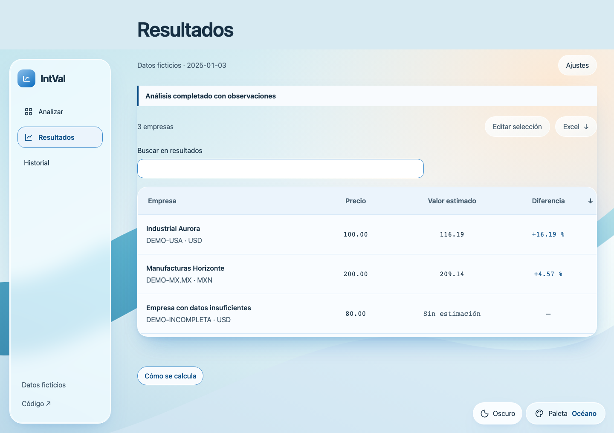
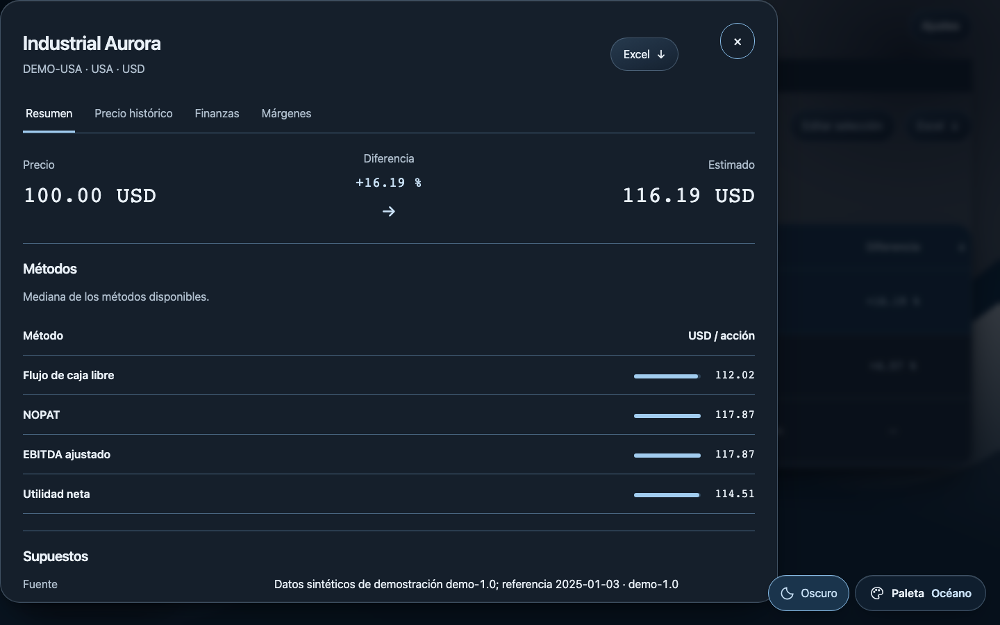
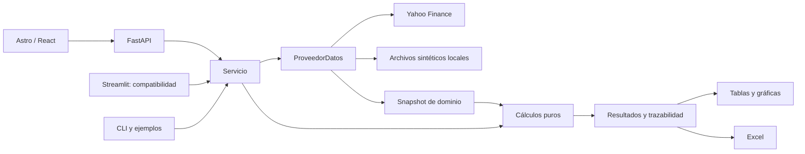

# IntVal · Explorador de valoración de acciones

[](https://github.com/adndvlp/IntVal/actions/workflows/tests.yml)

Aplicación web para comparar el precio de una acción con cuatro **proxies de
valoración**, revisar sus supuestos y exportar un análisis trazable a Excel.
Incluye empresas de USA y México y una demostración con datos completamente
sintéticos que funciona sin consultar Yahoo Finance.

La finalidad es educativa. La mediana de los proxies es una referencia heurística;
no representa un DCF completo ni acredita capacidad para predecir precios.



Captura real de la interfaz web Liquid Glass con `demo-1.0`, revisada en UI-5. La
[procedencia y revisión visual](docs/images/README.md) identifican los datos y
el entorno de captura.

<details>
<summary>Ver el detalle de una empresa</summary>



</details>

## Probar la demostración

En la aplicación, selecciona **Fuente de datos → Demostración**. Se cargan tres
casos: una empresa industrial en USD, otra en MXN y una con información
insuficiente. El aviso de datos sintéticos y su fecha de referencia, **2025-01-03**,
permanecen visibles. En el analizador web, elige las empresas y pulsa **Analizar empresas**; abrir la demo no selecciona ni calcula automáticamente. Puedes cambiar supuestos, volver a analizar, filtrar,
consultar gráficas y descargar el Excel.

Para que un servicio publicado abra directamente esa vista, configura
`VALORACION_DEMO=1` en su entorno. El selector permite volver a Mercado; cambiar
de fuente descarta los resultados anteriores y mantiene separadas las cachés.
El modo Mercado consulta Yahoo únicamente al solicitar un análisis o un histórico.

No hay una URL publicada como parte de este repositorio. La captura procede de
una instancia de desarrollo y no acredita un despliegue público.

## Un resultado que se puede revisar

Estos son los resultados sintéticos con los supuestos iniciales de la UI, tasas
de descuento del 10 % y metodología `proxies-1.0`:

| Caso ficticio | Moneda | Precio | Mediana de proxies | Diferencia frente al precio |
| --- | --- | ---: | ---: | ---: |
| DEMO-USA | USD | 100,00 | 116,19 | +16,19 % |
| DEMO-MX.MX | MXN | 200,00 | 209,14 | +4,57 % |
| DEMO-INCOMPLETA | USD | 80,00 | No disponible | Datos insuficientes |

Descarga el [Excel real](examples/demo/analisis_demo.xlsx), revisa el
[CSV](examples/demo/analisis_demo.csv) y los
[supuestos exactos](examples/demo/manifest.json). El
[ejemplo documentado](examples/demo/README.md) explica cómo reproducirlos desde
los [datos versionados](data/demo/README.md). Las cifras positivas de la tabla son
operaciones sobre datos inventados, no oportunidades de inversión.

## Funciones

- Analizador web directo, apariencia Liquid Glass, seis paletas o color propio y
  modo claro/oscuro con preferencias persistentes.
- Catálogo y vista de seleccionadas con búsqueda y páginas de 25; la selección se
  conserva entre páginas y mercados. Se distingue seleccionar la página de elegir
  todas las coincidencias, respetando el límite del servicio.
- Símbolos adicionales y análisis por lotes.
- Proxies de FCL, NOPAT, EBITDA ajustado y utilidad neta; mediana y cantidad de
  proxies aplicables, con precio objetivo de analistas cuando existe.
- Filtros por estado y diferencia frente al precio, detalle de supuestos,
  históricos de precios, ingresos y márgenes.
- Aislamiento de errores por empresa y avisos ante datos insuficientes.
- Excel con siete hojas: Resumen, USA, MX, Detalle, Supuestos, Universo y Fuentes.
  El detalle conserva versiones, procedencia, fechas y diagnósticos disponibles.
- CLI de mercado y ejemplos reproducibles sin conexión al proveedor.

## Diseño técnico

El frontend web usa Astro estático, React, TypeScript y Recharts; se conecta al
servicio FastAPI. La interfaz Streamlit se conserva como compatibilidad. Ambas
comparten el motor Python, pandas, NumPy, yfinance y openpyxl.
Pruebas con Vitest, Playwright, pytest, AppTest y pytest-cov; estilo con ESLint y
Ruff; CI con GitHub Actions.



La UI, la CLI y la demo comparten el servicio y las fórmulas. El motor recibe
snapshots y no realiza I/O. Los proveedores implementan un contrato inyectable;
el producto no importa fixtures de pruebas. La
[arquitectura](docs/architecture.md) explica responsabilidades y compatibilidad.

## Publicar el servicio

El [Dockerfile](Dockerfile) construye la web y la API como **un solo servicio**.
El alojamiento sólo necesita ejecutar la imagen y proporcionar `PORT`.
Node se utiliza durante el build; el contenedor final ejecuta Python y sirve
la web, `/api/v1` y el Excel desde el mismo origen.

```bash
# En un entorno que ya tenga Docker
docker build -t intval .
docker run --rm -e PORT=8000 -p 8000:8000 intval
```

En Render, por ejemplo, se configura un **Web Service con runtime Docker**, este
Dockerfile y health check `/readyz`; Render proporciona `PORT`. El contrato sirve
también para otros PaaS y no requiere Blueprint ni SDK del alojamiento.
El arranque escucha en `0.0.0.0:$PORT`, usa un worker y no instala dependencias.
Los trabajos viven en memoria: usar una instancia; un reinicio los pierde.

La [guía de despliegue](docs/development.md) explica configuración, verificación
y regreso a Streamlit. El workflow **Distribución** construye y prueba la imagen
con la demo, históricos y Excel reales; su primer run remoto está pendiente.
El [registro F11](docs/TDD_F11.md) separa esa comprobación de las pruebas locales
aprobadas. No hay un servicio publicado como parte de esta entrega.

## Desarrollo y comprobaciones

Desde la raíz, con CPython 3.12:

```bash
python3.12 -m venv .venv
.venv/bin/python -m pip install --no-deps -r requirements-dev.txt
.venv/bin/python -m pip check
.venv/bin/python -m ruff check .
.venv/bin/python -m ruff format --check .
.venv/bin/python -m pytest
```

Para generar los ejemplos sin consultar mercado:

```bash
.venv/bin/python -m examples.analisis_demo
.venv/bin/python -m examples.valoracion_independiente
```

Las salidas por defecto quedan en `examples/salida/`, ignorado por Git. El segundo
ejemplo concilia un caso sencillo con un oráculo Decimal independiente: proxies
52, 44, 44 y 48 USD por acción; mediana 46.

La CLI permite inspeccionar opciones y analizar mercado, con acceso a Yahoo:

```bash
.venv/bin/python motor_valoracion.py --help
.venv/bin/python motor_valoracion.py --ticker AAPL --output valoraciones_empresas.xlsx
```

La suite cubre cálculos, proveedores, sesión, cachés, UI, CLI y libros Excel
reabiertos. Bloquea consultas de mercado no preparadas y sockets de red de Python.
La instalación de paquetes y la primera carga de la web sí pueden necesitar red;
la demo no descarga datos financieros. `pyproject.toml` centraliza pytest,
cobertura y Ruff. CI prepara un entorno nuevo en Ubuntu/Python 3.12, comprueba
dependencias, estilo y pruebas, con umbral de cobertura del 85 % incluyendo ramas.

Los cambios de software siguen **TDD: prueba primero, fallo observado, cambio
mínimo y refactorización en verde**. Véanse [CONTRIBUTING](CONTRIBUTING.md), la
[matriz de pruebas](docs/F1_TEST_MATRIX.md) y el
[registro de F5](docs/TDD_F5.md). La insignia enlaza el workflow real; cada entrega
debe comprobar su propio run remoto.

La base de la nueva web está en `frontend/`, con Astro estático, React y
TypeScript. Abre directamente el analizador React conectado a FastAPI: selección
de empresas, ajustes, progreso y cancelación, resultados ordenables, cuatro
gráficas y descarga del Excel completo. Incluye demo, apariencia personalizable,
modo oscuro y Cómo se calcula. El análisis se inicia al solicitarlo.
El arranque por defecto sirve esta web y la API; `iniciar_streamlit.sh` conserva
la interfaz anterior. Para instalar y comprobar el
frontend se usa Node 26.13.1 y npm 11.12.1:

```bash
cd frontend
npm ci
npm run lint
npm run format:check
npm run check
npm run test:unit
npm run build
npm run test:shell
npm run test:assets
```

La [guía de desarrollo](docs/development.md#8-fundamentos-web-f6) explica cómo
ejecutar la API, regenerar los tipos y probar el navegador contra el servicio
real. [TDD de F6](docs/TDD_F6.md) registra los fallos iniciales y las verificaciones.
La validación integrada de F10 está completada: [procedimiento](docs/QA_F10.md)
y [evidencia](docs/TDD_F10.md), incluidos tres motores, accesibilidad automática,
presupuestos del build y capacidad con datos sintéticos.

## Límites del análisis

- Las fórmulas son heurísticas con tasas y múltiplos manuales. No incluyen una
  valoración completa de reinversión, capital de trabajo o coste de capital.
- Financieras, REIT/FIBRA y vehículos sin modelo implementado quedan fuera de los
  cuatro proxies y su mediana.
- Un FX no verificable bloquea la valoración. Deuda o efectivo desconocidos no se
  sustituyen por cero. Los resultados parciales conservan sus diagnósticos.
- Yahoo puede entregar datos incompletos, desactualizados o no estar disponible.
  Los objetivos de analistas no tienen cobertura ni horizonte garantizados.
- El catálogo local de 500 símbolos USA y 104 MX es un snapshot; no certifica la
  composición actual de un índice. La demo usa su propio catálogo de tres casos.
- La sesión y las cachés viven en memoria. Un reinicio puede requerir repetir el
  análisis; no hay cuentas ni persistencia remota.

La [metodología versionada](docs/methodology.md) documenta fórmulas, unidades,
fuentes y aplicabilidad. Pasar las pruebas acredita el comportamiento comprobado,
no la validez predictiva de una valoración.

## Documentación y estado

- [SDD y continuidad](docs/SDD.md): requisitos, decisiones, fases y trabajo pendiente.
- [SDD de interfaz Liquid Glass](docs/SDD_UI.md), con el
  [HTML interactivo adjunto](prototipo-intval-liquid-glass.html): especificación
  vigente del analizador, selección escalable, paleta/color elegible y modo oscuro.
  UI-1–4 integran apariencia, selección escalable, resultados, detalle, ajustes
  e historial, con datos y Excel conciliados con Python. UI-5 completa la revisión
  en tres motores, apariencia, texto ampliado y rendimiento, con evidencia en [TDD_UI5](docs/TDD_UI5.md). Evidencia de [UI-1](docs/TDD_UI1.md),
  [UI-2](docs/TDD_UI2.md), [UI-3](docs/TDD_UI3.md) y [UI-4](docs/TDD_UI4.md).
- [Arquitectura web y entregas F6–F11](docs/SDD_WEB.md): Astro, dashboard React y API
  FastAPI. F6 implementa los fundamentos; F7 incorpora la landing y metodología
  públicas, verificadas con navegador y capturas revisadas. F8 implementa el
  transporte de análisis y F9 lo integra en el dashboard. F10 está verificada
  localmente y UI-1–5 completan el rediseño vigente. F11 incorpora la distribución
  Docker y el arranque web/API, con aceptación de imagen y CI pendientes.
- [Arquitectura](docs/architecture.md), [metodología](docs/methodology.md) y
  [desarrollo/despliegue](docs/development.md).
- Evidencia TDD: [F1](docs/TDD_F1.md), [F2](docs/TDD_F2.md),
  [F3](docs/TDD_F3.md), [corrección de CI](docs/TDD_CI_APPTEST.md),
  [F4](docs/TDD_F4.md), [F5](docs/TDD_F5.md), [F6](docs/TDD_F6.md),
  [F7](docs/TDD_F7.md), [F8](docs/TDD_F8.md), [F9](docs/TDD_F9.md),
  [F10](docs/TDD_F10.md) y [F11](docs/TDD_F11.md).

F1–F5 están implementadas y verificadas localmente. La demo, el ejemplo público,
las capturas reales revisadas y la licencia MIT completan la presentación del
repositorio. El [CI del commit F5](https://github.com/adndvlp/IntVal/actions/runs/43370891010)
está verificado. F6 añade los fundamentos web con validación local; su nuevo
workflow aún requiere ejecución remota en el commit que se publique. F7 añade
la landing estática, metodología y sistema visual, con ocho pruebas de navegador
y capturas finales revisadas. F8 añade API de trabajos, cachés, históricos y
Excel con snapshots y recuperación de adquisiciones bloqueadas. F9 incorpora
el dashboard, sus pruebas y capturas reales revisadas. F10 completa la calidad integrada, las mediciones y las referencias visuales.
F11 incorpora la distribución y el arranque web/API, con imagen y smoke en CI
pendientes de aceptación. El despliegue público y la validación de su URL son
acciones posteriores.

Interfaz vigente (UI-5): [escritorio](docs/images/ui5/resultados-escritorio-claro.png),
[móvil oscuro](docs/images/ui5/resultados-movil-oscuro.png) y
[registro de revisión](docs/images/ui5/revision.json).

Capturas históricas de F7: [escritorio](docs/images/landing-desktop.png),
[móvil](docs/images/landing-mobile.png) y
[metodología](docs/images/landing-metodologia.png).

Dashboard histórico de F10: [escritorio](docs/images/dashboard-f10-desktop.png) y
[móvil](docs/images/dashboard-f10-mobile.png). Procedencia y reproducción en
[el registro de capturas](docs/images/README.md).

## Licencia

[MIT](LICENSE) · Copyright (c) 2026 [adndvlp](https://github.com/adndvlp).
