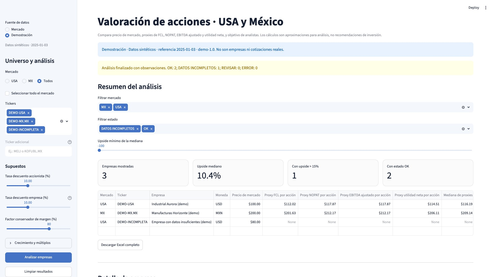
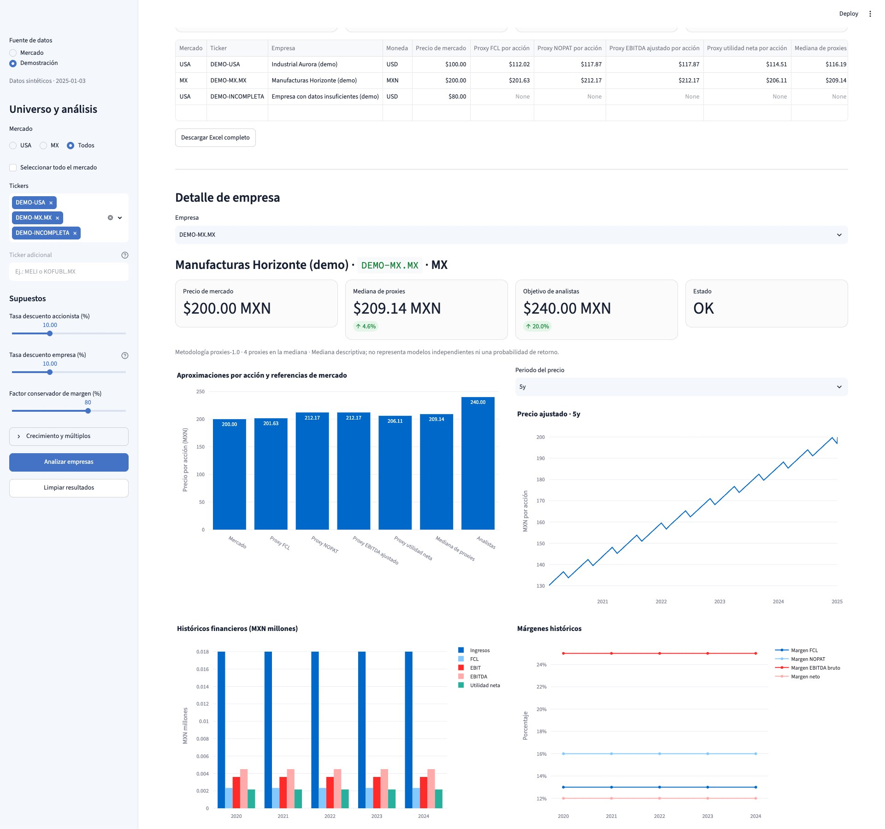
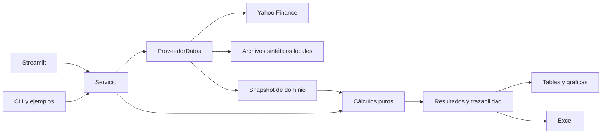

# IntVal · Explorador de valoración de acciones

[](https://github.com/adndvlp/IntVal/actions/workflows/tests.yml)

Aplicación web para comparar el precio de una acción con cuatro **proxies de
valoración**, revisar sus supuestos y exportar un análisis trazable a Excel.
Incluye empresas de USA y México y una demostración con datos completamente
sintéticos que funciona sin consultar Yahoo Finance.

La finalidad es educativa. La mediana de los proxies es una referencia heurística;
no representa un DCF completo ni acredita capacidad para predecir precios.



Captura real del resumen con `demo-1.0`. La
[procedencia y revisión visual](docs/images/README.md) identifican los datos y
el entorno de captura.

<details>
<summary>Ver el detalle de empresa y sus cuatro gráficas</summary>



</details>

## Probar la demostración

En la aplicación, selecciona **Fuente de datos → Demostración**. Se cargan tres
casos: una empresa industrial en USD, otra en MXN y una con información
insuficiente. El aviso de datos sintéticos y su fecha de referencia, **2025-01-03**,
permanecen visibles. Puedes cambiar supuestos, volver a analizar, filtrar,
consultar gráficas y descargar el Excel.

Para que un servicio publicado abra directamente esa vista, configura
`VALORACION_DEMO=1` en su entorno. El selector permite volver a Mercado; cambiar
de fuente descarta los resultados anteriores y mantiene separadas las cachés.
El modo Mercado consulta Yahoo únicamente al solicitar un análisis o un histórico.

No hay una URL publicada como parte de este repositorio. La captura procede de
una instancia de desarrollo y no acredita un despliegue público.

## Un resultado que se puede revisar

Estos son los resultados sintéticos con los supuestos iniciales de la UI, tasas
de descuento del 10 % y metodología `proxies-1.0`:

| Caso ficticio | Moneda | Precio | Mediana de proxies | Diferencia frente al precio |
| --- | --- | ---: | ---: | ---: |
| DEMO-USA | USD | 100,00 | 116,19 | +16,19 % |
| DEMO-MX.MX | MXN | 200,00 | 209,14 | +4,57 % |
| DEMO-INCOMPLETA | USD | 80,00 | No disponible | Datos insuficientes |

Descarga el [Excel real](examples/demo/analisis_demo.xlsx), revisa el
[CSV](examples/demo/analisis_demo.csv) y los
[supuestos exactos](examples/demo/manifest.json). El
[ejemplo documentado](examples/demo/README.md) explica cómo reproducirlos desde
los [datos versionados](data/demo/README.md). Las cifras positivas de la tabla son
operaciones sobre datos inventados, no oportunidades de inversión.

## Funciones

- Selección de empresas por mercado, símbolos adicionales y análisis por lotes.
- Proxies de FCL, NOPAT, EBITDA ajustado y utilidad neta; mediana y cantidad de
  proxies aplicables, con precio objetivo de analistas cuando existe.
- Filtros por estado y diferencia frente al precio, detalle de supuestos,
  históricos de precios, ingresos y márgenes.
- Aislamiento de errores por empresa y avisos ante datos insuficientes.
- Excel con siete hojas: Resumen, USA, MX, Detalle, Supuestos, Universo y Fuentes.
  El detalle conserva versiones, procedencia, fechas y diagnósticos disponibles.
- CLI de mercado y ejemplos reproducibles sin conexión al proveedor.

## Diseño técnico

Python 3.12, Streamlit, pandas, NumPy, Plotly, yfinance y openpyxl.
Pruebas con pytest, AppTest y pytest-cov; estilo con Ruff; CI con GitHub Actions.



La UI, la CLI y la demo comparten el servicio y las fórmulas. El motor recibe
snapshots y no realiza I/O. Los proveedores implementan un contrato inyectable;
el producto no importa fixtures de pruebas. La
[arquitectura](docs/architecture.md) explica responsabilidades y compatibilidad.

## Publicar el servicio

El servicio es **agnóstico del proveedor de alojamiento**: requiere Linux,
Bash, CPython 3.12, HTTP/WebSockets y un puerto proporcionado mediante `PORT`.
En el entorno del servicio, configura estos comandos:

```bash
# Preparación
python -m pip install --no-deps -r requirements.txt
python -m pip check

# Arranque
bash iniciar_servicio.sh
```

El arranque utiliza el Python preparado, escucha en `0.0.0.0:$PORT` y no instala
paquetes. El health check es `/_stcore/health`. Configurar `VALORACION_DEMO=1` es
opcional. La [guía de despliegue](docs/development.md) describe el contrato y cómo
validar la URL del entorno elegido. La publicación se configura fuera del código.

## Desarrollo y comprobaciones

Desde la raíz, con CPython 3.12:

```bash
python3.12 -m venv .venv
.venv/bin/python -m pip install --no-deps -r requirements-dev.txt
.venv/bin/python -m pip check
.venv/bin/python -m ruff check .
.venv/bin/python -m ruff format --check .
.venv/bin/python -m pytest
```

Para generar los ejemplos sin consultar mercado:

```bash
.venv/bin/python -m examples.analisis_demo
.venv/bin/python -m examples.valoracion_independiente
```

Las salidas por defecto quedan en `examples/salida/`, ignorado por Git. El segundo
ejemplo concilia un caso sencillo con un oráculo Decimal independiente: proxies
52, 44, 44 y 48 USD por acción; mediana 46.

La CLI permite inspeccionar opciones y analizar mercado, con acceso a Yahoo:

```bash
.venv/bin/python motor_valoracion.py --help
.venv/bin/python motor_valoracion.py --ticker AAPL --output valoraciones_empresas.xlsx
```

La suite cubre cálculos, proveedores, sesión, cachés, UI, CLI y libros Excel
reabiertos. Bloquea consultas de mercado no preparadas y sockets de red de Python.
La instalación de paquetes y la primera carga de la web sí pueden necesitar red;
la demo no descarga datos financieros. `pyproject.toml` centraliza pytest,
cobertura y Ruff. CI prepara un entorno nuevo en Ubuntu/Python 3.12, comprueba
dependencias, estilo y pruebas, con umbral de cobertura del 85 % incluyendo ramas.

Los cambios de software siguen **TDD: prueba primero, fallo observado, cambio
mínimo y refactorización en verde**. Véanse [CONTRIBUTING](CONTRIBUTING.md), la
[matriz de pruebas](docs/F1_TEST_MATRIX.md) y el
[registro de F5](docs/TDD_F5.md). La insignia enlaza el workflow real; cada entrega
debe comprobar su propio run remoto.

## Límites del análisis

- Las fórmulas son heurísticas con tasas y múltiplos manuales. No incluyen una
  valoración completa de reinversión, capital de trabajo o coste de capital.
- Financieras, REIT/FIBRA y vehículos sin modelo implementado quedan fuera de los
  cuatro proxies y su mediana.
- Un FX no verificable bloquea la valoración. Deuda o efectivo desconocidos no se
  sustituyen por cero. Los resultados parciales conservan sus diagnósticos.
- Yahoo puede entregar datos incompletos, desactualizados o no estar disponible.
  Los objetivos de analistas no tienen cobertura ni horizonte garantizados.
- El catálogo local de 500 símbolos USA y 104 MX es un snapshot; no certifica la
  composición actual de un índice. La demo usa su propio catálogo de tres casos.
- La sesión y las cachés viven en memoria. Un reinicio puede requerir repetir el
  análisis; no hay cuentas ni persistencia remota.

La [metodología versionada](docs/methodology.md) documenta fórmulas, unidades,
fuentes y aplicabilidad. Pasar las pruebas acredita el comportamiento comprobado,
no la validez predictiva de una valoración.

## Documentación y estado

- [SDD y continuidad](docs/SDD.md): requisitos, decisiones, fases y trabajo pendiente.
- [SDD de la nueva web](docs/SDD_WEB.md): landing Astro, dashboard React y API
  FastAPI, especificados para F6–F11 y todavía sin implementar.
- [Arquitectura](docs/architecture.md), [metodología](docs/methodology.md) y
  [desarrollo/despliegue](docs/development.md).
- Evidencia TDD: [F1](docs/TDD_F1.md), [F2](docs/TDD_F2.md),
  [F3](docs/TDD_F3.md), [corrección de CI](docs/TDD_CI_APPTEST.md),
  [F4](docs/TDD_F4.md) y [F5](docs/TDD_F5.md).

F1–F5 están implementadas y verificadas localmente. La demo, el ejemplo público,
las capturas reales revisadas y la licencia MIT completan la presentación del
repositorio. El [CI del commit F5](https://github.com/adndvlp/IntVal/actions/runs/43370891010)
está verificado. F6–F11 describen la evolución web futura en la nueva SDD y siguen
pendientes de implementación. El despliegue público y la validación de su URL
quedan pendientes.

## Licencia

[MIT](LICENSE) · Copyright (c) 2026 [adndvlp](https://github.com/adndvlp).
