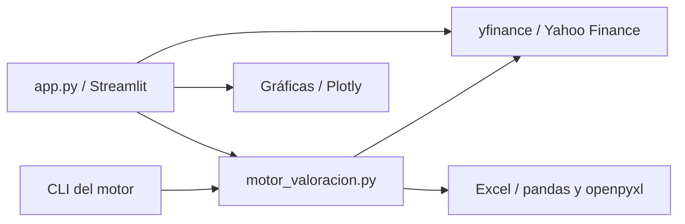
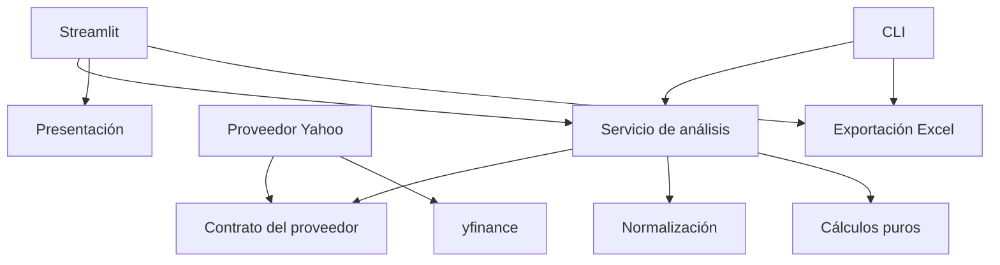
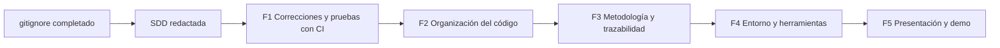

# SDD — Aplicación de valoración de acciones de USA y México

**Especificación y diseño de software de IntVal: formalización del repositorio y evolución de su interfaz web.**

La nueva etapa de landing y dashboard está detallada en la
[SDD web: Astro, React y FastAPI](SDD_WEB.md). Leerla junto con 21.14 para
continuar el trabajo. F1–F6 están implementadas; F7 está implementada con validación de navegador
pendiente; F8–F11 siguen pendientes de implementación.

| Campo | Valor |
| --- | --- |
| Versión del documento | 2.2 |
| Fecha de elaboración | 2026-11-12 |
| Idioma del producto y del documento | Español |
| Nombre actual de la carpeta | `valoracion_app` |
| Línea base inspeccionada | Commit `635cd15` (`fst commit`) |
| Estado | F1–F6 completadas; F7 implementada con cierre visual pendiente. 396 pruebas Python, 12 unitarias frontend y cinco HTML pasan. Continuidad en 21.14; CI y publicación se verifican por commit/entorno |
| Línea base de la etapa web | Commit 345aa0a, entrega F5; árbol de producto limpio antes de esta redacción |
| Trabajo previo realizado | Creación y verificación de `.gitignore` |
| Primera implementación acordada | F1: corrección de fallos, pruebas y automatización en una misma entrega |
| Método de implementación obligatorio | TDD: prueba primero, fallo observado, cambio mínimo y refactorización con pruebas verdes |
| Refactorización implementada | F2: separación de responsabilidades, a partir de `b9852e6` |
| Metodología implementada | F3: proxies-1.0, contrato 2.0, trazabilidad y conciliación independiente |
| Entorno implementado | F4: servicio web agnóstico, Python 3.12, resoluciones pip-tools, arranque mediante PORT, configuración central y Ruff |
| Presentación implementada | F5: demo sintética, ejemplo público, documentación, capturas reales revisadas y licencia MIT elegida por el usuario |
| Nuevo encargo autorizado | Implementar F6 con TDD: fundamentos Astro/React/TS, API de lectura y CI; conservar entrada Streamlit |

Este documento debe permitir que una persona o un agente continúe el trabajo en un chat sin historial. Contiene el contexto, las decisiones acordadas, los hallazgos, los contratos de datos, los cambios esperados, la matriz de pruebas y los criterios de cierre. No sustituye al código como evidencia del estado actual: al retomar, se debe comparar esta línea base con el repositorio disponible.

**El estado de cada fase se acredita con su registro de ejecución.** Los apartados de línea base describen el commit original, no sustituyen la evidencia posterior. En particular, los contratos originales de 19/45 campos se amplían en F3 a 24/73; las reglas vigentes están en 21.8 y `methodology.md`. La matriz de F1 está en [trazabilidad de F1](F1_TEST_MATRIX.md); sus ciclos y cierre, en [TDD de F1](TDD_F1.md) y la sección 21.6. F2 se documenta en [arquitectura](architecture.md), [TDD de F2](TDD_F2.md) y la sección 21.7. F3 se documenta en [metodología](methodology.md), [TDD de F3](TDD_F3.md) y la sección 21.8. La corrección de CI posterior se registra en 21.9 y [TDD de AppTest](TDD_CI_APPTEST.md). F4 se cierra en 21.10 con [guía de desarrollo](development.md) y [TDD de F4](TDD_F4.md). El cierre de F5 está en 21.11 y [TDD de F5](TDD_F5.md). **La continuidad vigente es 21.14 y [SDD_WEB.md](SDD_WEB.md)**: no rehacer F1–F5 ni confundir diseño futuro, implementación, CI remoto y publicación.

## Índice

1. [Contexto y acuerdos](#1-contexto-y-acuerdos)
2. [Objetivo y alcance](#2-objetivo-y-alcance)
3. [Estado actual del repositorio](#3-estado-actual-del-repositorio)
4. [Flujos y comportamiento existentes](#4-flujos-y-comportamiento-existentes)
5. [Mapa del código](#5-mapa-del-código)
6. [Hallazgos y evidencia](#6-hallazgos-y-evidencia)
7. [Configuración y cálculo actuales](#7-configuración-y-cálculo-actuales)
8. [Contratos de datos](#8-contratos-de-datos)
9. [Requisitos de F1](#9-requisitos-de-f1)
10. [Diseño de las pruebas](#10-diseño-de-las-pruebas)
11. [Matriz de pruebas](#11-matriz-de-pruebas)
12. [Oráculos numéricos](#12-oráculos-numéricos)
13. [Automatización y CI](#13-automatización-y-ci)
14. [Ejecución y cierre de F1](#14-ejecución-y-cierre-de-f1)
15. [F2: separación de responsabilidades](#15-f2-separación-de-responsabilidades)
16. [F3: metodología y trazabilidad](#16-f3-metodología-y-trazabilidad)
17. [F4: instalación y herramientas](#17-f4-instalación-y-herramientas)
18. [F5: presentación del repositorio](#18-f5-presentación-del-repositorio)
19. [Trazabilidad y dependencias](#19-trazabilidad-y-dependencias)
20. [Decisiones y riesgos](#20-decisiones-y-riesgos)
21. [Continuidad en otro chat](#21-continuidad-en-otro-chat)
22. [Fuentes y mantenimiento](#22-fuentes-y-mantenimiento)
23. [Extensión web y plan F6–F11](#23-extensión-web-y-plan-f6f11)

## 1. Contexto y acuerdos

### 1.1 Necesidad del usuario

El usuario quiere que este proyecto pueda presentarse en un portafolio y que el repositorio demuestre prácticas de ingeniería verificables. El interés inmediato está en la calidad del repositorio: organización, pruebas, automatización, metodología documentada e instalación reproducible.

La aplicación ya tiene una funcionalidad concreta: comparar precios de acciones con cuatro aproximaciones de valoración, consultar gráficos y generar un Excel. El trabajo consiste en formalizar y fortalecer esa base.

### 1.2 Acuerdos explícitos de la conversación

| Punto original | Tema | Acuerdo | Fase |
| --- | --- | --- | --- |
| 1 | Corregir fallos y casos límite | Realizar junto con las pruebas y su automatización | F1 |
| 2 | Añadir pruebas y CI | Una sola implementación con el punto 1; cubrir las áreas del proyecto | F1 |
| 3 | Separar responsabilidades | De acuerdo; documentar y dejar pendiente | F2 |
| 4 | Documentar y validar la metodología | Documentar; ejecutar después de los puntos anteriores | F3 |
| 5 | Hacer reproducible la instalación | Documentar y dejar pendiente | F4 |
| 6 | Preparar la presentación del repositorio | Documentar y dejar pendiente | F5 |
| Previo | Crear `.gitignore` | Ya realizado y comprobado | Completado |
| Nueva etapa | Landing atractiva y mejora sustancial de la UI | Especificación Astro/React/FastAPI autorizada; implementación por fases posterior | F6–F11 |

El usuario pidió primero redactar esta SDD y posteriormente autorizó F1, con TDD obligatorio, después F2 y F3. Se implementaron en entregas separadas. Después se autorizó F4, precisando que el servicio debía ser agnóstico del alojamiento, y finalmente F5. La evidencia se registra en los documentos TDD de cada fase. El usuario precisó que el titular es el dueño del repositorio: `adndvlp`, propietario verificado de `adndvlp/IntVal`, y eligió MIT. El archivo LICENSE conserva esa atribución; no se infirió de la carpeta ni del autor de Git.

Después de F5 solicitó una landing y una interfaz menos genérica. Tras revisar
el alcance estático, la propuesta de Next.js se sustituyó por Astro, con React
para el dashboard y FastAPI delante del motor existente. El usuario encargó
redactar la SDD completa de esta etapa. El alcance concreto está en SDD_WEB.md;
no se implementan esas fases como consecuencia automática de especificarlas.

### 1.3 Restricciones y decisiones de alcance

- En F1–F5 se mantuvieron Python y Streamlit. El destino F6–F11 conserva Python y
  migra la presentación a Astro/React; Streamlit sigue funcionando durante la
  transición y no se elimina antes de demostrar paridad.
- TDD es obligatorio para los cambios de software en todas las fases, por instrucción expresa del usuario. Las refactorizaciones se realizan con la suite en verde; no se fabrican fallos en comportamiento ya correcto para aparentar un ciclo RED.
- No hay una necesidad demostrada de crear un backend HTTP separado para realizar F1 a F5.
- La nueva interfaz sí requiere una API HTTP para acceder al motor Python desde
  React. FastAPI se añade como adaptador; no obliga a un VPS ni a servicios de pago.
- El usuario precisó durante F4 que el despliegue debe ser **agnóstico del proveedor**. El producto es un servicio web Python/Streamlit sobre Linux; el alojamiento previsto es PaaS, con preferencia de coste gratuito, sin una plataforma o plan obligatorios en el código. El entorno local sirve para desarrollar/verificar. La publicación y la elección de proveedor quedan fuera de la lógica de la aplicación.
- No se necesita desplegar ni contratar servicios para formalizar el repositorio.
- No introducir cuentas, autenticación, base de datos o infraestructura sin un requisito concreto.
- No cambiar las fórmulas financieras al mismo tiempo que se añade la primera base de pruebas.
- Se permiten pequeños cambios internos necesarios para corregir fallos y probar el código en F1; la reorganización completa queda en F2.
- No hacer commits, publicar, desplegar ni cambiar configuración de un servicio externo como consecuencia automática de redactar esta SDD.

### 1.4 Cómo interpretar los requisitos

Las decisiones de secuencia y alcance de la tabla anterior proceden del usuario. Los detalles de diseño —nombres de archivos futuros, identificadores, umbral de cobertura, organización de fixtures y estrategia de CI— son propuestas concretas de esta SDD para permitir su ejecución. Pueden ajustarse con evidencia técnica, dejando registrado el motivo y conservando el alcance acordado.

En este documento:

- **Actual** describe algo observado en la línea base.
- **Requisito** describe el comportamiento que debe resultar de una fase.
- **Pendiente de validar** identifica un riesgo o decisión que no se ha demostrado mediante una prueba.
- **Caracterización** significa registrar el comportamiento existente para detectar cambios; no equivale a validar que un modelo financiero sea correcto.
- **Finalizado** requiere evidencia de implementación y verificación, no únicamente una casilla marcada.

## 2. Objetivo y alcance

### 2.1 Objetivo general

Convertir la aplicación en un proyecto cuyo repositorio permita entender su propósito, instalarlo, comprobar sus resultados, reproducir sus pruebas y continuar su desarrollo con límites explícitos entre datos, cálculos e interfaz.

### 2.2 Resultados esperados

1. Los errores del proveedor y los conjuntos vacíos no interrumpen toda la aplicación.
2. Los cálculos y flujos principales tienen pruebas deterministas con resultados verificables.
3. Las pruebas se ejecutan localmente y en CI con el mismo comando.
4. La estructura del código permite probar y sustituir la adquisición de datos sin rehacer la valoración.
5. La metodología explica lo que calcula, los supuestos y las limitaciones de cada aproximación.
6. Una instalación limpia reproduce un entorno definido.
7. La documentación muestra el producto y la evidencia técnica sin atribuirle capacidades no implementadas.

### 2.3 Qué significa «cubrir todo con tests»

Cubrir las áreas y comportamientos relevantes: utilidades, adquisición y normalización de datos, cálculos, análisis por ticker, interfaz, estado de sesión, cachés, exportación y CLI. Incluir escenarios correctos, fallos, datos faltantes y límites.

No significa crear una prueba por línea, exigir un porcentaje de cobertura de 100 % o comprobar que una función repite su propia implementación. El criterio principal es la matriz de comportamientos de la sección 11; la cobertura ayuda a detectar huecos.

### 2.4 Fuera del alcance de la primera implementación

- Separar toda la aplicación en paquetes nuevos.
- Cambiar el modelo económico o recalibrar supuestos.
- Añadir nuevos proveedores de mercado.
- Paralelizar consultas o crear trabajos distribuidos.
- Añadir un backend, usuarios o persistencia remota.
- Rediseñar visualmente la aplicación.
- Añadir operaciones de compraventa o seguimiento de una cuenta de inversión.
- Publicar una demo o producir capturas de funcionalidades todavía no implementadas.

## 3. Estado actual del repositorio

### 3.1 Inventario versionable

```text
valoracion_app/
├── .gitignore
├── .streamlit/
│   └── config.toml
├── README.md
├── app.py
├── motor_valoracion.py
├── requirements.txt
├── ejecutar_app.sh
└── ejecutar_app.bat
```

Esta SDD añade `docs/SDD.md` y una referencia desde el README. El inventario anterior representa la línea base previa a esa adición.

También existen localmente `.venv/`, `__pycache__/` y archivos del sistema; se excluyen del versionado. No confundirlos con archivos necesarios para instalar el proyecto.

### 3.2 Estado confirmado en la línea base original

Este inventario corresponde al commit `635cd15`. La incorporación de pruebas, workflow y documentación de F1 se registra en la sección 21.6; la reorganización de F2, en la sección 21.7. La tabla 19.3 mantiene el estado actual.

| Aspecto | Estado observado |
| --- | --- |
| Git | Inicializado; commit de referencia `635cd15`; árbol limpio antes de redactar la SDD |
| Interfaz | Streamlit; archivo de aproximadamente 576 líneas |
| Motor | Archivo de aproximadamente 1,837 líneas que contiene varias responsabilidades |
| Universo local | 500 símbolos USA y 104 MX; sin duplicados dentro de cada lista en esta revisión |
| Pruebas versionadas | No existen |
| Workflow de CI | No existe |
| Configuración de pytest/cobertura | No existe |
| `pyproject.toml` | No existe |
| Dependencias | Seis paquetes de ejecución con límites mínimos abiertos |
| Licencia | No existe un archivo de licencia |
| Documentación | README con instalación, uso y consideraciones generales |
| Demostración sin conexión | No existe un modo de producto con datos guardados |
| `.gitignore` | Añadido y verificado antes de esta SDD |

Las cantidades de símbolos son una propiedad del archivo local. No se ha verificado que las listas equivalgan a los componentes actuales de un índice bursátil; no presentarlas como una composición oficial actualizada.

### 3.3 Dependencias declaradas actualmente

```text
streamlit>=1.37
plotly>=5.24
yfinance>=0.2.50
pandas>=2.0
numpy>=1.24
openpyxl>=3.1
```

### 3.4 Entorno usado para los diagnósticos

| Componente | Versión local observada |
| --- | --- |
| Python | 3.12.2 |
| Streamlit | 1.60.0 |
| pandas | 3.0.3 |
| NumPy | 2.5.1 |
| yfinance | 1.5.1 |
| Plotly | 6.9.0 |
| openpyxl | 3.1.5 |

Estas versiones describen el entorno local; no son un lockfile, una selección de versiones recomendadas ni una certificación de compatibilidad. El README dice Python 3.10 o posterior; únicamente se comprobó el arranque en el entorno de la tabla.

### 3.5 `.gitignore` existente

Excluye entornos virtuales, bytecode, cachés de herramientas, reportes de cobertura, `.env` y variantes, `.streamlit/secrets.toml`, temporales, registros y archivos del sistema. Permite versionar `.env.example`.

Excluye `/valoraciones_*.xlsx` en la raíz, que cubre los nombres de exportación predeterminados. No excluye todos los `.xlsx` del proyecto: los ejemplos y fixtures futuros deben poder versionarse de manera intencional. `.streamlit/config.toml` permanece versionable.

## 4. Flujos y comportamiento existentes

### 4.1 Flujo por interfaz

1. Elegir `USA`, `MX` o `Todos`.
2. Seleccionar símbolos del universo o introducir símbolos adicionales separados por comas.
3. Ajustar descuento, margen conservador, factores de crecimiento y múltiplos terminales.
4. Pulsar **Analizar empresas**.
5. Ejecutar análisis secuencial por ticker, con caché y una pausa entre empresas.
6. Guardar resultados, detalles y configuración usada en `st.session_state`.
7. Mostrar resumen, filtros, indicadores y tabla.
8. Generar un Excel completo en un directorio temporal para descargarlo.
9. Elegir una empresa para ver valores, precio histórico, estados financieros y márgenes.

Al inicio no se consultan empresas: se muestran instrucciones y los tamaños de los universos. La selección inicial toma seis símbolos para USA/Todos y diez para MX.

### 4.2 Estado de sesión y cachés

| Elemento | Función actual |
| --- | --- |
| `principales` | Lista de registros de resumen del análisis |
| `detalles` | Lista de registros de diagnóstico |
| `config` | Tupla de pares con los valores de la configuración usada |
| `detalle_ticker` | Clave del selector de la empresa en el detalle |
| `analizar_cached` | `st.cache_data`, TTL de 3,600 segundos |
| `precio_historico` | `st.cache_data`, TTL de 1,800 segundos |
| `historicos_financieros` | `st.cache_data`, TTL de 3,600 segundos |
| `CACHE_FX` | Diccionario global del motor para pares de divisas; sin TTL propio |

Cambiar controles no debe alterar retrospectivamente el significado de resultados ya calculados. La aplicación guarda la configuración usada y la reutiliza para la exportación y los detalles financieros.

### 4.3 Flujo por terminal

El motor tiene una CLI funcional en su propio archivo:

```bash
python motor_valoracion.py --mercado USA --ticker AAPL --ticker MSFT --output valoraciones_empresas.xlsx
```

- `--mercado`: `USA`, `MX` o `TODOS`; predeterminado `TODOS`.
- `--ticker`: repetible; cuando se usa, determina los símbolos analizados.
- `--output`: predeterminado `valoraciones_empresas.xlsx`.
- Sin `--ticker`, puede analizar un universo grande. No ejecutar este caso contra Yahoo durante las pruebas.
- La CLI captura errores por empresa y genera un registro de resumen con más campos que el registro de error actual de la interfaz. Esa divergencia es relevante para F1.

### 4.4 Libro Excel

Se generan siete hojas: `Resumen`, `USA`, `MX`, `Detalle`, `Supuestos`, `Universo` y `Fuentes`.

Los encabezados se escriben en la fila 3 y los datos empiezan en la fila 4. El libro incluye títulos con fecha de generación, paneles congelados, formatos numéricos, tablas y formato condicional.

La descarga de la interfaz representa el **análisis completo almacenado**, no únicamente las filas visibles después de aplicar filtros. Conservar y documentar este comportamiento en F1.

## 5. Mapa del código

Las líneas siguientes corresponden a la línea base y pueden desplazarse. Buscar por nombre de función al retomar.

Desde F2, las implementaciones están en el paquete `valoracion`; el mapa actual está en [arquitectura](architecture.md). Las referencias de este apartado se conservan para entender los hallazgos y la migración desde el monolito.

### 5.1 Interfaz: `app.py`

| Funciones | Responsabilidad |
| --- | --- |
| `analizar_cached` | Construcción de configuración y análisis con caché |
| `precio_historico` | Consulta y preparación del precio ajustado |
| `historicos_financieros` | Obtención y preparación de estados y márgenes para gráficas |
| `format_money`, `format_percent` | Presentación de valores y ausencias |
| `construir_configuracion` | Controles de supuestos |
| `preparar_tabla`, `render_table` | Selección de columnas y presentación del resumen |
| `grafica_valoraciones` | Comparación de valores por método |
| `mostrar_detalle` | Detalle de una empresa y sus gráficas |
| `main` | Selección, ejecución, filtros, estado y descarga |

Puntos especialmente relevantes: `main`, aproximadamente línea 421; cálculo de `validos`, línea 544; `mostrar_detalle`, línea 318. La configuración visual y los decoradores de caché se ejecutan al importar el módulo.

### 5.2 Motor: `motor_valoracion.py`

| Grupo | Símbolos principales |
| --- | --- |
| Universo | `EMPRESAS_USA`, `EMPRESAS_MX`, `EMPRESAS`, `FUENTES_UNIVERSO` |
| Configuración | `Configuracion`, `CONFIG`, `CACHE_FX` |
| Utilidades | `mercado_de_ticker`, `eliminar_duplicados`, `numero_valido`, `normalizar_etiqueta` |
| Normalización | `obtener_fila`, `ultimo_valor`, `alinear_series`, `convertir_serie` |
| Proveedor | `obtener_info_segura`, `obtener_precio_actual`, `obtener_objetivo_analistas`, `obtener_acciones`, `ultimo_cierre_simbolo`, `obtener_tipo_cambio` |
| Métricas | `calcular_cagr`, `estimar_tasa_impuestos`, `construir_fcl`, `construir_ebitda`, `margen_normalizado` |
| Valoración | `proyectar_valor`, `por_accion`, `rendimiento`, `es_financiera`, `analizar_ticker` |
| Excel | `escribir_excel` |
| Terminal | `main` |

Puntos especialmente relevantes: `Configuracion`, línea 698; `proyectar_valor`, línea 1060; `analizar_ticker`, línea 1117; `escribir_excel`, línea 1496; CLI `main`, línea 1756.

### 5.3 Dependencias actuales



La interfaz también descarga datos para sus gráficos. Por tanto, simular únicamente `analizar_ticker` no basta para que una prueba completa de resultados quede aislada de la red.

## 6. Hallazgos y evidencia

### 6.1 Comprobaciones realizadas

| ID | Comprobación | Resultado |
| --- | --- | --- |
| E-001 | Arranque con `AppTest.from_file('app.py').run()` | Sin excepciones en la pantalla inicial |
| E-002 | Simular `RuntimeError` en `motor_valoracion.analizar_ticker`, seleccionar `A` y pulsar analizar | Se registra `Estado=ERROR`, pero después la interfaz falla con `AttributeError` |
| E-003 | Llamar `escribir_excel` con un único registro de error reducido equivalente al de la interfaz | `KeyError: 'Upside mediana'` |
| E-004 | Llamar `escribir_excel([], [], ruta_temporal, Configuracion())` | Se genera un libro; no se validó exhaustivamente su contrato de encabezados |
| E-005 | Comprobar reglas de `.gitignore` con `git check-ignore` | Entorno, cachés, secretos y exportaciones predeterminadas excluidos; código y configuración pública disponibles |

Esos diagnósticos iniciales no constituían una suite de pruebas versionada. En aquella revisión no se comprobó un análisis completo con datos reales de Yahoo, ni se midió cobertura, ni se ejecutó CI remoto. La suite posterior de F1 usa datos sintéticos, mide cobertura y conserva pendiente la primera verificación remota de CI.

### 6.2 Defectos de la línea base corregidos en F1

**BUG-001 — La interfaz falla cuando todos los análisis lanzan una excepción.**

El bloque de error de `app.main` crea un registro sin la columna `Upside mediana`. Más adelante se ejecuta:

```python
pd.to_numeric(filtrado.get("Upside mediana"), errors="coerce").dropna()
```

Cuando falta la columna, la conversión produce un escalar y `.dropna()` provoca:

```text
AttributeError: 'numpy.float64' object has no attribute 'dropna'
```

La corrección debe preservar una estructura tabular válida incluso cuando ningún ticker tiene valoración.

**BUG-002 — El Excel falla con registros de error reducidos.**

`escribir_excel` ordena por `Mercado` y `Upside mediana` si el DataFrame no está vacío. Con registros reducidos, la segunda columna no existe y el proceso termina con `KeyError`.

La corrección debe normalizar el esquema antes de ordenar y escribir. No basta con arreglar la interfaz si el exportador sigue siendo frágil al recibir registros válidos de error.

### 6.3 Riesgos de la línea base incorporados a las pruebas de F1

| ID | Observación en el código | Trabajo esperado |
| --- | --- | --- |
| R-001 | El filtro de upside usa `fillna(-999)` y puede ocultar registros sin valoración, incluidos errores | Definir y probar visibilidad de ausencias en F1 |
| R-002 | `precio_historico` no captura errores de `history()` | Aislar un fallo de gráfica y mantener disponible el análisis |
| R-003 | El detalle vuelve a consultar información y estados; hay accesos al proveedor fuera del análisis principal | Simular toda la adquisición en tests; evitar que una gráfica rompa el resto |
| R-004 | Se muestra un mensaje de éxito general al terminar el bucle, aunque pueda haber errores | Mostrar un balance fiel de resultados |
| R-005 | Los registros y tablas vacíos no comparten un esquema explícito | Definir esquema estable para ausencia de datos |
| R-006 | `CACHE_FX`, cachés de Streamlit y sesión pueden contaminar pruebas | Limpiar y reconstruir estado entre casos |
| R-007 | El detalle usa selecciones y `.iloc[0]` que presuponen la existencia de una fila | Comprobar conjuntos vacíos y selección obsoleta |
| R-008 | Algunos helpers aceptan valores no finitos o configuraciones que no proceden de la UI | Fijar contratos de entrada; impedir valores engañosos y excepciones accidentales |

Originalmente eran observaciones de inspección. F1 añadió primero pruebas de sus comportamientos relevantes, corrigió los fallos reproducidos y registró los casos que ya funcionaban como caracterización. La relación con pruebas ejecutables está en `docs/F1_TEST_MATRIX.md`; las causas RED observadas están en `docs/TDD_F1.md`.

### 6.4 Cuestiones metodológicas reservadas a F3

- Si falla la conversión entre monedas distintas, `analizar_ticker` usa `fx=1.0` con una nota; `historicos_financieros` usa `or 1.0` sin un diagnóstico equivalente en su retorno.
- Deuda y efectivo faltantes terminan tratándose como cero.
- El código trata FCL y utilidad neta como flujos del accionista; EBIT/NOPAT y EBITDA ajustado como valor de empresa. Esta es una elección del código, no una validación financiera.
- La clasificación de empresas financieras añade una advertencia, pero no excluye por sí misma esos modelos de la mediana.
- Se comparte una tasa de descuento entre aproximaciones distintas.
- Algunas etiquetas de márgenes históricos necesitan contrastarse con las métricas efectivamente graficadas; por ejemplo, el margen llamado EBIT se calcula usando NOPAT.

F1 puede documentar y caracterizar estos comportamientos. No debe convertirlos en recomendaciones metodológicas ni modificarlos silenciosamente para lograr que las pruebas pasen.

## 7. Configuración y cálculo actuales

Esta sección describe la implementación inspeccionada. Se incluye para construir pruebas y comprender cambios posteriores; **no certifica la validez económica de los modelos**.

### 7.1 `Configuracion`

Es una `dataclass(frozen=True)`. Sus valores predeterminados son:

| Campo | Predeterminado |
| --- | --- |
| `anos_proyeccion` | `10` |
| `tasa_descuento` | `0.10` |
| `factor_crecimiento_inicial` | `0.25` |
| `factor_crecimiento_final` | `0.50` |
| `crecimiento_minimo` | `-0.02` |
| `crecimiento_maximo` | `0.12` |
| `crecimiento_fallback` | `0.03` |
| `factor_margen_conservador` | `0.80` |
| `max_anos_historicos` | `5` |
| `multiplo_terminal_fcl` | `12.0` |
| `multiplo_terminal_ebit` | `12.0` |
| `multiplo_terminal_ebitda` | `12.0` |
| `multiplo_terminal_utilidad_neta` | `15.0` |
| `tasa_impuestos_fallback` | `0.21` |
| `tasa_impuestos_minima` | `0.00` |
| `tasa_impuestos_maxima` | `0.35` |
| `pausa_entre_tickers` | `0.35` |

La UI sustituye la pausa por `0.15`. La tasa visible va de 5 % a 20 %; el factor de margen, de 40 % a 100 %; los factores de crecimiento, de 0 % a 100 %. Los múltiplos de FCL/EBIT/EBITDA van de 4 a 30 y el de utilidad neta de 4 a 35.

### 7.2 Normalización y métricas

1. `obtener_fila` normaliza nombres contables, busca candidatos por prioridad, convierte a números, elimina ausencias y ordena fechas.
2. `alinear_series` conserva fechas comunes mediante unión interna y descarta filas con ausencias.
3. `construir_fcl` prefiere `Free Cash Flow`; si no está disponible, calcula `CFO - abs(CapEx)`.
4. `construir_ebitda` prefiere EBITDA disponible; en su defecto calcula `EBIT + abs(D&A)`.
5. La tasa de impuestos usa la mediana de tasas admitidas con utilidad antes de impuestos positiva, limitada al rango configurado; si no hay observaciones, usa el fallback.
6. `NOPAT = EBIT × (1 - tasa_impuestos)`.
7. `EBITDA ajustado = EBITDA - max(EBIT, 0) × tasa_impuestos - abs(CapEx)`, con fechas alineadas.

### 7.3 Crecimiento y márgenes

El CAGR de ingresos se calcula con observaciones positivas y la duración en años obtenida de los días entre fechas divididos entre `365.25`.

Si el CAGR no está disponible, se usa `revenueGrowth` y después `crecimiento_fallback`. La tasa de fallback todavía pasa por los factores de crecimiento:

```text
g_1_5  = clip(cagr_o_fallback × factor_crecimiento_inicial,
              crecimiento_minimo, crecimiento_maximo)
g_6_10 = g_1_5 × factor_crecimiento_final
```

Por ejemplo, el fallback de `0.03` con factores predeterminados produce `g_1_5=0.0075` y `g_6_10=0.00375`; no una proyección directa de 3 %.

Para cada métrica, se calculan márgenes sobre ingresos positivos, se excluyen infinitos y márgenes fuera del intervalo abierto `(-2, 2)`, se toman hasta cinco observaciones recientes y se usa su mediana. Si es positiva, se multiplica por el factor conservador; si es negativa, se conserva.

La base proyectable es el último ingreso disponible multiplicado por el margen normalizado conservador. Una base no positiva produce ausencia de valoración en `proyectar_valor`.

### 7.4 Proyección y valor por acción

Para base `B`, descuento `r`, horizonte `N` y múltiplo terminal `M`:

```text
metrica_0 = B
metrica_t = metrica_(t-1) × (1 + g_t)
g_t      = g_1_5 si t <= 5; g_6_10 si t >= 6
PV_flujos = suma(metrica_t / (1 + r)^t), t=1..N
PV_terminal = metrica_N × M / (1 + r)^N
valor_total = PV_flujos + PV_terminal
```

En el comportamiento actual:

- Se resta deuda neta al resultado de EBIT/NOPAT y EBITDA ajustado.
- No se resta deuda neta al resultado de FCL ni utilidad neta.
- `deuda_neta = deuda - efectivo`.
- `por_accion` divide por las acciones y sólo devuelve resultados positivos y finitos.
- La mediana incluye los valores por acción disponibles de los cuatro modelos.
- `rendimiento` calcula `valor / precio - 1`.

### 7.5 Estado del análisis actual

| Estado | Condición actual |
| --- | --- |
| `DATOS INCOMPLETOS` | Falta precio, acciones o ingreso actual |
| `REVISAR` | Existen esos datos, pero hay menos de dos modelos disponibles |
| `OK` | No se cumple ninguna de las condiciones anteriores |
| `ERROR` | La capa de ejecución captura una excepción al analizar el ticker |

`OK` no significa que las hipótesis económicas hayan sido validadas ni que todos los campos estén presentes. F3 deberá distinguir estado de ejecución, disponibilidad y calidad metodológica si incorpora nuevos diagnósticos.

## 8. Contratos de datos

### 8.1 Principios

- Conservar los nombres públicos de columnas durante F1.
- Mantener números como números; los porcentajes se almacenan como fracciones, por ejemplo `0.15` para 15 %.
- Diferenciar ausencia de valor y cero real. No completar valores financieros faltantes con ceros para facilitar la UI o el Excel.
- Las monedas deben permanecer explícitas; no sumar o comparar importes de monedas diferentes como si fueran homogéneos.
- Un error por ticker debe conservar identidad, estado y diagnóstico.
- Las capas que reciben registros deben poder trabajar con listas vacías y con registros de error parciales, normalizando las columnas conocidas.
- Normalizar con un esquema explícito y tipos compatibles con ausencias. No asumir que `DataFrame([])` contiene columnas.

### 8.2 Resultado principal

`analizar_ticker(ticker, config, mercado=None)` devuelve `(principal, detalle)`. El esquema principal completo tiene las siguientes 19 columnas:

| Columna | Tipo lógico |
| --- | --- |
| `Mercado` | Texto: `USA` o `MX` |
| `Ticker` | Texto |
| `Empresa` | Texto |
| `Moneda` | Texto o ausencia |
| `Precio de mercado` | Número finito o ausencia |
| `Valor intrínseco FCL` | Número finito positivo o ausencia |
| `Upside FCL` | Número finito o ausencia |
| `Valor intrínseco EBIT` | Número finito positivo o ausencia |
| `Upside EBIT` | Número finito o ausencia |
| `Valor intrínseco EBITDA` | Número finito positivo o ausencia |
| `Upside EBITDA` | Número finito o ausencia |
| `Valor intrínseco utilidad neta` | Número finito positivo o ausencia |
| `Upside utilidad neta` | Número finito o ausencia |
| `Mediana de modelos` | Número finito positivo o ausencia |
| `Upside mediana` | Número finito o ausencia |
| `Precio objetivo analistas` | Número finito positivo o ausencia |
| `Upside analistas` | Número finito o ausencia |
| `Estado` | Uno de los cuatro estados existentes |
| `Notas` | Texto; puede estar vacío |

Se propone definir una constante de columnas y un constructor pequeño de error, compartido por UI y CLI. Puede permanecer en `motor_valoracion.py` durante F1. La normalización del exportador debe seguir siendo defensiva y no depender exclusivamente de ese constructor.

### 8.3 Detalle

El detalle completo tiene 45 campos. Deben conservarse como contrato de compatibilidad durante F1:

```text
Mercado
Ticker
Empresa
Sector
Industria
Moneda estados
Moneda cotización
Tipo de cambio
Ingresos actuales
Acciones en circulación
Deuda
Efectivo
Deuda neta
Tasa de impuestos
CAGR histórico ingresos
Crecimiento años 1-5
Crecimiento años 6-10
Margen FCL mediano
Margen FCL conservador
Años FCL
Fuente FCL
Margen NOPAT mediano
Margen NOPAT conservador
Años EBIT
Margen EBITDA ajustado mediano
Margen EBITDA ajustado conservador
Años EBITDA
Fuente EBITDA ajustado
Margen neto mediano
Margen neto conservador
Años utilidad neta
Base FCL
Base NOPAT
Base EBITDA ajustado
Base utilidad neta
PV flujos FCL
PV terminal FCL
PV flujos EBIT
PV terminal EBIT
PV flujos EBITDA
PV terminal EBITDA
PV flujos utilidad neta
PV terminal utilidad neta
Empresa financiera
Notas
```

Un detalle de error puede tener sólo identidad y notas como entrada heredada. La tabla que lo consume debe añadir columnas ausentes con valores nulos sin inventar importes. La fila correspondiente debe poder identificarse por ticker, sin depender exclusivamente de la posición.

### 8.4 Históricos y presentación

- `precio_historico`: DataFrame con `Fecha` y `Cierre`, incluso cuando no hay datos. Fechas compatibles con Plotly y sin zona horaria en su salida actual.
- `historicos_financieros`: dos DataFrames, para importes y márgenes. Los importes se muestran en millones; los márgenes son fracciones.
- El índice anual usado para gráficos se llama `Año`.
- `format_money` y `format_percent`: ausencia o valor no finito se representa como `—`.
- Los gráficos no deben contener barras inventadas en cero para un modelo sin valor.

### 8.5 Contrato Excel de F1

- Conservar las siete hojas existentes y su orden.
- Encabezados legibles en la fila 3; datos desde la fila 4.
- `Resumen`, `USA` y `MX` deben mantener las columnas del resultado principal aunque no tengan filas.
- `Detalle` debe conservar su esquema normalizado incluso si sólo hay errores.
- Un registro de USA no aparece en la hoja MX, y viceversa.
- `Supuestos` debe representar la configuración del análisis exportado, no los controles editados después.
- Ausencias financieras se escriben como celdas vacías, no como cadenas `nan`, `None` o importes ficticios.
- El archivo debe abrirse mediante `openpyxl` después de guardarse.
- La fecha de generación no debe ser la base de una comparación binaria del archivo.
- Con un error de escritura, la aplicación debe conservar los resultados y mostrar un mensaje útil; no afirmar que el archivo fue generado.

## 9. Requisitos de F1

F1 es una única entrega de correcciones y pruebas automatizadas. Sus pasos internos pueden ejecutarse de forma incremental, pero no se considera terminada con las correcciones sin tests, con tests sin las correcciones, o con un workflow que no ejecuta las comprobaciones reales.

**TDD es obligatorio por instrucción expresa del usuario.** Para cada cambio de comportamiento: escribir primero una prueba, ejecutarla y observar el fallo por la causa esperada, implementar lo mínimo para pasarla y refactorizar con la suite correspondiente en verde. Registrar comandos y resultados en `docs/TDD_F1.md`. Las caracterizaciones que ya pasan no requieren alterar el producto ni fabricar un fallo. No se permite implementar primero y añadir después los tests de esa implementación.

### 9.1 Robustez y comportamiento observable

| ID | Requisito |
| --- | --- |
| F1-R01 | El arranque no consulta Yahoo y no produce excepciones de aplicación. |
| F1-R02 | Sin tickers seleccionados, mostrar una advertencia y no iniciar consultas. Conservar un análisis anterior si existe. |
| F1-R03 | Un error por ticker no interrumpe los demás; cada símbolo conserva un resultado o un error identificable. |
| F1-R04 | Si todos los tickers fallan, mostrar su estado y diagnóstico sin excepción ni indicadores numéricos inventados. |
| F1-R05 | Si todos los resultados carecen de valores calculables, las tablas, indicadores y exportación siguen funcionando. |
| F1-R06 | Los registros sin `Upside mediana` se conservan visibles al aplicar el filtro numérico; éste sólo elimina filas con upside disponible por debajo del umbral. El filtro explícito de estado sí puede excluir errores. |
| F1-R07 | Un filtro que produce cero filas muestra conteo cero y valores agregados ausentes. No ejecutar `.iloc[0]` sobre un conjunto vacío. |
| F1-R08 | La selección del detalle usa resultados existentes; una selección obsoleta se restablece o produce un mensaje sin romper la pantalla. |
| F1-R09 | Un error en un histórico o gráfico se comunica de forma localizada; el resumen y la descarga siguen disponibles. No consultar históricos para un registro de error sin datos útiles. |
| F1-R10 | El mensaje de finalización distingue resultados calculados, incompletos, a revisar y errores; un lote enteramente fallido no se anuncia como éxito total. |
| F1-R11 | Limpiar resultados elimina el estado del análisis y devuelve la pantalla a un estado inicial coherente. |
| F1-R12 | La configuración almacenada sigue asociada al resultado y al Excel hasta ejecutar un análisis nuevo. |
| F1-R13 | Las tablas financieras no propagan infinitos como precios o valoraciones válidas; las ausencias se presentan como tales. |
| F1-R14 | Las siete hojas Excel pueden generarse con datos completos, mixtos, sólo errores o ninguna fila. |
| F1-R15 | Un error de escritura o preparación del Excel no elimina el análisis ni muestra una descarga inválida como si hubiera funcionado. |
| F1-R16 | La CLI conserva sus argumentos y genera resultados con el mismo contrato que la interfaz, incluido el caso de error por empresa. |
| F1-R17 | Las fórmulas, supuestos y resultados válidos de la línea base se mantienen, salvo una corrección aritmética demostrada y documentada por separado. |

La selección de una empresa en el detalle y la descarga continúan trabajando sobre el análisis completo. Los filtros del resumen no cambian silenciosamente esos ámbitos.

### 9.2 Errores de datos y de programación

Capturar errores del proveedor en límites definidos y presentar un diagnóstico útil. No envolver toda la aplicación en un `except Exception` que oculte fallos de programación.

En el procesamiento por ticker se mantiene el aislamiento de excepciones para que una empresa no detenga el lote. Una prueba debe demostrar que el error aparece asociado a su ticker y que el siguiente ticker continúa.

Los contratos de entradas inválidas deben distinguir:

- Datos ausentes o no convertibles del proveedor: representar ausencia y diagnóstico.
- Operaciones sin resultado válido, como dividir por cero acciones: devolver ausencia según el contrato del helper.
- Configuración estructuralmente inválida, por ejemplo horizonte no positivo o no entero, límites invertidos o parámetros no finitos: rechazar de forma explícita antes del análisis, con un error de validación comprensible. No corregir silenciosamente la configuración.
- `proyectar_valor` conserva su retorno de tres ausencias para base ausente/no positiva o descuento `<= -1`. Para parámetros no finitos, debe evitar resultados infinitos o excepciones accidentales y fijar un comportamiento explícito en tests.

La validación puede implementarse en un helper pequeño dentro de los archivos actuales. No obliga a reorganizar toda la aplicación en esta fase.

### 9.3 Calidad y automatización

| ID | Requisito |
| --- | --- |
| F1-Q01 | Suite con pytest; fixtures sintéticos, deterministas y sin credenciales. |
| F1-Q02 | Ninguna prueba obligatoria hace consultas reales de mercado. La instalación de paquetes sí puede necesitar red. |
| F1-Q03 | Pruebas de cálculos con valores esperados independientes del código bajo prueba. |
| F1-Q04 | Regresiones obligatorias para BUG-001 y BUG-002. |
| F1-Q05 | Cobertura de las áreas de la sección 11; porcentaje por sí solo insuficiente. |
| F1-Q06 | Medir `app.py` y `motor_valoracion.py`, incluyendo ramas; umbral inicial propuesto de 85 % de cobertura total calculada por coverage.py. |
| F1-Q07 | Un comando local ejecuta suite, reportes y umbral; CI usa ese mismo comando. |
| F1-Q08 | Workflow en `push`, `pull_request` y ejecución manual; sin despliegue ni secretos. |
| F1-Q09 | Pruebas independientes del orden de ejecución y del contenido de cachés de una ejecución anterior. |
| F1-Q10 | Documentar cómo instalar dependencias de desarrollo, ejecutar la suite e interpretar resultados. |

El umbral de 85 % es una decisión de diseño inicial. No bajar el umbral para evitar escribir pruebas significativas. Si una incompatibilidad técnica impide medir parte de la app, resolverla o documentar con precisión la limitación; no excluir todo el archivo ni presentar esa exclusión como cobertura completa.

## 10. Diseño de las pruebas

### 10.1 Herramientas y alcance

Se propone utilizar:

- `pytest`: organización, parametrización y fixtures.
- `pytest-cov`/coverage.py: medición de líneas y ramas, reportes y umbral.
- `unittest.mock` o `monkeypatch`: sustitución de dependencias externas.
- `streamlit.testing.v1.AppTest`: interacción con la interfaz sin navegador. Su alcance está descrito en la [documentación oficial de pruebas de Streamlit](https://docs.streamlit.io/develop/api-reference/app-testing).
- `openpyxl`: inspección del archivo Excel generado; ya es dependencia del proyecto.
- Bloqueo automático mediante `monkeypatch` de construcción de `yf.Ticker`, sockets IPv4/IPv6 y DNS. La implementación está en `tests/conftest.py` y tiene su propia prueba; un acceso no preparado falla aunque el producto capture `Exception`.
- `PyYAML`: inspección estructural del contrato del workflow de CI; sólo dependencia de desarrollo.

Se evaluó inicialmente `pytest-socket` como defensa adicional, según su [documentación de uso](https://github.com/miketheman/pytest-socket). En F1 se implementó el bloqueo mediante la fixture automática compartida para mantener explícitas las defensas del proveedor y de Python sin incorporar otro plugin. Los sockets Unix que utiliza la coordinación local pueden seguir funcionando. El bloqueo de sockets por sí solo no se presenta como defensa suficiente frente a transportes nativos.

No se requiere Selenium, Playwright ni un servidor web para la primera suite. AppTest no sustituye una revisión visual del producto; su función aquí es verificar lógica e interacción.

### 10.2 Estructura propuesta para F1

```text
.github/
└── workflows/
    └── tests.yml
tests/
├── conftest.py
├── fixtures/
│   ├── README.md
│   └── datos_sinteticos.py o archivos JSON/CSV pequeños
├── unit/
│   ├── test_utilidades.py
│   ├── test_normalizacion.py
│   ├── test_metricas.py
│   ├── test_proyeccion.py
│   └── test_presentacion.py
├── integration/
│   ├── test_proveedor_yahoo_simulado.py
│   ├── test_analizar_ticker.py
│   ├── test_excel.py
│   └── test_cli.py
└── ui/
    └── test_app.py
requirements-dev.txt
pytest.ini
.coveragerc
```

Los nombres exactos pueden adaptarse al tamaño real de la suite. No crear archivos vacíos para aparentar estructura. `pytest.ini` y `.coveragerc` son configuración mínima de F1; consolidarlos en `pyproject.toml` corresponde a F4.

`requirements-dev.txt` debe incluir las dependencias de ejecución mediante `-r requirements.txt` y las herramientas de pruebas con versiones compatibles verificadas. El bloqueo completo de dependencias de ejecución sigue pendiente de F4.

### 10.3 Capas y responsabilidades de las pruebas

| Capa | Qué debe ejecutarse de verdad | Qué se sustituye |
| --- | --- | --- |
| Unidad | Operaciones numéricas, normalización y formato | Ningún componente interno salvo necesidad justificada |
| Adaptadores del proveedor | Helpers que eligen campos y fallbacks | Objeto `yf.Ticker` y respuestas externas |
| Integración de análisis | `analizar_ticker` completo y sus cálculos | Sólo adquisición de mercado y, cuando corresponda, reloj |
| Excel | Creación, guardado y lectura del libro real | Ruta temporal y fecha si se necesita fijarla |
| CLI | Parser, selección de tickers, bucle y exportación | Datos del proveedor, pausas y argumentos del proceso |
| UI | Script real, controles, sesión, filtros y preparación de descarga | Adquisición de mercado y fallos de escritura deliberados |

No simular `analizar_ticker` en todas las pruebas de integración: al menos un caso debe recorrer el motor real con estados financieros sintéticos. En UI puede simularse el análisis para aislar una regresión, pero debe existir también un flujo representativo con el motor real y proveedor falso.

### 10.4 Fixtures de dominio

Definir compañías sintéticas sin atribuir importes a empresas reales. Los símbolos de prueba pueden ser `TEST` y `TEST.MX`; los DataFrames deben imitar la estructura que utiliza el código.

| Fixture | Contenido y finalidad |
| --- | --- |
| Empresa industrial completa | Ingresos, EBIT, utilidad, impuestos, pretax, CFO, CapEx, EBITDA, deuda, efectivo, precio y acciones |
| Empresa MX en moneda local | Esquema completo con `currency=MXN` y estados en MXN |
| Empresa con monedas distintas | Estados en una moneda y cotización en otra, con FX directo/inverso controlado |
| Datos insuficientes | Faltan ingresos, acciones o precio de forma parametrizada |
| Modelos parciales | Sólo uno, dos o tres modelos calculables |
| Empresa financiera | Sector/industria que activa la advertencia actual |
| Histórico vacío | DataFrames sin filas con estructura conocida |
| Fallo del proveedor | Propiedades y métodos que lanzan errores controlados |
| Fechas y signos | Columnas desordenadas, fechas comunes parciales, CapEx/D&A positivos y negativos |
| Valores no finitos | `None`, `NaN`, infinitos y texto no convertible |
| Lote mixto | Al menos una empresa válida, una incompleta y una con error |

Si se usan JSON/CSV, reconstruir fechas y tipos explícitamente. Los fixtures no deben depender de cómo un parser infiera los tipos en una versión concreta de pandas.

Cada fixture debe tener una explicación de origen, unidades y valores esperados en `tests/fixtures/README.md`. Los DataFrames mutables deben devolverse como copias nuevas por test.

### 10.5 Simulación de yfinance y bloqueo de red

El doble de `Ticker` debe ofrecer únicamente las propiedades y métodos necesarios: `get_info`, `info`, `fast_info`, `income_stmt`, `cashflow`, `balance_sheet`, `analyst_price_targets`, `history` y `get_shares_full`.

Requisitos:

1. Instalar por defecto una sustitución que haga fallar el test si se intenta construir un ticker no preparado.
2. Permitir reemplazos explícitos por escenario y registrar tickers/argumentos solicitados.
3. Simular respuestas y excepciones, no sólo el caso exitoso.
4. Parchear el nombre donde se resuelve la dependencia. La UI importa funciones del motor al ejecutar su script; tenerlo en cuenta al preparar AppTest.
5. No permitir una vuelta accidental al `yf.Ticker` real cuando falta un fixture.
6. Bloquear sockets de Python como segunda defensa. Si el transporte usa bibliotecas nativas, no considerar suficiente ese bloqueo: la sustitución del proveedor debe impedir llegar a ese transporte.
7. Un acceso no preparado debe fallar de forma visible para la suite, incluso si el código de producto captura `Exception`. Evitar que un mock incorrecto se transforme silenciosamente en «datos incompletos» y haga pasar el test.

El mecanismo de sustitución temporal puede implementarse con [monkeypatch de pytest](https://docs.pytest.org/en/stable/how-to/monkeypatch.html). No desactivar de manera global funciones financieras internas para facilitar la prueba.

### 10.6 Aislamiento del tiempo, disco y estado

- Usar `tmp_path` para Excel y archivos de cada prueba; es una fixture provista por [pytest](https://docs.pytest.org/en/stable/how-to/tmp_path.html).
- Sustituir pausas entre tickers para que las pruebas no esperen tiempo real.
- No esperar los TTL de las cachés; comprobar claves y llamadas con contador y limpieza explícita.
- Vaciar `CACHE_FX` y las cachés relevantes de Streamlit antes/después de los casos que las utilizan.
- Crear una instancia nueva de AppTest por escenario, salvo pruebas explícitas de persistencia dentro de una misma sesión.
- No reutilizar DataFrames mutados entre casos.
- No comparar archivos Excel binarios: la fecha y metadatos pueden cambiar sin alterar su contenido funcional.
- Si se fija la fecha, usar un punto de sustitución pequeño o comprobar su formato y presencia, sin modificar el reloj global de todo el proceso.

### 10.7 Reglas para los asserts

- Utilizar `pytest.approx` para valores flotantes; tolerancia inicial sugerida `rel=1e-9, abs=1e-9` en cálculos pequeños y deterministas.
- Las operaciones monetarias grandes pueden requerir una tolerancia absoluta distinta, documentada según unidades.
- No calcular el esperado llamando de nuevo a la función probada o copiando su bucle.
- Comprobar valores, unidades, esquema, estados y diagnósticos relevantes.
- No fijar el texto completo de un traceback, un orden interno de llamadas irrelevante, hashes de binarios ni todo el HTML generado.
- No probar la implementación de pandas, Plotly o una dataclass por sí misma. Probar el uso que hace la aplicación de ellas.
- No permitir `skip` o `xfail` permanentes en los dos bugs comprobados ni en los requisitos obligatorios para declarar F1 terminada.

## 11. Matriz de pruebas

Los IDs son referencias de comportamiento. Un test parametrizado puede cubrir varios IDs, y un ID puede necesitar varios casos. No son una cuota mínima de archivos o funciones.

### 11.1 Utilidades y normalización

| ID | Área | Caso y resultado requerido |
| --- | --- | --- |
| U-01 | Mercado | Sufijo `.MX` en mayúsculas/minúsculas produce MX; símbolos del alcance sin ese sufijo producen USA según la regla actual. |
| U-02 | Duplicados | Eliminar repetidos conservando el orden de primera aparición. |
| U-03 | Número | Admitir número y texto numérico; rechazar ausencia, texto inválido, NaN e infinitos. |
| U-04 | Etiquetas | Mayúsculas, espacios y signos no impiden localizar una línea contable equivalente. |
| U-05 | Filas | Respetar la prioridad de candidatos; seleccionar de forma determinista ante etiquetas repetidas. |
| U-06 | Filas | DataFrame ausente, vacío o sin candidato devuelve una serie vacía compatible. |
| U-07 | Fechas | Ordenar datos contables por fecha antes de elegir el último valor o calcular crecimiento. |
| U-08 | Alineación | Conservar sólo fechas comunes válidas; soportar series vacías y sin coincidencias. |
| U-09 | Último valor | Ausencias y serie vacía producen ausencia; una serie normalizada produce el último valor válido. |
| U-10 | FX de serie | Multiplicar todos los datos por el factor manteniendo fechas y sin mutar la entrada. |
| U-11 | No finitos | La normalización que alimenta valores financieros no presenta infinitos como datos válidos. |
| U-12 | Formato | Moneda y porcentaje correctos; ausencia/no finito se presenta como `—`, no como cero. |
| U-13 | Tabla | Preparar columnas visibles sin modificar el DataFrame original; manejar tabla vacía normalizada. |

### 11.2 Helpers de adquisición

| ID | Área | Caso y resultado requerido |
| --- | --- | --- |
| P-01 | Información | `get_info` válido se utiliza; fallo permite probar fallback a `info`. |
| P-02 | Información | Fallan ambos accesos o la respuesta no es un diccionario: resultado definido, sin error no controlado. |
| P-03 | Precio | Elegir el primer precio positivo y finito disponible en `fast_info`. |
| P-04 | Precio | Con `fast_info` insuficiente, usar cierre histórico válido; histórico vacío/fallido produce ausencia. |
| P-05 | Analistas | Preferencia actual: mean/median de API específica, después targetMeanPrice/targetMedianPrice de info. |
| P-06 | Analistas | Ausencia, cero, negativo, NaN o error no generan un precio objetivo válido. |
| P-07 | Acciones | Cubrir info, fast_info, capitalización/precio e histórico de acciones según la prioridad actual. |
| P-08 | Acciones | No dividir capitalización entre cero; cero/negativo/no finito no son acciones válidas. |
| P-09 | FX | Misma moneda devuelve 1 sin consultas. Caracterizar monedas ausentes sin inferir que sean económicamente equivalentes. |
| P-10 | FX | Cotización directa positiva, inversa positiva y ausencia de ambas. |
| P-11 | FX | El caché distingue pares y reutiliza el resultado actual, incluida ausencia; no se contamina entre tests. |
| P-12 | Histórico | Cierres no numéricos, vacío y fallo de consulta producen un resultado controlado. |

### 11.3 Métricas y proyección

| ID | Área | Caso y resultado requerido |
| --- | --- | --- |
| C-01 | CAGR | Crecimiento conocido con fechas explícitas; resultado independiente de columnas originalmente desordenadas al pasar por normalización. |
| C-02 | CAGR | Menos de dos observaciones positivas o duración no positiva: ausencia. |
| C-03 | CAGR | Caracterizar el descarte de observaciones no positivas y el fallback ante fechas no interpretables. |
| C-04 | Impuestos | Mediana de observaciones admitidas; excluir pretax no positivo y tasas no válidas. |
| C-05 | Impuestos | Aplicar ventana histórica, límites configurados y fallback sin datos útiles. |
| C-06 | FCL | Campo directo tiene prioridad sobre el calculado. |
| C-07 | FCL | CFO menos valor absoluto de CapEx con ambos signos y fechas alineadas. |
| C-08 | EBITDA | Campo directo y fallback EBIT más valor absoluto de depreciación; sin datos produce ausencia. |
| C-09 | Margen | Mediana conocida, ventana reciente y factor conservador sobre margen positivo. |
| C-10 | Margen | Margen negativo no se mejora artificialmente aplicándole el factor; ingresos cero y outliers no se utilizan. |
| C-11 | Proyección | Caso numérico conocido sin crecimiento ni descuento. |
| C-12 | Proyección | Caso conocido con crecimiento y descuento; verificar separación entre flujos y terminal. |
| C-13 | Proyección | Cambio de crecimiento en el año 6, con un horizonte que realmente cruce ese límite. |
| C-14 | Proyección | Base ausente/no positiva y descuento `<= -1` producen las tres ausencias definidas. |
| C-15 | Entradas | NaN, infinitos, horizonte inválido y configuración inconsistente reciben el tratamiento explícito acordado en F1, sin resultados engañosos. |
| C-16 | Por acción | División conocida; rechazar ausencia de acciones, cero, negativos y resultados no finitos/no positivos. |
| C-17 | Upside | Valores conocidos positivos y negativos, valor cero y precio inválido; no emitir infinito. |
| C-18 | Sector | Clasificación financiera por los campos utilizados y empresa no financiera; no confundir advertencia con modelo validado. |

### 11.4 Integración del análisis por empresa

| ID | Caso | Resultado requerido |
| --- | --- | --- |
| A-01 | Industrial con datos completos | Motor real produce los cuatro modelos, mediana, upsides, detalle y estado según datos conocidos. |
| A-02 | Empresa MX con estados en MXN | Conserva moneda y valores coherentes sin conversión innecesaria. |
| A-03 | Estados y cotización en monedas distintas | FX controlado se aplica a ingresos, métricas y balance de forma consistente. |
| A-04 | Falla FX entre monedas distintas | Caracterización explícita del fallback actual y su nota; pendiente de corrección metodológica en F3. No denominar este escenario «validación de FX». |
| A-05 | Falta precio | `DATOS INCOMPLETOS`; upside ausente; no dividir por ausencia. |
| A-06 | Faltan acciones | Valores por acción ausentes y estado incompleto. |
| A-07 | Faltan ingresos | Valores normalizados ausentes y estado incompleto. |
| A-08 | Uno o ningún modelo calculable | `REVISAR` si existen los datos básicos; mediana sólo de disponibles o ausente. |
| A-09 | Dos/tres modelos disponibles | Mediana excluye ausencias; no se rellenan modelos con cero. |
| A-10 | No hay CAGR | Probar revenueGrowth y fallback; verificar aplicación posterior de ambos factores. |
| A-11 | Crecimiento extremo | Se aplican límites antes del segundo factor; comprobar extremo positivo y negativo. |
| A-12 | Deuda y efectivo conocidos | Conciliación aritmética actual de modelos de empresa versus accionista, con números comprobables. |
| A-13 | Empresa financiera | Se incluye diagnóstico y bandera; caracterizar mediana actual sin afirmar idoneidad metodológica. |
| A-14 | Proveedor falla parcialmente | Una parte ausente no produce importes inventados; conservar datos y notas disponibles. |
| A-15 | No finitos en datos del proveedor | Salidas financieras válidas o ausencias explícitas; ningún infinito como valoración. |
| A-16 | Inmutabilidad de entradas | Analizar una empresa no modifica los DataFrames compartidos por el fixture ni la configuración de otra. |

### 11.5 Interfaz y sesión

| ID | Caso | Resultado requerido |
| --- | --- | --- |
| UI-01 | Abrir app | Instrucciones y controles; ninguna consulta externa ni excepción. |
| UI-02 | Analizar sin selección | Advertencia; cero consultas nuevas; análisis previo, si lo hay, conservado. |
| UI-03 | Símbolos adicionales | Separar comas, normalizar espacios/mayúsculas y quitar duplicados conservando el orden. |
| UI-04 | Lote correcto | Mostrar resumen, tabla, detalle y preparación de descarga con datos simulados. |
| UI-05 | Sólo excepciones por ticker | Regresión BUG-001: cero excepciones de aplicación, errores identificables y métricas ausentes. |
| UI-06 | Sólo datos incompletos | La UI funciona aunque no exista ninguna valoración numérica. |
| UI-07 | Lote mixto | Conservar resultados válidos y filas de error; mostrar balance fiel del lote. |
| UI-08 | Filtro por mercado/estado | Incluir únicamente los estados/mercados seleccionados, manteniendo el contrato tabular. |
| UI-09 | Filtro por upside | Excluir números inferiores al umbral; conservar ausencias salvo filtro de estado explícito. |
| UI-10 | Cero filas visibles | Conteo cero; agregados ausentes; ninguna división o selección inválida. |
| UI-11 | Limpiar | Retornar al estado inicial; no dejar un detalle huérfano ni resultados anteriores visibles. |
| UI-12 | Cambiar supuestos sin recalcular | Resultados/Excel conservan su configuración original; un análisis nuevo usa la nueva. |
| UI-13 | Cambiar de lote | Selector de detalle coherente cuando el ticker seleccionado antes ya no existe. |
| UI-14 | Histórico de precio vacío | Mensaje localizado; resumen y descarga disponibles. |
| UI-15 | Histórico de precio lanza error | Igual aislamiento; no traceback no controlado. |
| UI-16 | Estados para gráficos vacíos/fallidos | Mensaje localizado y conservación del análisis. |
| UI-17 | Error al preparar Excel | Mensaje útil; conservar resultados y permitir otros controles. |
| UI-18 | Gráfica de valoraciones con modelos ausentes | Sólo valores disponibles; etiquetas/unidades coherentes; no ceros inventados. |
| UI-19 | Reejecución de Streamlit | Los filtros no repiten consultas de análisis innecesarias ni alteran datos guardados. |
| UI-20 | Flujo integrado | Al menos un caso utiliza el motor real con `Ticker` falso, además de los casos que simulan la función de análisis. |

La descarga binaria puede no exponerse como una interacción de navegador en AppTest. Verificar sus entradas o los bytes preparados y cubrir el archivo a nivel integración. No añadir un servidor completo sólo para sortear ese límite.

### 11.6 Exportación Excel

| ID | Caso | Resultado requerido |
| --- | --- | --- |
| X-01 | Libro completo | Siete hojas, encabezados, filas y valores esperados; se puede reabrir. |
| X-02 | Mercados | Partición correcta USA/MX; resumen conserva ambos. |
| X-03 | Sólo errores reducidos | Regresión BUG-002: archivo válido y columnas estables. |
| X-04 | Lista vacía | Libro válido con esquemas de resumen/detalle y hojas auxiliares. |
| X-05 | Registros mixtos | Ordenar por mercado/upside sin perder errores o ausencias. |
| X-06 | Tipos | Importes y porcentajes numéricos; ausencias como celdas vacías. |
| X-07 | Supuestos | Configuración usada realmente en el análisis. |
| X-08 | Formato funcional | Encabezados en fila 3, paneles congelados, formatos de moneda/porcentaje, tablas válidas donde hay datos. |
| X-09 | Identidad | Caracteres acentuados, nombres y tickers se conservan. |
| X-10 | Ruta | Crear directorio de salida si falta; no escribir fuera de la ruta temporal de prueba. |
| X-11 | Escritura fallida | Excepción controlable por la capa llamadora; nunca registrar éxito inexistente. |
| X-12 | Alcance de la descarga | Los filtros de pantalla no reducen silenciosamente el análisis completo exportado. |

No fijar anchos exactos de todas las columnas o el XML completo salvo que protejan un defecto específico. El objetivo es un libro correcto y utilizable.

### 11.7 CLI y cachés

| ID | Caso | Resultado requerido |
| --- | --- | --- |
| CLI-01 | `--ticker` repetido | Una ejecución por símbolo único, orden conservado. |
| CLI-02 | Selección de mercado | Elegir el universo correcto sin consultarlo realmente; usar universos de prueba pequeños. |
| CLI-03 | `--output` | Escribir en la ruta solicitada; procesar rutas con espacios mediante objetos Path. |
| CLI-04 | Fallo de una empresa | Continuar con las siguientes y exportar el error junto con los resultados. |
| CLI-05 | Todos los análisis fallan | Generar un libro con errores sin fallar por columnas inexistentes. |
| CLI-06 | Argumento inválido/ayuda | Mensaje y código de salida del parser coherentes; sin consultas. |
| CACHE-01 | Mismo ticker y configuración | Reutilizar análisis sin llamadas extra al proveedor. |
| CACHE-02 | Cambiar configuración | Invalidar la clave correspondiente y producir resultado nuevo. |
| CACHE-03 | Histórico con distinto período | Claves distintas y contenido correcto. |
| CACHE-04 | Aislamiento | Una prueba no obtiene datos cacheados de otra; pares de divisas y configuraciones no se mezclan. |

## 12. Oráculos numéricos

Los siguientes casos se eligieron para poder calcular el esperado fuera de la implementación. Utilizar estos valores y añadir los que requieran las fixtures integradas.

### 12.1 Proyección sin crecimiento ni descuento

```text
B=100; g_1_5=0; g_6_10=0; r=0; N=3; M=2
PV_flujos = 100 + 100 + 100 = 300
PV_terminal = 100 × 2 = 200
Valor total = 500
Retorno esperado: (500, 300, 200)
```

### 12.2 Crecimiento y descuento iguales

```text
B=100; g_1_5=0.10; g_6_10=0.05; r=0.10; N=2; M=10
Métrica año 1 = 110; PV = 100
Métrica año 2 = 121; PV = 100
PV_terminal = 121 × 10 / 1.1^2 = 1000
Retorno esperado: (1200, 200, 1000)
```

### 12.3 Cambio de etapa en año 6

```text
B=100; g_1_5=0.10; g_6_10=0; r=0; N=6; M=2
Métricas: 110, 121, 133.1, 146.41, 161.051, 161.051
PV_flujos = 832.612
PV_terminal = 322.102
Valor total = 1154.714
```

Este caso debe fallar si por error se usa el crecimiento inicial también en el sexto año.

### 12.4 Otras referencias

| Caso | Entradas | Esperado |
| --- | --- | --- |
| CAGR | Ingresos 100 el 2020-01-01 y 146.41 el 2024-01-01 | 10 %; intervalo de cuatro años con la convención actual |
| FCL calculado | CFO `[150, 180]`, CapEx `[-40, -50]` | `[110, 130]` |
| EBITDA calculado | EBIT `[100, 120]`, D&A `[-20, 30]` | `[120, 150]` |
| Margen | Métrica `[20, 30, 60]`, ingresos `[100, 200, 300]`, factor `0.8` | Márgenes `[0.20, 0.15, 0.20]`, mediana `0.20`, conservador `0.16`, base reciente `48` |
| Impuestos | Impuestos `[20, 25]`, pretax `[100, 100]` | Mediana `0.225` |
| Tope fiscal | Tasa observada admitida `0.37`, máximo `0.35` | `0.35` |
| Proxy EBITDA ajustado | EBITDA `150`, EBIT `100`, impuestos `0.2`, CapEx `-30` | `100` |
| FX directo | Importe `100`, factor `20` | `2000` en moneda destino |
| FX inverso | Cotización inversa `0.05` | Factor directo `20` |
| Valor por acción | Valor total `1000`, acciones `10` | `100` |
| Upside | Valor `120`, precio `100` | `0.20` |
| Downside | Valor `80`, precio `100` | `-0.20` |
| Pérdida total teórica | Valor `0`, precio `100` | `-1.0` en el helper de rendimiento |
| Mediana disponible | Modelos `[100, None, 140, 120]` | `120`, no `110` por rellenar una ausencia con cero |
| Límite de crecimiento | CAGR `0.50`, factor `0.25`, máximo `0.12`, segundo factor `0.5` | `0.12` y `0.06` |
| Límite negativo | CAGR `-0.20`, factor `0.25`, mínimo `-0.02`, segundo factor `0.5` | `-0.02` y `-0.01` |

La fixture A-01 también debe publicar un cálculo completo de ingresos, márgenes, proyección, deuda, acciones y mediana, con valores esperados propios. No basta con que los resultados «sean mayores que cero».

## 13. Automatización y CI

### 13.1 Comandos objetivo de F1

**Estos comandos están disponibles desde F1.** Ejecutarlos con el entorno virtual activo y las dependencias de desarrollo instaladas.

```bash
python -m pip install -r requirements-dev.txt
python -m pip check
python -m pytest
```

La configuración de pytest debe hacer que `python -m pytest` incluya los objetivos equivalentes a:

```bash
python -m pytest --cov=app --cov=motor_valoracion --cov=valoracion --cov-branch --cov-report=term-missing --cov-report=xml --cov-fail-under=85
```

No duplicar opciones de cobertura en varias configuraciones que puedan divergir. Elegir la configuración declarada como fuente del comando canónico. El bloqueo de red y los markers también deben quedar documentados allí.

Desde F2 se mide también todo `valoracion`, tanto en `pytest.ini` como en `.coveragerc`. La cobertura no queda limitada a las fachadas después de mover el código.

`pytest-cov` admite selección de fuentes, cobertura de ramas, reportes y umbral de fallo; véase su [referencia de configuración](https://pytest-cov.readthedocs.io/en/latest/config.html).

Para depurar un caso se podrán usar selectores de pytest, por ejemplo `python -m pytest tests/ui/test_app.py -k todos_fallan`. Una ejecución parcial no sirve como evidencia de que pasó la suite completa.

### 13.2 Workflow propuesto

Ruta: `.github/workflows/tests.yml`.

| Elemento | Diseño |
| --- | --- |
| Disparadores | `push`, `pull_request`, `workflow_dispatch` |
| Entorno inicial obligatorio | Ubuntu con Python 3.12 |
| Job | Instalar, comprobar dependencias, ejecutar suite y publicar reportes como artefactos |
| Tiempo máximo inicial | 10 minutos por job; investigar esperas antes de ampliarlo |
| Permisos | Lectura del contenido del repositorio; sin permisos de publicación |
| Caché | Sólo paquetes de instalación, con clave asociada a los archivos de dependencias |
| Secretos | Ninguno |
| Publicación del producto | Ninguna |
| Reportes | Cobertura XML y, si se configura, JUnit; conservar también ante fallos cuando estén disponibles |

Secuencia:

1. Obtener el código con una acción oficial de checkout.
2. Preparar la versión de Python con la acción oficial correspondiente.
3. Instalar dependencias de desarrollo.
4. Ejecutar `python -m pip check`.
5. Ejecutar el mismo `python -m pytest` documentado para local.
6. Adjuntar reportes generados para revisión; no enviar datos a una plataforma externa de cobertura.

GitHub documenta ese flujo para proyectos Python en [Building and testing Python](https://docs.github.com/en/actions/tutorials/build-and-test-code/python). La recomendación de permisos mínimos está en su [referencia de uso seguro de Actions](https://docs.github.com/en/actions/reference/security/secure-use).

Al implementar, verificar versiones vigentes de las acciones oficiales y fijarlas de forma revisable; preferir SHA completo con comentario de versión. No copiar versiones o hashes inventados de esta SDD.

### 13.3 Compatibilidad

Python 3.12 es la primera plataforma de CI elegida por ser la versión local comprobada. El README menciona 3.10+, pero eso no demuestra que todas las combinaciones actuales de dependencias estén probadas.

En F4 se debe cerrar una política explícita de versiones y ampliar la matriz para reflejarla. Si F1 ya prueba Python 3.10 además de 3.12, documentar sus resultados; no convertir una combinación fallida en un job permitido a fallar y anunciarla como soportada.

### 13.4 Límites de lo verificable localmente

Crear y validar un workflow no demuestra que GitHub lo haya ejecutado. La entrega de F1 debe distinguir:

- Suite ejecutada localmente: comando, entorno y resultado.
- Workflow escrito y revisado: archivo y disparadores.
- CI remoto ejecutado: enlace real al run y estado, únicamente si existe y se dispone del contexto necesario para consultarlo.

Si no hay remoto configurado o no hay acceso, dejar esa verificación como pendiente externo explícito; no inventar una ejecución verde. No hace falta crear un repositorio remoto o cambiar permisos para redactar la SDD o desarrollar las pruebas.

## 14. Ejecución y cierre de F1

### 14.1 Orden de trabajo recomendado

1. Confirmar línea base, instrucciones locales y cambios del usuario.
2. Añadir dependencias/configuración mínima de pruebas y fixtures de proveedor.
3. Escribir y ejecutar regresiones que fallen por BUG-001 y BUG-002 en la línea base. Registrar que fallan por la causa esperada.
4. Definir esquema tabular y una construcción de errores consistente; corregir ambos defectos con cambios pequeños.
5. Añadir casos de unidades e integración numérica; conservar resultados válidos conocidos.
6. Cubrir lotes mixtos, vacíos, filtros, configuración guardada y fallos localizados del detalle.
7. Cubrir Excel y CLI con archivos reales temporales y proveedor simulado.
8. Añadir comprobaciones de caché y ausencia de consultas reales.
9. Revisar huecos de cobertura y cubrir comportamientos relevantes, sin asserts artificiales.
10. Crear el workflow y documentar instalación/ejecución de la suite.
11. Ejecutar el comando canónico completo y comprobar que no quedan artefactos generados versionables.
12. Actualizar esta SDD con evidencias y pendientes; no marcar F2 a F5 como implementadas.

### 14.2 Archivos que puede modificar F1

- `app.py`: robustez de interfaz, filtros, estado, históricos y descarga.
- `motor_valoracion.py`: esquema, helpers pequeños, manejo de entradas y exportación robusta.
- `tests/**`: fixtures y suite.
- `requirements-dev.txt`, `pytest.ini`, `.coveragerc`: soporte de pruebas.
- `.github/workflows/tests.yml`: automatización.
- `README.md` y esta SDD: instrucciones y evidencia.
- `.gitignore`: sólo si aparecen artefactos concretos de pruebas que requieran exclusión.

No mover masivamente código, renombrar la API pública o modificar las listas de empresas para hacer más rápidas las pruebas. Los universos grandes se sustituyen dentro del test que los necesita.

### 14.3 Criterios de aceptación de F1

- [x] BUG-001 y BUG-002 tienen pruebas de regresión que pasan y correcciones en producto.
- [x] Cada área y caso obligatorio de la matriz tiene una prueba identificable: `docs/F1_TEST_MATRIX.md`.
- [x] Al menos una integración utiliza todo el motor real con datos sintéticos y esperado independiente.
- [x] Todas las pruebas obligatorias funcionan sin Yahoo ni credenciales.
- [x] La suite detecta accesos de proveedor no preparados; no se apoya sólo en que la máquina no tenga Internet.
- [x] Cero errores de aplicación en los casos UI obligatorios.
- [x] Libros Excel de datos completos, mixtos, errores y vacío se generan y se reabren.
- [x] La configuración usada se conserva en resultados y exportación.
- [x] Cobertura medida sobre ambos archivos con ramas y umbral total de al menos 85 %.
- [x] Sin exclusiones amplias, skips o xfails que oculten requisitos obligatorios.
- [x] `python -m pip check` y `python -m pytest` pasan en el entorno documentado.
- [x] Workflow configurado para ejecutar esas comprobaciones y propagar fallos; contrato local comprobado. La ejecución en GitHub sigue pendiente.
- [x] README explica comandos y límites de la suite.
- [x] Se informa con precisión que la primera ejecución de CI remota sigue pendiente.
- [x] No se han introducido cambios metodológicos silenciosos ni iniciado la refactorización completa.
- [x] Estado de fases y evidencia actualizados en esta SDD.

El cumplimiento de la suite completa debe poder revisarse en una sola entrega. El número final de tests y su duración se registran después de ejecutarlos; no se predicen como resultados alcanzados.

## 15. F2: separación de responsabilidades

**Estado: implementada y verificada localmente; corresponde al punto 3 original. Línea base: F1 en `b9852e6`.** La evidencia y la decisión de estructura están en `docs/TDD_F2.md` y `docs/architecture.md`.

### 15.1 Problema que resuelve

El motor concentra catálogo, proveedor, transformación de estados, cálculo, Excel y CLI. La UI también descarga y transforma datos. Esto dificulta aislar cambios y obliga a conocer detalles de Yahoo para probar funciones de presentación.

F2 organiza el código conservando los resultados y comportamientos protegidos por F1. No debe aprovecharse la reorganización para cambiar fórmulas, componentes del universo o estilos sin relación con ella.

### 15.2 Estructura objetivo propuesta

```text
app.py                         # Entrada de Streamlit
motor_valoracion.py             # Fachada de compatibilidad y entrada CLI heredada
valoracion/
├── __init__.py
├── configuracion.py            # Configuración y validación
├── modelos.py                  # Datos internos y diagnósticos
├── universo.py                 # Carga y validación del catálogo local
├── normalizacion.py            # Etiquetas, fechas, números y alineación
├── calculos.py                 # Métricas y proyecciones sin I/O
├── servicio.py                 # Orquestación de análisis por empresa
├── cli.py                      # Argumentos y ejecución por terminal
├── proveedores/
│   ├── __init__.py
│   ├── base.py                 # Contrato de adquisición
│   └── yahoo.py                # Adaptación de yfinance
├── exportacion/
│   ├── __init__.py
│   └── excel.py
└── presentacion/
    ├── __init__.py
    ├── formatos.py
    └── graficas.py
data/
└── universo.json               # Símbolos, mercado y metadatos de procedencia
```

Esta estructura usa un paquete en la raíz para no exigir una migración simultánea a instalación editable. Se puede elegir otro diseño justificado, pero debe conservarse una frontera clara entre cálculo e I/O. No crear una clase por cada función ni subdividir archivos sólo por cantidad de líneas.

### 15.3 Dirección de dependencias



El contrato del proveedor define qué datos necesita el servicio, no cómo se renderizan. El servicio recibe una implementación; Yahoo es la predeterminada y los tests suministran un proveedor sintético.

### 15.4 Requisitos

| ID | Requisito |
| --- | --- |
| F2-R01 | Los cálculos no importan Streamlit, yfinance u openpyxl y no escriben archivos ni hacen consultas. |
| F2-R02 | La adquisición de datos de análisis e históricos pasa por un adaptador explícito; evitar una segunda implementación de Yahoo escondida en la UI. |
| F2-R03 | La configuración y los diagnósticos tienen una definición compartida. |
| F2-R04 | La UI mantiene selección, estado y presentación; la CLI mantiene argumentos y mensajes de terminal. |
| F2-R05 | Excel recibe resultados y configuración; no descarga datos de mercado. |
| F2-R06 | El universo se carga desde datos locales con validación de identidad, mercado y duplicados; sin consultas al importar. |
| F2-R07 | La fachada heredada permite seguir usando `streamlit run app.py` y `python motor_valoracion.py ...`. |
| F2-R08 | Las mismas fixtures producen resultados numéricos y esquemas equivalentes a los de F1. |

### 15.5 Modelos internos

Se propone separar tres conceptos:

- `DatosEmpresa`: identidad, monedas, precio, acciones y estados normalizados adquiridos.
- `ResultadoAnalisis`: resumen, detalle y configuración usada.
- `Diagnostico`: motivo de ausencia, fallback o fallo y su ámbito.

Pueden implementarse con dataclasses y tipos de Python. No añadir una dependencia de validación sólo por disponer de clases. Los tipos internos deben poder convertirse al contrato de columnas existente; UI y Excel no deben conocer estructuras privadas de yfinance.

Las colecciones mutables se crean por resultado. No compartir DataFrames entre empresas o sesiones sin una política explícita de copia y caché.

### 15.6 Migración del catálogo

Conservar exactamente los símbolos y su orden inicial al extraerlos, y comprobarlo en una prueba de equivalencia. Añadir metadatos que distingan fecha de snapshot del catálogo, fecha de comprobación de fuente y significado de la lista.

No descargar automáticamente los componentes de un índice para sustituir el catálogo durante esta refactorización. Eso sería un cambio funcional separado.

### 15.7 Secuencia y criterios de aceptación

1. Extraer configuración, utilidades y cálculo puro con las pruebas existentes.
2. Introducir contrato y adaptador del proveedor; reutilizarlo para históricos.
3. Extraer servicio, exportación y CLI.
4. Mover catálogo preservando contenido y orden.
5. Reducir la UI y mantener la fachada de compatibilidad.
6. Ajustar medición de cobertura a los módulos nuevos; no perder cobertura al dejar de medir código movido.
7. Escribir una decisión de arquitectura que explique dependencias y compatibilidad.

- [x] Suite completa de F1 pasa con los mismos esperados numéricos; ocho escenarios completos adicionales se comparan con snapshots de F1.
- [x] Los cálculos no necesitan parches de red; también se ejecutó un oráculo fuera de pytest sin fixtures.
- [x] Servicio probado con proveedor falso por inyección explícita.
- [x] UI e históricos usan el adaptador definido; prueba de UI con proveedor de dominio inyectado.
- [x] Entradas heredadas y esquemas públicos siguen funcionando; CLI verificada desde otra carpeta.
- [x] Catálogo extraído sin cambios de símbolos, orden o fuentes; equivalencia por hash y conteos 500/104.
- [x] Diagrama e inventario actualizados; 16 módulos y 23 dependencias internas, sin ciclos.
- [x] Cobertura incluye `valoracion`, además de las entradas; total con ramas de 98.49 % en la ejecución de cierre.

Entregables: paquete organizado, catálogo de datos, pruebas migradas y `docs/architecture.md` con la decisión de estructura.

## 16. F3: metodología y trazabilidad

**Estado: implementada y verificada localmente; corresponde al punto 4 original.
Depende de F1 y F2.** Las tablas siguientes conservan los requisitos acordados;
las respuestas definitivas están en [methodology.md](methodology.md), el ejemplo
en [examples](../examples/README.md) y la evidencia de cierre en 21.8. La fase
explicita proxies y restricciones; no afirma validación empírica de rentabilidades.

### 16.1 Objetivo

Explicar y revisar qué representa cada modelo, con qué datos se calcula, cómo llega al valor por acción y cuándo deja de ser aplicable. Las pruebas de aritmética de F1 protegen comportamiento; esta fase debe evaluar y justificar el modelo económico.

### 16.2 Investigación y decisiones que deben cerrarse

| ID | Tema | Pregunta que debe resolverse y quedar documentada |
| --- | --- | --- |
| MET-01 | Naturaleza del FCL | ¿El dato de Yahoo o CFO menos CapEx se puede tratar como FCFE en este contexto? ¿Qué componentes faltan o requieren conciliación? |
| MET-02 | Descuento | ¿Qué tasa corresponde a cada tipo de flujo y por qué? ¿Se mantiene una tasa común como simplificación declarada? |
| MET-03 | EBIT/NOPAT | ¿Qué reinversión o ajustes adicionales requiere la aproximación utilizada? |
| MET-04 | EBITDA ajustado | ¿Qué aproxima restar impuestos sobre EBIT y todo el CapEx? ¿Cómo se diferencia CapEx de mantenimiento y crecimiento, si se hace? |
| MET-05 | Utilidad neta | ¿Qué supone proyectarla como flujo distribuible y cuáles son las limitaciones? |
| MET-06 | Múltiplos | ¿Sobre qué métrica se aplican los múltiplos terminales, y qué fuente o criterio justifica sus valores? |
| MET-07 | Crecimiento/margen | ¿Qué fundamento tienen factores, límites y ventanas? ¿Cómo se trata un histórico corto, negativo o extraordinario? |
| MET-08 | Balance y acciones | ¿Cómo se concilian deuda/efectivo, fechas de balance y acciones actuales? ¿Qué ocurre ante datos desconocidos? |
| MET-09 | Sectores | ¿Qué modelos son aplicables a industriales, financieras, aseguradoras, vehículos inmobiliarios u otras categorías del universo? |
| MET-10 | Mediana | ¿Es válido combinar las aproximaciones disponibles? ¿Qué debe mostrarse cuando sólo hay una o cuando alguna no aplica? |
| MET-11 | Divisas | ¿Qué conversión se usa para estados, balance y comparación con precio? ¿Qué limitación temporal introduce? |
| MET-12 | Analistas | ¿Qué estadístico, cobertura, fecha y horizonte están disponibles? ¿Cómo evitar presentar el objetivo como comprobación del modelo? |

Estas preguntas requieren investigación con fuentes técnicas o académicas primarias y datos conocidos. No asumir respuestas a partir del nombre de una columna ni del hecho de que un test de F1 pase.

### 16.3 Requisitos

| ID | Requisito |
| --- | --- |
| F3-R01 | Documento de metodología con fórmulas, unidades, fuentes, supuestos, aplicabilidad y limitaciones de cada modelo. |
| F3-R02 | Al menos un ejemplo completo calculado y conciliado de manera independiente, reproducible sin Yahoo. |
| F3-R03 | Versionar la metodología y asociarla al resultado/exportación cuando se introduzcan cambios en los cálculos. |
| F3-R04 | Una conversión desconocida entre monedas distintas no puede producir una valoración rotulada como convertida correctamente usando 1.0. |
| F3-R05 | Separar deuda o efectivo desconocidos de un valor confirmado igual a cero; comunicar su efecto en los modelos. |
| F3-R06 | Publicar una matriz de aplicabilidad por sector y excluir de agregados los modelos declarados no aplicables. |
| F3-R07 | Identificar número de modelos que participa en la mediana y explicar sus límites. |
| F3-R08 | Alinear etiquetas de interfaz/Excel con la métrica realmente calculada. |
| F3-R09 | Mostrar procedencia y fecha de adquisición, período financiero y supuestos usados en cada resultado en la medida disponible. |
| F3-R10 | Cada cambio económico tiene una decisión documentada y cambios de pruebas explicados; no reemplazar esperados sin justificación. |

### 16.4 Política prevista para ausencia de FX

Si origen y destino son iguales y están identificados, `1.0` es una identidad de unidades. Si son distintos y no se consigue una conversión válida, el resultado no debe aparentar que fue convertido:

- Conservar precio y objetivo si ya se conocen en moneda de cotización.
- Marcar como no disponibles las valoraciones afectadas por la conversión.
- Conservar identidad y diagnóstico para que el usuario entienda qué falta.
- No mezclar gráficos de importes de monedas distintas con la misma etiqueta.
- Clasificar el caso como datos incompletos o con un diagnóstico de calidad explícito, según el contrato revisado.

Si la moneda está ausente, tratarla como desconocida y documentar cualquier inferencia. No aplicar una equivalencia económica porque las cadenas estén vacías.

Esta política es parte de F3 porque modifica resultados y diagnósticos económicos de la línea base. F1 debe impedir fallos de ejecución, pero no presentar su caracterización del fallback como aprobación de esa política anterior.

### 16.5 Trazabilidad de un resultado

Registrar, con nombres definitivos decididos en esta fase:

- Ticker, mercado y moneda de cotización.
- Moneda de los estados y factor de conversión utilizado, con su procedencia.
- Momento de adquisición de datos y períodos financieros usados.
- Fuente de cada métrica construida o directa.
- Cantidad de observaciones y fallback aplicado a crecimiento, márgenes e impuestos.
- Configuración efectiva, versión de metodología y modelos incluidos/excluidos.
- Motivo de un dato ausente o de un modelo no aplicable.

No inventar una fecha de mercado porque se conoce la fecha de descarga. No describir como fuente primaria una serie derivada por la aplicación.

### 16.6 Entregables y criterios de aceptación

Entregables previstos:

- `docs/methodology.md`.
- Un ejemplo verificable en `examples/`, con datos sintéticos o una snapshot cuya procedencia y condiciones de uso estén documentadas.
- Registro de decisiones metodológicas y migración de resultados.
- Diagnósticos y presentación actualizados.
- Tests específicos para las políticas nuevas y un caso completo conciliado.

- [x] MET-01 a MET-12 tienen respuesta documentada o limitación explícita que restringe el producto.
- [x] Ninguna valoración convertida usa un FX desconocido como si fuera conocido.
- [x] No se confunde balance ausente con balance cero sin advertencia ni decisión expresa.
- [x] Aplicabilidad por sector implementada conforme a la decisión documentada.
- [x] Fórmulas, nombres y unidades coinciden entre código, explicación, gráficos y Excel.
- [x] Ejemplo independiente produce los resultados esperados.
- [x] Cambios respecto a la versión previa se explican y quedan cubiertos por tests.

No añadir simulaciones avanzadas, optimización de cartera o una matriz de sensibilidad como requisito implícito de esta fase. Pueden proponerse después si aportan valor, con alcance propio.

## 17. F4: instalación y herramientas

**Estado: implementada y verificada localmente; corresponde al punto 5 original.**
La [guía de desarrollo](development.md), el [registro TDD](TDD_F4.md) y la sección
21.10 describen la implementación y sus límites de verificación remota.

### 17.1 Problema resuelto

Antes de F4, `requirements.txt` permitía versiones futuras y los scripts actualizaban pip e instalaban dependencias al arrancar. F4 fija las versiones y convierte el arranque en una operación sobre un entorno preparado explícitamente.

### 17.2 Diseño implementado

Mantener el flujo basado en pip y separar las definiciones de dependencias de los archivos resueltos:

```text
requirements.in           # Dependencias directas de ejecución
requirements-dev.in       # Herramientas de desarrollo y relación con ejecución
requirements.txt          # Resolución versionada de ejecución
requirements-dev.txt      # Resolución versionada de desarrollo
pyproject.toml            # Configuración de herramientas y metadatos que correspondan
```

Se adoptó `pip-tools` 7.6.2 para generar las resoluciones; su documentación explica las entradas `.in` y la compilación de archivos fijados en [pip-tools](https://pip-tools.pypa.io/en/stable/).

El archivo de desarrollo incluye las entradas de ejecución y las restringe con `-c requirements.txt`. Se generó con CPython 3.12 en el Mac de desarrollo, fijando explícitamente watchdog requerido en Linux. El contrato de ejecución es Linux/Python, agnóstico del proveedor; CI usa Ubuntu. No se presume despliegue remoto ni soporte de instalaciones locales de usuario final.

No mantener la misma lista manual de dependencias en `.in`, `pyproject.toml` y otros archivos con autoridades contradictorias. Si posteriormente se empaqueta el proyecto, revisar y documentar la fuente única correspondiente.

### 17.3 Requisitos

| ID | Requisito |
| --- | --- |
| F4-R01 | Definir y probar las versiones de Python soportadas; alinear README, resolución y CI. |
| F4-R02 | Instalar versiones resueltas y versionadas; documentar actualización deliberada de dependencias. |
| F4-R03 | Separar preparación del entorno y arranque. Un arranque normal no actualiza pip ni reinstala todo. |
| F4-R04 | Despliegue agnóstico del proveedor: Python del entorno, `PORT`, host 0.0.0.0 y preparación/arranque separados, sin manifiestos ni APIs de alojamiento obligatorios; el entorno local es sólo de desarrollo. |
| F4-R05 | Consolidar configuración de pytest/cobertura y herramientas en `pyproject.toml` cuando sea apropiado, sin duplicaciones. |
| F4-R06 | Añadir lint y formato mediante Ruff con reglas explícitas y una ejecución en CI. |
| F4-R07 | Una instalación limpia, comprobación de dependencias y suite completa deben pasar utilizando sólo archivos versionados. |
| F4-R08 | Documentar qué necesita red al instalar y qué pruebas/modo de demostración pueden ejecutarse sin proveedor externo. |

Se adoptó Ruff 0.17.2 como herramienta de lint y formato según su [documentación oficial](https://docs.astral.sh/ruff/). Introducir primero reglas de errores e imports relevantes; evitar una reescritura masiva sin relación con la calidad funcional.

### 17.4 Contrato de preparación y arranque agnóstico

La aplicación se consume por URL. El proveedor, su plan, credenciales, reglas de
publicación y configuración de infraestructura son decisiones externas al código.
No se exige un Blueprint ni un manifiesto de una plataforma para completar F4.

- Preparación: `python -m pip install --no-deps -r requirements.txt`, seguida de
  `python -m pip check` en el entorno de ejecución.
- Arranque: `bash iniciar_servicio.sh`, usando Python del entorno preparado,
  dirección `0.0.0.0` y variable `PORT`. No crea `.venv`, instala ni actualiza pip.
- El servicio utiliza HTTP/WebSockets; el health check de Streamlit es
  `/_stcore/health`.
- El entorno de desarrollo se documenta aparte. CI usa Ubuntu y no publica la app.
- No se añadió un backend separado, base de datos, persistencia o administración
  de VPS como requisito. El servicio puede configurarse en el PaaS elegido.
- La validación de una URL pública requiere publicar en ese entorno; no ocurrió
  en esta sesión y no condiciona F4 a un proveedor concreto.

### 17.5 Criterios de aceptación

- [x] Instalación limpia con los archivos resueltos, seguida de `pip check`, sin conflictos.
- [x] Suite y cobertura pasan con el entorno resuelto.
- [x] CPython 3.12 declarado; CI Ubuntu configurado y límites de verificación remota explícitos.
- [x] Preparación y arranque agnósticos separados y probados; desarrollo documentado aparte.
- [x] El servicio usa Python/PORT del entorno y no reinstala al arrancar.
- [x] Ruff y formato tienen comandos documentados y CI coherente.
- [x] Regeneración reproducible documentada, con marcadores de Linux comprobados y entorno de compilación identificado.
- [x] No se promete que una resolución generada para un entorno sea universal sin comprobarlo.

## 18. F5: presentación del repositorio

**Estado: implementada y verificada localmente, incluidas las dos capturas reales
revisadas y la licencia MIT elegida por el usuario. Corresponde al punto 6 original
y parte del commit `d90fc2a`, con F1 a F4 completas. Evidencia en 21.11 y TDD_F5.md.**

### 18.1 Objetivo

Que una persona que abre el repositorio comprenda el problema, vea el resultado, pueda probarlo y encuentre evidencia de las decisiones técnicas. La presentación debe reflejar la implementación existente al terminar las fases anteriores.

### 18.2 README objetivo

Contenido esperado, organizado para una lectura rápida:

1. Nombre y descripción breve del problema que resuelve.
2. Captura o animación real de un flujo representativo.
3. Funciones disponibles y límites principales.
4. Tecnologías y esquema sencillo del flujo de datos.
5. Instalación reproducible y ejecución por interfaz/CLI.
6. Cómo usar una demostración sin Yahoo.
7. Cómo ejecutar pruebas y comprobaciones de calidad.
8. Enlaces a SDD, arquitectura, metodología y ejemplo verificable.
9. Estado del proyecto, trabajo pendiente y limitaciones del proveedor/modelos.
10. Licencia y atribución reales.

Las insignias de CI y cobertura deben apuntar a evidencias existentes. No inventar métricas de rendimiento, precisión, usuarios o validación financiera.

### 18.3 Requisitos

| ID | Requisito | Estado y evidencia |
| --- | --- | --- |
| F5-R01 | README orientado a evaluar y ejecutar el proyecto, con enlaces válidos. | Implementado: README, contrato de ejecución y ejemplos enlazados; sin URL pública inventada |
| F5-R02 | Capturas reales de la versión actual, con datos identificados como sintéticos si corresponde. | Completado: resumen y detalle con cuatro gráficas revisados, enlazados en README y con procedencia en `docs/images/README.md` |
| F5-R03 | Modo de demostración determinista sin depender de Yahoo. | Implementado: ProveedorDemo, archivos versionados y pruebas de proveedor/UI con red bloqueada |
| F5-R04 | Ejemplo de análisis y exportación que pueda reproducirse desde datos versionados. | Implementado: `examples/analisis_demo.py`, CSV/Excel/manifest públicos y pruebas de integración |
| F5-R05 | Licencia decidida por el titular y añadida con atribución correcta; no inventar identidad del autor. | Completado: usuario eligió MIT, titular adndvlp confirmado; LICENSE con Copyright (c) 2026 adndvlp |
| F5-R06 | Guía breve de contribución con comandos, pruebas y criterio para cambios metodológicos. | Implementado: CONTRIBUTING.md, TDD obligatorio y guía de dependencias |
| F5-R07 | Estado de fases y roadmap coherentes con lo que realmente se ha implementado. | Completado: secciones 19.3/21.11, arquitectura y README reflejan F1–F5 y separan el despliegue y CI de esta entrega pendientes |
| F5-R08 | Material de portafolio sin exponer secretos, rutas personales, datos privados o afirmaciones no comprobadas. | Completado: documentos, exportación y capturas finales revisados; sin rutas privadas, secretos ni afirmaciones de rentabilidad o despliegue |

### 18.4 Diseño del modo de demostración

Usar el contrato del proveedor introducido en F2 para suministrar datos sintéticos desde archivos locales. Compartir el motor de cálculo y las vistas del producto; no construir una segunda app con resultados escritos manualmente.

El modo debe:

- Poder activarse con un control o argumento documentado.
- Mostrar de forma persistente que usa datos de demostración y su fecha de referencia.
- Ofrecer pocos símbolos con casos representativos: empresa completa USA, empresa MX y datos insuficientes.
- Permitir analizar, filtrar, consultar detalle y descargar Excel sin consultas externas.
- Incluir la procedencia de demostración en la exportación.
- Tener una prueba que impida una llamada accidental al proveedor de mercado.

Los fixtures de tests de F1 y los datos de demo pueden compartir origen, pero no deben acoplar el código de producto a imports desde `tests/`. Extraer los datos de demostración a un lugar adecuado y conservar fixtures de prueba independientes.

Implementación adoptada:

- `ProveedorDemo` lee tres archivos de `data/demo` mediante rutas relativas a su
  módulo. Dataset `demo-1.0`, referencia 2025-01-03; todos los datos son ficticios.
- Símbolos: DEMO-USA (USD, completo), DEMO-MX.MX (MXN, completo) y DEMO-INCOMPLETA
  (sin acciones ni cuentas suficientes). Sus estados y precios son archivos de
  producto; no se importan fixtures ni se recalculan datos con el reloj.
- La UI ofrece **Fuente de datos** y admite `VALORACION_DEMO=1` para el valor
  inicial de una sesión nueva. Entrar en demo analiza sus casos una vez; limpiar
  no dispara otra carga automática. El usuario puede volver a analizar con otros
  supuestos o cambiar al modo Mercado.
- El catálogo y ticker adicional se separan por fuente; el adicional se desactiva
  en demo. Un símbolo/período desconocido falla localmente, sin fallback a Yahoo.
- El servicio recibe el proveedor inyectado y mantiene el mismo cálculo,
  gráficos y exportador. La demo elimina la pausa entre consultas, sin alterar
  los supuestos financieros. La configuración del resultado se conserva hasta
  reanalizar.
- Fuente incluida en las claves de las tres cachés; TTL conservados. Cambiarla
  descarta resultados, configuración almacenada y selector de detalle. Se prueba
  aislamiento incluso con idéntico símbolo en ambos proveedores.
- Fuente, versión y referencia sintéticas aparecen en el aviso de UI, Detalle y
  Notas exportadas. El archivo descargado se llama `demo_valoraciones_USA_MX.xlsx`.
  Universo/Fuentes conservan el catálogo de mercado y se explica su alcance.
- El ejemplo público usa las tasas iniciales de la UI (10 %/10 %), mediana USA
  116.1879930510067 USD y MX aproximadamente 209.138387491812 MXN. El caso
  incompleto no aporta proxies ni mediana. El ejemplo Decimal de F3 permanece
  separado y conserva la mediana 46 con su configuración simplificada.
- Sin dependencias nuevas, cambios de fórmulas, esquema, catálogo de mercado,
  snapshots históricos ni integración con un proveedor de alojamiento.

### 18.5 Artefactos de F5

```text
README.md
LICENSE                         # MIT, Copyright (c) 2026 adndvlp
CONTRIBUTING.md
docs/
├── SDD.md
├── architecture.md
├── methodology.md
├── TDD_F5.md
└── images/                     # Resumen y detalle aceptados, JSON de procedencia y README
data/demo/
├── README.md
├── empresas.json
├── estados.csv
└── precios.csv
valoracion/proveedores/demo.py
examples/
├── analisis_demo.py
└── demo/                       # README, CSV, Excel y manifest públicos
tests/
├── integration/test_proveedor_demo.py
├── integration/test_ejemplo_demo.py
└── ui/test_demo.py
```

No son requisitos automáticos un sitio de marketing, dominio, despliegue, changelog extenso, plantillas de incidencias o múltiples documentos de gobernanza. Añadirlos sólo si existe una necesidad concreta.

### 18.6 Criterios de aceptación

- [x] README explica la preparación resuelta de F4 y la ejecución; comandos y enlaces revisados.
- [x] La demo completa funciona con las consultas de mercado bloqueadas.
- [x] Captura del resumen real revisada y enlazada; muestra datos sintéticos y referencia.
- [x] Capturas corresponden al producto y datos de demo actuales; detalle con cuatro gráficas completas.
- [x] Ejemplo reproducible concuerda con metodología y Excel.
- [x] Pruebas y CI mencionados existen; enlaces no contienen repositorios ficticios.
- [x] Licencia y atribución resueltas por el usuario; MIT con titular adndvlp en LICENSE.
- [x] Las limitaciones son específicas y visibles, sin convertir la documentación en promesas de rentabilidad.
- [x] SDD, arquitectura y roadmap reflejan el cierre real y las verificaciones externas pendientes.

## 19. Trazabilidad y dependencias

### 19.1 Secuencia general



La configuración mínima de tests/CI de F1 no espera a la formalización completa de dependencias de F4. Los ajustes documentales necesarios en cada fase se realizan junto con ella, aunque la presentación completa del README corresponda a F5.

### 19.2 Relación entre hallazgos, requisitos y verificaciones

| Origen | Requisitos principales | Verificaciones |
| --- | --- | --- |
| BUG-001: lote enteramente fallido | F1-R03, R04, R05, Q04 | UI-05, UI-06; pruebas de esquema |
| BUG-002: Excel con errores reducidos | F1-R14, Q04 | X-03, CLI-05 |
| R-001: filtro oculta ausencias | F1-R06 | UI-07, UI-09 |
| R-002/R-003: fallos de históricos | F1-R09 | UI-14, UI-15, UI-16, P-12 |
| R-004: mensaje de éxito general | F1-R10 | UI-05, UI-07 |
| R-005/R-007: esquemas y selección | F1-R07, R08, R14 | UI-10, UI-13, X-04 |
| R-006: cachés y sesión | F1-Q09, R11, R12 | CACHE-01 a CACHE-04, UI-11, UI-12, UI-19 |
| R-008: entradas no finitas | F1-R13, Q03 | U-03, U-11, C-15, C-16, C-17, A-15 |
| Cálculos actuales | F1-R17, Q03 | C-01 a C-18, A-01, A-12, oráculos numéricos |
| Adquisición y fallbacks | F1-Q02, Q05 | P-01 a P-12, A-02 a A-14 |
| Contrato de exportación | F1-R14, R15 | X-01 a X-12, UI-17 |
| CLI | F1-R16 | CLI-01 a CLI-06 |
| Código mezclado | F2-R01 a F2-R08 | Suite F1 migrada y equivalencia de resultados |
| Dudas económicas y datos | F3-R01 a F3-R10 | MET-01 a MET-12, nuevos casos conciliados |
| Dependencias abiertas/arranque | F4-R01 a F4-R08 | Instalación limpia, preparación/arranque agnósticos, comandos y CI Ubuntu |
| Falta de evidencia de producto | F5-R01 a F5-R08 | Demo, documentación, capturas y ejemplo |

### 19.3 Estado después de F5 y especificación de la etapa web

| Entrega | Estado | Evidencia |
| --- | --- | --- |
| `.gitignore` | Completada | Archivo existente y comprobación E-005 |
| SDD | Actualizada | Versión 2.2; continuidad vigente en 21.14 y extensión SDD_WEB.md |
| F1 | Implementada y verificada localmente; incluida en CI previo a F5 | Suite, workflow, matriz y registro TDD; cierre en sección 21.6 |
| F2 | Implementada y verificada localmente; incluida en CI previo a F5 | Paquete, catálogo, proveedor inyectable, pruebas migradas y ADR; cierre en sección 21.7 |
| F3 | Implementada y verificada localmente | Metodología versionada, políticas/trace, ejemplo Decimal, UI/Excel y tests; cierre en sección 21.8. Sin validación predictiva |
| F4 | Implementada; CI remoto del commit d90fc2a correcto; publicación pendiente | Resoluciones, entorno limpio, Ruff, arranque agnóstico y [Tests #5](https://github.com/adndvlp/IntVal/actions/runs/43363574654); cierre histórico en 21.10 |
| F5 | Implementada; verificación local y CI remoto de 345aa0a correctos | Demo, ejemplo, documentación, capturas y MIT; cierre en 21.11. [Run 43370891010](https://github.com/adndvlp/IntVal/actions/runs/43370891010) verificado durante la especificación web |
| F6 | Implementada y verificada localmente | [TDD_F6.md](TDD_F6.md); fundamentos web y API de lectura |
| F7 | Implementada, validación de navegador pendiente | [TDD_F7.md](TDD_F7.md) |
| F8–F11 | Especificadas, pendientes | [SDD web](SDD_WEB.md), sección 18 |

## 20. Decisiones y riesgos

### 20.1 Registro inicial de decisiones

| ID | Decisión | Estado y motivo |
| --- | --- | --- |
| D-001 | Correcciones y pruebas automatizadas en la misma entrega | Acordada con el usuario; evita separar el arreglo de su protección contra regresiones |
| D-002 | Refactorización amplia después de F1 | Acordada; primero establecer comportamiento verificable |
| D-003 | Cambios metodológicos después de F2 | Acordada; distinguir reorganización y cambios de resultados |
| D-004 | Mantener Streamlit y no añadir un servicio separado por defecto | Diseño de esta SDD acorde al alcance del repositorio |
| D-005 | Usar pruebas deterministas con proveedor simulado | Diseño de F1; evitar dependencia de disponibilidad y límites de Yahoo |
| D-006 | Cobertura de ramas con umbral total inicial 85 % | Propuesta de calidad de F1, complementada por matriz funcional |
| D-007 | Python 3.12 en primer CI; soporte completo se cierra en F4 | Propuesta basada en entorno local comprobado |
| D-008 | Un esquema común de resultado y error | Diseño de F1 para resolver fallos de UI y exportación |
| D-009 | Dependencias resueltas con estrategia única basada en pip | Propuesta de F4; no migrar de herramienta por preferencia aislada |
| D-010 | Modo demo usa el motor real y proveedor local | Implementada en F5 con inyección de ProveedorDemo; cachés separadas por fuente |
| D-011 | Licencia decidida por el titular | Resuelta en F5: usuario eligió MIT y confirmó al dueño del repo, adndvlp, como titular; texto en LICENSE |
| D-012 | Si se necesita servicio externo, preferencia por coste cero | Restricción del usuario; verificar alternativas cuando exista necesidad real |
| D-013 | TDD obligatorio para los cambios de software de todas las fases | Instrucción explícita posterior del usuario; ciclos de F1 documentados |
| D-014 | Bloqueo de red en fixture automática, sin pytest-socket | Ajuste de diseño de F1: proveedor, sockets Python y DNS bloqueados con monkeypatch y verificados mediante tests |
| D-015 | PyYAML como herramienta de desarrollo | Permite comprobar el contrato estructural del workflow; no se incorpora al producto |
| D-016 | Paquete plano y fachada de reexports | Implementada en F2; mantiene comandos y funciones públicas sin duplicar lógica ni exigir instalación editable |
| D-017 | Protocolo de proveedor y snapshots de dominio | Implementada en F2; Yahoo, servicio, cálculo y presentación comparten contratos explícitos |
| D-018 | Catálogo extraído a JSON con validación | Implementada en F2; conserva contenido/orden/fuentes, distingue snapshot y verificación de referencias |
| D-019 | Migrar parches a módulos propietarios | Implementada en F2; no se usan imports incidentales del monolito como interfaz de inyección |

### 20.2 Riesgos y mitigaciones

| Riesgo | Consecuencia | Mitigación |
| --- | --- | --- |
| Tests que dependen de Yahoo | Fallos intermitentes y resultados no reproducibles | Proveedor falso, fixtures y bloqueo de accesos accidentales |
| Mocks que ocultan todo el motor | Suite verde sin probar cálculo real | Integración A-01/UI-20 y esperados independientes |
| Congelar un error económico como verdad | Mayor confianza injustificada | Etiquetar caracterización y resolver MET en F3 |
| Migración amplia antes de tener pruebas | Regresiones difíciles de atribuir | Orden F1 → F2 y cambios pequeños |
| Dependencias nuevas no fijadas | Entornos divergentes | Compatibilidad mínima en F1 y resolución completa en F4 |
| Cachés compartidas | Pruebas dependientes del orden o datos obsoletos | Limpieza por fixture y casos específicos de caché |
| Cobertura superficial | Porcentaje alto sin verificar resultados | Matriz y oráculos además del umbral |
| Excel comparado como binario | Tests frágiles por metadatos | Reabrir e inspeccionar estructura/tipos/valores |
| CI local confundido con remoto | Evidencia de calidad engañosa | Registrar por separado suite local y run remoto |
| Datos financieros sin procedencia | Resultados difíciles de explicar | Trazabilidad y versión de metodología en F3 |
| Demo dependiente de Internet | Revisor no puede probar el producto | Proveedor local y prueba sin red en F5 |
| Documentación desactualizada | Otro chat ejecuta una fase equivocada | Actualizar estado/evidencia al cerrar cada fase |

### 20.3 Decisiones que no deben improvisarse

- La licencia y la identidad legal del autor.
- El significado financiero de FCL y la tasa de descuento adecuada.
- La sustitución del catálogo por componentes actuales de un índice.
- Una promesa de soporte multiplataforma sin pruebas.
- Una ejecución remota de CI inexistente.
- La contratación de servicios, publicación o despliegue.

Las decisiones pendientes de una fase futura no impiden realizar las correcciones y pruebas acordadas para F1. Resolver opciones rutinarias de implementación dentro del alcance; escalar al usuario únicamente decisiones de producto, derechos, coste o cambios de alcance que no estén resueltos por este documento.

## 21. Continuidad en otro chat

### 21.1 Lectura y comprobaciones iniciales

1. Leer esta SDD completa, el README y las instrucciones locales aplicables.
2. Consultar `git status` y el historial reciente; proteger los cambios del usuario.
3. Comprobar qué fases ya tienen implementación y evidencia. No suponer que el estado de esta versión sigue vigente.
4. Comparar el commit actual con `635cd15`; localizar funciones por nombre, no por líneas antiguas.
5. Revisar `app.py`, `motor_valoracion.py`, dependencias y tests existentes antes de cambiar contratos.
6. Ejecutar los comandos que realmente existan. Si F1 sigue pendiente, no afirmar que `python -m pytest` ejecuta una suite del proyecto.
7. Implementar la fase solicitada, respetando el orden y el alcance. No continuar automáticamente a fases posteriores por haber terminado una.

Trabajar desde la raíz del checkout disponible. La ruta personal usada en la
sesión original se retiró al preparar F5; no es parte del contrato ni debe
copiarse a comandos públicos, tests o documentación para otras personas.

### 21.2 Instrucción lista para continuar con F1

Se conserva el siguiente texto como alcance original de F1. Antes de usarlo en un chat nuevo, revisar los registros de las secciones 21.6 a 21.11: F1 a F5 están implementadas y verificadas localmente. F5 incluye las dos capturas revisadas y MIT; no quedan pendientes de implementación de estas fases. Las correcciones futuras deben seguir TDD; no reiniciar las fases ni tratar el texto histórico como un encargo nuevo. El run remoto de esta entrega y una URL pública se verifican al publicarse, por separado.

> Lee `docs/SDD.md` y las instrucciones del repositorio. Implementa únicamente F1: corrige los casos de fallo, crea pruebas deterministas para todas las áreas relevantes y automatízalas en CI en una misma entrega. F2 a F5 siguen pendientes. Empieza por reproducir BUG-001 y BUG-002 mediante tests y corrige sus causas. Usa fixtures sintéticos y un proveedor falso; las pruebas obligatorias no deben consultar Yahoo. Conserva las fórmulas válidas actuales y sus contratos públicos; documenta como caracterización lo que aún requiere revisión metodológica. Sigue la matriz de pruebas, verifica los resultados numéricos de forma independiente, mide cobertura sobre ambos archivos con ramas y usa el umbral inicial de 85 %. Añade el workflow y comandos de desarrollo sin realizar la refactorización completa ni el bloqueo integral de dependencias de fases posteriores. Ejecuta las comprobaciones disponibles, distingue suite local de CI remoto, y actualiza esta SDD con archivos cambiados, comandos, resultados reales y pendientes. No publiques ni despliegues como parte de esta tarea.

### 21.3 Reproducción puntual de los defectos originales

El siguiente diagnóstico es de la **línea base anterior a F1**. Debe ejecutarse desde la raíz y con las dependencias instaladas. Produce un fallo deliberado; no es un reemplazo de los tests de regresión que se deben versionar.

```python
from pathlib import Path
from tempfile import TemporaryDirectory
from unittest.mock import patch

import streamlit as st
from streamlit.testing.v1 import AppTest

from motor_valoracion import Configuracion, escribir_excel

st.cache_data.clear()

# BUG-001: todos los tickers seleccionados fallan en la capa de análisis.
with patch(
    "motor_valoracion.analizar_ticker",
    side_effect=RuntimeError("Fallo simulado del proveedor"),
):
    app = AppTest.from_file("app.py", default_timeout=20).run()
    app.sidebar.multiselect[0].set_value(["A"])
    app.sidebar.button[0].click().run()
    print([error.message for error in app.exception])

# BUG-002: el exportador recibe el registro reducido usado por la UI.
principal = {
    "Mercado": "USA",
    "Ticker": "TEST",
    "Empresa": "TEST",
    "Estado": "ERROR",
    "Notas": "Fallo simulado",
}
detalle = {
    "Mercado": "USA",
    "Ticker": "TEST",
    "Empresa": "TEST",
    "Notas": "Fallo simulado",
}
with TemporaryDirectory() as temporal:
    escribir_excel(
        [principal],
        [detalle],
        Path(temporal) / "diagnostico.xlsx",
        Configuracion(),
    )
```

En la línea base, el primer caso muestra el `AttributeError` de BUG-001 y el segundo lanza el `KeyError` de BUG-002. Después de F1, ambos deben transformarse en regresiones que pasan y verificar resultados útiles, no sólo ausencia de excepciones.

La posición de los widgets puede cambiar. En los tests definitivos preferir claves explícitas o identificación estable; no conservar índices posicionales por comodidad si dejan de ser claros.

### 21.4 Registro obligatorio al cerrar una fase

Añadir un registro con:

```text
Fase:
Fecha:
Commit o referencia verificable, si existe:
Estado: pendiente / en curso / implementada / verificación externa pendiente
Alcance realizado:
Archivos relevantes:
Requisitos y casos de prueba cubiertos:
Comandos ejecutados:
Entorno y versiones:
Resultado real de tests, cobertura y herramientas:
Enlace de CI remoto, si existe:
Limitaciones y pendientes:
Decisiones ajustadas y motivo:
Siguiente fase, todavía no iniciada:
```

No escribir porcentajes, cantidades de tests, compatibilidades o enlaces de CI estimados. Mantener las casillas abiertas cuando falta evidencia.

### 21.5 Registro de la entrega documental original, anterior a F1

- Fecha: 2026-11-12.
- Alcance: SDD detallada y referencia desde el README.
- Implementación funcional: ninguna modificación de aplicación ni de fórmulas.
- Evidencia utilizada: inspección del código y diagnósticos E-001 a E-005.
- Tests del proyecto: todavía no existen en la línea base.
- CI remoto: no ejecutado como parte de esta redacción.
- Siguiente fase: F1, pendiente.

### 21.6 Registro de implementación de F1

Registro histórico al cerrar F1; el estado vigente está en 21.12.

- Fecha: 2026-11-12.
- Referencia inicial: commit `635cd15`. Los cambios de F1 están en el árbol de trabajo; no se creó un commit ni se publicó el código como parte de esta implementación.
- Estado: implementada y verificada localmente; primera ejecución remota de GitHub Actions pendiente.
- Método: TDD por instrucción expresa del usuario. Primero se ejecutaron regresiones fallidas, después los cambios mínimos, y finalmente una refactorización pequeña con la suite en verde. Evidencia en `docs/TDD_F1.md`.
- Alcance: esquema estable de 19/45 columnas; errores y vacíos; validación de configuración y números finitos; aislamiento de históricos y exportación; conservación de configuración/sesión; pruebas unitarias, integración, UI, Excel, CLI y cachés; workflow de CI.
- Fórmulas: se conservaron las expresiones y resultados válidos caracterizados. Las dudas metodológicas de FX, deuda, sectores y naturaleza de flujos siguen pendientes de F3.
- Pruebas: matriz original de 101 escenarios relacionada con pruebas ejecutables en `docs/F1_TEST_MATRIX.md`; casos parametrizados generan una suite más amplia.
- Datos de referencia: `tests/fixtures/README.md` contiene la conciliación independiente de los cuatro modelos con datos sintéticos.
- Entorno local: macOS, Python 3.12.2; versiones de ejecución de la sección 3.4. Herramientas añadidas: pytest 9.1.1, pytest-cov 7.1.0, coverage 7.17.0 y PyYAML 6.0.3.
- Dependencias: se instalaron herramientas desde wheels previamente descargados en la caché local porque la sesión no pudo resolver PyPI. No se añadió esa ruta local al proyecto ni al workflow; el comando público sigue usando `requirements-dev.txt`.
- Comprobación de dependencias: `python -m pip check`, sin requisitos rotos.
- Checkpoint de suite completa: `python -m pytest -q --tb=short --show-capture=no`, 215 pruebas pasaron; cobertura total con ramas 97.96 %, sin exclusiones de código, skips ni xfails. Duración observada: 28.00 s.
- Verificación tras refactorización: 29 pruebas de CLI, cachés e interfaz pasaron en 11.70 s. La ejecución canónica final se registra en `docs/TDD_F1.md`.
- Ejecución canónica final: `python -m pytest`, **215 pruebas pasaron**, sin skips ni xfails, en **28.58 s**. Cobertura total combinada de líneas y ramas **98.04 %** (`app.py`: 97.61 %; `motor_valoracion.py`: 98.20 %). Umbral de 85 % superado.
- Advertencia observada: pandas avisa al probar índices de fechas deliberadamente no interpretables en una caracterización del fallback de CAGR; no impidió la suite.
- Workflow: `.github/workflows/tests.yml`, Ubuntu/Python 3.12, eventos push/PR/manual, permisos de lectura, acciones oficiales fijadas por SHA y reportes XML/JUnit. Se verificó el contrato local, no se ejecutó un runner remoto.
- Pendiente externo: comprobar el primer run real de CI cuando el usuario publique estos cambios. No se afirma un run verde ni se incluye un enlace inexistente.
- Siguiente fase: F2, pendiente y no iniciada. F3, F4 y F5 también permanecen pendientes.

### 21.7 Registro de implementación de F2

Registro histórico al cerrar F2; el estado vigente está en 21.12.

- Fecha: 2026-11-12.
- Línea base: `b9852e6`, commit de F1. El árbol estaba limpio al comenzar. Los cambios de F2 permanecen en el árbol de trabajo; no se hizo commit ni se publicó como parte del encargo.
- Estado: implementada y verificada localmente. F3 a F5 no iniciadas.
- Método: TDD y refactorización respaldada por la suite verde. Se registraron RED/GREEN para núcleo puro, catálogo, servicio/proveedor, entradas/cobertura y compatibilidad de estados `None` en `docs/TDD_F2.md`.
- Organización: paquete `valoracion` de 16 módulos, con configuración, modelos, normalización, cálculo puro, servicio, proveedor Yahoo, exportación, presentación y CLI. La fachada quedó en 24 líneas; la UI en 446.
- Contratos: `DatosEmpresa`, `ResultadoAnalisis`, `Diagnostico` y `ProveedorDatos`. El servicio acepta un proveedor explícito. Yahoo acepta una factory, también utilizada para FX, y permite aislar cachés entre instancias.
- Datos: `data/universo.json` conserva exactamente 500 símbolos USA, 104 MX, su orden y las tres fuentes originales. El hash de equivalencia se documenta en arquitectura. La fecha de verificación de fuentes permanece `null`; no se consultaron ni actualizaron índices.
- Compatibilidad: se mantienen `streamlit run app.py`, `python motor_valoracion.py ...`, los argumentos de CLI, las 19/45 columnas y las siete hojas Excel. Las pruebas de F1 conservan los esperados y cambian sus imports/parches al módulo propietario.
- Equivalencia: ocho snapshots completos de resultados de F1, capturados antes de sustituir el motor, se comparan con el servicio nuevo; también se conservan los oráculos independientes de F1. No se cambiaron fórmulas ni políticas de FX, deuda, sectores o mediana.
- Casos límite: la revisión detectó que los estados `None` debían normalizarse como vacíos en el adaptador; tres regresiones RED precedieron la corrección.
- Cobertura: `pytest.ini` y `.coveragerc` incluyen `app`, `motor_valoracion` y todo `valoracion`; no se excluyeron módulos movidos ni se redujo el umbral del 85 %.
- Ejecución canónica: `python -m pytest`, **270 passed**, cero skips y xfails, en **32.30 s**. Cobertura total combinada de líneas y ramas **98.49 %**.
- Dependencias: `python -m pip check` sin requisitos rotos. No se añadieron paquetes ni se cambió la estrategia de instalación; F4 sigue pendiente.
- Entorno: macOS, Python 3.12.2 y las versiones locales de F1. Una advertencia de pandas corresponde al caso de fechas no interpretables ya caracterizado.
- Arquitectura: análisis de imports de 16 módulos y 23 dependencias internas, sin ciclos ni imports de la fachada desde el paquete. Cálculo puro ejecutado fuera de pytest sin fixtures ni parches de proveedor.
- Documentación: `docs/architecture.md`, `docs/TDD_F2.md`, esta SDD, README y explicación de snapshots en `tests/fixtures/README.md`.
- CI: el workflow sigue ejecutando `python -m pytest`, que ahora mide el paquete nuevo. No se ejecutó un runner remoto ni se afirma un run verde en esta sesión.
- Siguiente fase: F3, revisión de metodología y trazabilidad; pendiente. F4 y F5 también permanecen pendientes.

### 21.8 Registro histórico de implementación de F3

- Fecha: 2026-11-12. Línea base: `81ed7fb`, commit de F2.
- Estado: **F1, F2 y F3 implementadas y verificadas localmente. F4 y F5 pendientes.**
  No se creó commit, se publicó ni se desplegó como parte de esta implementación.
- Método obligatorio: TDD. Los cinco ciclos RED/GREEN y las migraciones de
  esperados están registrados en [TDD de F3](TDD_F3.md).
- Alcance metodológico: respuestas MET-01 a MET-12 con fuentes primarias,
  fórmulas, unidades, supuestos y limitaciones en [methodology.md](methodology.md).
  Se mantienen cuatro proxies explícitos; no se afirma un DCF FCFF/FCFE completo
  ni capacidad predictiva validada.
- Reglas nuevas: FX no verificable bloquea importes/valoraciones/históricos;
  ausencia de deuda/efectivo distinta de cero; balance de fechas distintas no
  conciliado; ambos saldos sin fecha sólo provisionales con `REVISAR`.
- Aplicabilidad: financieras, REIT/FIBRA, instrumentos no operativos y empresas
  sin clasificar quedan excluidos de los cuatro proxies. Mediana descriptiva de
  los elegibles; cantidad, identificadores y motivos de exclusión disponibles.
- Configuración: tasa del accionista y tasa de empresa separadas. Si la segunda
  no se especifica en la API, hereda la primera. Ambas se editan en la UI y quedan
  registradas como efectivas; no se estima un WACC.
- Versiones: metodología `proxies-1.0`, contrato `2.0`. Resumen de 24 campos y
  detalle de 73, conservando las primeras 19/45 claves como aliases heredados.
  UI/Excel usan etiquetas de proxy y NOPAT; permanecen siete hojas.
- Trazabilidad: proveedor, adquisición UTC, rutas de precio/objetivo/acciones,
  fechas conocidas sin inventarlas, FX original cacheado, períodos efectivos de
  márgenes, fuentes contables/derivadas, crecimiento/impuestos, configuración y
  modelos incluidos/excluidos. Proveedores sin metadata no se atribuyen a Yahoo.
- Ejemplo: `python -m examples.valoracion_independiente --output /tmp/valoracion-f3-ejemplo`
  ejecutado fuera de pytest, sin Yahoo. CSV propio y oráculo Decimal con anualidad
  cerrada; 52/44/44/48 por acción, mediana 46. Generó conciliación y libro Excel.
- Migración: `resultados_f1.json` permanece intacto. Los ocho escenarios conservan
  comparación de todos los campos heredados con cambios explícitos de referencia
  para las políticas de F3, sin regenerar snapshots desde el producto.
- Ejecución canónica: `python -m pytest`, **313 passed**, sin skips ni xfails,
  en **37.78 s**. Cobertura combinada de líneas y ramas **98.51 %**; umbral 85 %.
  Una advertencia de pandas corresponde a la caracterización de fechas inválidas.
- Comprobaciones complementarias: `python -m pip check` sin requisitos rotos;
  `git diff --check` limpio; enlaces locales y esquemas/etiquetas verificados.
- Entorno: macOS, Python 3.12.2 y dependencias de F2; no se agregaron paquetes.
- CI: conserva el comando canónico y mide todo `valoracion`; ejecución remota no
  verificada. No se afirma instalación limpia en Linux ni un run remoto verde.
- Siguiente fase: **F4**, instalación reproducible/herramientas, pendiente. F5
  también pendiente. No iniciar ninguna sin el siguiente encargo del usuario.

Para continuar en un chat nuevo: leer esta sección, `methodology.md`, `TDD_F3.md`
y la sección 17. Confirmar el estado del árbol y ejecutar la suite. Preservar TDD,
los contratos y las limitaciones económicas; no rehacer F1/F2/F3 ni tratar sus
heurísticas como datos auditados.

### 21.9 Corrección posterior a F3: ruta de AppTest en CI

Registro previo a F4; el punto de continuidad vigente está en 21.14.

- Línea base: `43d6725`; fecha 2026-11-12. El usuario compartió un run anterior
  con 20 pruebas de UI fallidas, 250 pasadas y cobertura 84.39 %. AppTest buscaba
  `tests/ui/app.py` al resolver una ruta relativa desde el test llamador.
- Se reprodujo mediante TDD con dos casos reales: arrancar desde otra carpeta,
  sin `app.py` y con un `app.py` ajeno. RED: 2 failed; GREEN: 2 passed.
- Corrección: ruta absoluta calculada desde `__file__`; todas las pruebas de UI
  reutilizan `iniciar()`, incluida la prueba de proveedor inyectado de F2.
- Verificación local: `python -m pytest`, **315 passed**, sin skips/xfails,
  **98.51 %** de cobertura combinada de líneas y ramas, **40.54 s**.
- Entorno: macOS, Python 3.12.2, Streamlit 1.60.0. La versión de Streamlit del
  run fallido no aparece en el log compartido. La diferencia de resolución está
  demostrada por el código local y el traceback, sin atribuir una versión exacta.
- Evidencia y comandos en [TDD de la corrección de AppTest](TDD_CI_APPTEST.md).
  No se cambió el producto, las dependencias, el workflow ni el umbral de cobertura.
- El nuevo run de GitHub sigue pendiente: no confundir la verificación local con
  una ejecución remota exitosa. No se hizo commit, push ni despliegue.
- Punto de continuidad: se mantienen las decisiones y contratos de 21.8, más
  esta corrección. **F4 y F5 siguen pendientes** y requieren el siguiente encargo.

### 21.10 Registro histórico de implementación de F4

El punto de continuidad vigente es 21.14. Este apartado conserva la evidencia
y los pendientes que existían al terminar F4; el CI de ese commit se verificó
posteriormente al implementar F5.

- Fecha: 2026-11-12. Línea base: `c149bd7`, corrección de AppTest posterior a F3.
  Línea base verificada: 315 pruebas, cobertura 98.51 %, 42.53 s.
- Estado: **F1 a F4 implementadas y verificadas localmente. F5 pendiente.**
  No se hizo commit, push ni publicación como parte del encargo.
- Contrato definitivo solicitado por el usuario: servicio web Python/Streamlit
  sobre Linux, **agnóstico del proveedor de alojamiento**. La preferencia por PaaS
  no exige una plataforma, API, manifiesto ni plan determinados en el repositorio.
- TDD: regresiones de dependencias/configuración, CI, portabilidad de archivos y
  arranque genérico. Tras la precisión de agnosticismo, cuatro pruebas de arranque
  fallaron antes de introducir la entrada independiente. Evidencia en TDD_F4.md.
- Python: CPython 3.12 en `.python-version`, referencia de ejecución y CI.
  Localmente se verificó Python 3.12.2 en macOS ARM64; CI usa Ubuntu. Cada entorno
  de publicación debe configurar su intérprete compatible por su propio mecanismo.
- Dependencias: entradas `.in`, resoluciones `.txt` reales de pip-tools 7.6.2;
  desarrollo restringido por ejecución. Versiones del producto de F3 conservadas.
  Watchdog se fija por Linux al compilar desde macOS. Regeneración idéntica
  verificada con pip 26.3 y pip-tools 7.6.2, con cabeceras normalizadas.
- Preparación: instalar el archivo de ejecución y ejecutar pip check. Arranque:
  `bash iniciar_servicio.sh` con Python y `PORT` del entorno, host `0.0.0.0`,
  headless, watcher/telemetría desactivados y `exec`. Sin instalaciones al iniciar.
- Se retiraron el manifiesto y el nombre de arranque vinculados a un proveedor,
  y las pruebas que sólo exigían su Blueprint. También se retiraron los antiguos
  lanzadores orientados a instalación local. El contrato no exige recursos remotos.
- Configuración: pytest/coverage/Ruff en TOML, sin `pytest.ini` ni `.coveragerc`;
  umbral 85 % y alcance completo conservados. Ruff usa E4/E7/E9/F/I y 100 columnas.
- Estilo: imports/formato y lambda local convertida en función equivalente. El AST
  confirmó que no se modificaron otras expresiones de producto. Catálogo,
  snapshots y documento de metodología permanecen intactos.
- Reproducibilidad de archivos: LF en código/shell y UTF-8 explícito en fixtures.
  Esto no equivale a prometer soporte de instalación de usuario final en otro OS.
- Instalación limpia: runtime sin paquetes globales, pip check y ejemplo
  independiente exitosos; después herramientas y suite. Revisión agnóstica final:
  **327 passed**, cero skips/xfails, **42.01 s**, cobertura **98.51 %**. Evidencia
  en [TDD_F4.md](TDD_F4.md).
- Limitación del smoke HTTP: la política local bloquea abrir sockets de escucha.
  Se verifica el contrato con un runtime de prueba, sin afirmar que una URL pública
  o un health check HTTP real hayan sido comprobados.
- Red: el usuario descargó paquetes desde su terminal ante la restricción de red
  de la sesión. Se usaron como fuente offline sin incorporar rutas de esa descarga
  como dependencias del proyecto.
- CI: Ubuntu/Python 3.12, `.venv` limpio, lock de desarrollo, pip check, lint,
  formato y pytest; reportes conservados. No crea recursos ni publica el servicio.
- Documentación: README, [development.md](development.md), arquitectura, TDD y SDD
  actualizados al contrato genérico. Ningún paso de cierre exige un Blueprint.
- Siguiente fase: **F5**, presentación/demo del repositorio. No se inició.

Para continuar en otro chat: leer esta sección, la sección 18, `development.md`,
`methodology.md` y `TDD_F4.md`; comparar el árbol con el commit disponible.
Mantener TDD y las resoluciones. No rehacer F1 a F4 ni cambiar fórmulas/catálogo
para presentar el proyecto. La publicación se configura con los comandos y las
variables del contrato en el entorno elegido, y se valida en su URL. La licencia
sigue necesitando decisión de su titular. No inventar un run remoto ni publicación.

### 21.11 Registro de implementación y cierre de F5

El punto de continuidad vigente es 21.14 y SDD_WEB.md. Este registro conserva
los resultados y el alcance del cierre de F5.

- Fecha: 2026-11-12. Línea base: commit `d90fc2a`, F4. Antes del cambio:
  **327 passed**, 1 warning, 40.13 s y cobertura con ramas 98.51 %.
- Encargo autorizado: F5, presentación del repositorio y demo, con **TDD
  obligatorio**. F1 a F4 no se rehacen. El alojamiento sigue siendo agnóstico;
  no se añade un manifiesto ni se publica la aplicación.
- Estado actual: **F1 a F5 implementadas y verificadas localmente; demo, ejemplo,
  documentación, dos capturas reales revisadas y licencia MIT completados**. No se hizo
  commit, push ni cambio de configuración de un servicio externo.
- Software nuevo: `valoracion/proveedores/demo.py`, dataset en `data/demo/` y
  `examples/analisis_demo.py`. UI adaptada en `app.py`. El proveedor satisface las
  tres operaciones del protocolo existente, devuelve copias y sólo lee archivos
  locales. No importa tests ni consulta Yahoo ante errores.
- Datos: `demo-1.0`, referencia fija 2025-01-03. DEMO-USA y DEMO-MX.MX completos;
  DEMO-INCOMPLETA sin acciones/cuentas suficientes. Estados 2020–2024, precios
  ficticios versionados, sin aleatoriedad ni actualización por reloj en ejecución.
  Unidades y procedencia en `data/demo/README.md`.
- UI: selector Mercado/Demostración; `VALORACION_DEMO=1` selecciona demo al abrir
  una sesión. Primera activación analiza los tres casos; limpiar conserva el modo
  y no recarga hasta analizar. Se conservan filtros, detalle, cuatro gráficas y
  Excel. Un aviso persistente identifica datos sintéticos y referencia. Adicionales
  desactivados en demo; catálogo de mercado separado.
- Cachés: análisis, precios y estados incluyen la fuente en sus claves; TTL
  anteriores conservados. Cambiar fuente borra resultados/configuración/selector
  de detalle. La configuración exportada permanece ligada al análisis almacenado
  hasta reanalizar, aunque cambien los controles.
- Cálculo: mismo servicio y metodología `proxies-1.0`; contrato `2.0` con 24/73
  campos. Sin cambios de fórmulas, fachada, CLI, catálogo de mercado, snapshots
  de F1 ni dependencias. Demo sólo elimina la pausa entre consultas de mercado.
- Ejemplo público: `examples/demo/analisis_demo.csv`, `.xlsx`, `manifest.json`
  y README. Tasas iniciales de la UI 10 %/10 %, medianas USA 116.1879930510067
  USD y MX aproximadamente 209.138387491812 MXN; incompleta sin mediana. El libro
  conserva siete hojas y fuente sintética en Detalle/Notas. Universo/Fuentes
  siguen describiendo el catálogo de mercado; se explica en la documentación.
- Regeneración: `python -m examples.analisis_demo` produce salidas ignoradas en
  `examples/salida/demo/`; `--output examples/demo` actualiza intencionalmente el
  ejemplo versionado. No se compara Excel por bytes: incluye fecha de generación.
  El ejemplo Decimal independiente de F3 permanece intacto.
- TDD: ciclo proveedor **11 failed → 11 passed**; ciclo UI **5 failed → 5 passed**;
  ciclo ejemplo **2 failed → 2 passed**. Pruebas en
  `tests/integration/test_proveedor_demo.py`, `test_ejemplo_demo.py` y
  `tests/ui/test_demo.py`. Los esperados simplificados se concilian de forma
  independiente y la fixture mantiene red/Yahoo sin preparar bloqueados.
- Verificación local final: **345 passed**, cero skips/xfails, 1 warning previo,
  **49.63 s**, cobertura total con ramas **98.59 %**. Pip check correcto, Ruff
  sin incidencias y 73 archivos con formato correcto. No se redujo el umbral
  del 85 % ni el alcance de cobertura. Evidencia completa en [TDD_F5.md](TDD_F5.md).
- Interrupción de infraestructura: una ejecución falló al agotarse el disco.
  Se retiraron únicamente dos entornos y una copia de ruedas temporales de F4
  creados por el agente; el entorno del proyecto y los archivos del usuario se
  conservaron. La suite se repitió tras recuperar espacio y pasó. Ese fallo no
  se registra como RED de software.
- Revisión manual: libro público reabierto, valores conciliados con CSV y XML
  sin rutas personales/patrones de credenciales. Catálogo, snapshots F1 y documento
  de metodología iguales byte a byte a HEAD. Enlaces locales y diff revisados.
- Documentación: README de portafolio, CONTRIBUTING con TDD y cambios económicos,
  descripción del dataset, ejemplo, arquitectura, guía de desarrollo y esta SDD.
  No se atribuyen precisión financiera, rentabilidad, usuarios ni una URL pública.
- CI remoto verificado por API del repositorio real: run
  [Tests #5](https://github.com/adndvlp/IntVal/actions/runs/43363574654), SHA
  `d90fc2aab0b99b662054f10f849cf9b008df65fa`, `completed/success`. Corresponde
  al commit previo de F4, no a cambios de F5 aún sin publicar. La insignia enlaza
  el workflow real. Verificar el run del commit de F5 cuando se publique.

**Cierre de los requisitos de capturas y licencia:**

1. F5-R02: **completado**. El usuario ejecutó la captura asistida fuera de la
   restricción de esta sesión, sólo en localhost. La primera revisión rechazó
   el encuadre del detalle; se corrigió el scroll y se comprobó la presencia de
   las cuatro gráficas antes de guardar. El usuario repitió el proceso y las
   imágenes finales tienen fecha **2026-11-13T04:55:44.765Z**, sin errores de
   navegador. Se inspeccionaron ambas: resumen 1920 × 1080 y detalle 1920 × 1800,
   con DEMO-MX.MX, precio 200 MXN, mediana 209,14 MXN y las cuatro gráficas.
   Fuente sintética y referencia visibles, sin datos privados, EXIF ni comentarios.
   Ambas están en README y su procedencia en `docs/images/README.md` y
   `docs/images/captura-demo.json`. El procedimiento manual permite repetirlas
   sin depender del script temporal. La captura verifica una instancia local,
   no un despliegue público.
2. F5-R05: **completado**. El usuario confirmó al dueño del repositorio como
   titular: adndvlp, propietario verificado de `adndvlp/IntVal`. Tras recomendar
   MIT y consultar su [texto oficial](https://opensource.org/license/mit), el
   usuario la eligió. Se añadió LICENSE con el texto estándar y
   `Copyright (c) 2026 adndvlp`; README enlaza la licencia.
3. F5-R01 a F5-R08 y las casillas de 18.6 están completados. El cierre sólo
   cambió documentos y artefactos; el software conserva el resultado de las
   345 pruebas y cobertura 98.59 %. Se revisaron enlaces, metadatos, licencia y
   diff. No se repitió toda la suite por estos cambios documentales.

**Para continuar en otro chat:** leer primero esta sección, la sección 18,
`TDD_F5.md`, `data/demo/README.md`, `examples/demo/README.md` y las instrucciones
del repositorio; comprobar el árbol disponible antes de actuar. Mantener TDD,
metodología, contrato, catálogo y resoluciones. **F1 a F5 están completas**:
no volver a pedir licencia o titular, y no rehacer esas fases. La etapa posterior
F6–F11 se especifica ahora en 21.12 y SDD_WEB.md; las capturas futuras deberán
corresponder a la nueva interfaz. Una
corrección de software debe tener su regresión antes del cambio. Tras cambios de
software ejecutar los checks pertinentes y el cierre canónico; no repetir toda
la suite sólo por modificar texto/capturas si no aparece una preocupación nueva.

Publicar en un alojamiento, hacer push o modificar recursos externos no formó
parte de este encargo. Cuando se solicite, usar el contrato de `development.md`
y verificar HTTP/WebSockets, demo, consulta de mercado y descarga en la URL real.
No exigir Render, un Blueprint, VPS ni servicios adicionales para cerrar el repo.

### 21.12 Registro histórico de la especificación web

La continuidad de esta redacción queda sustituida por 21.13 después de F6.

- Línea base inspeccionada: **345aa0a**, F5. Antes de editar sólo existía como
  novedad no versionada la carpeta temp proporcionada por el usuario; no se
  modifica ni se incorpora al producto.
- Encargo actual: **redactar la SDD de toda la etapa web**, sin implementar
  software, instalar dependencias, publicar ni desplegar.
- Documento de detalle: [SDD_WEB.md](SDD_WEB.md), versión 1.0. La presente SDD
  general pasa a versión 2.0 y conserva la historia y evidencia de F1–F5.
- Destino: **Astro estático + React + TypeScript + Tailwind CSS + shadcn/ui
  personalizado + Recharts**, con **FastAPI** delante de valoracion. No usar
  Next.js como base al retomar; esa propuesta se sustituyó al aclarar el alcance.
- Landing y metodología se generan en build sin consultar Yahoo. El dashboard
  obtiene datos mediante la API; publicar estáticos no elimina el runtime Python
  necesario para calcular y consultar Mercado.
- Motor, metodología proxies-1.0, contrato financiero 2.0, catálogo, ejemplos y
  licencia MIT se conservan. La API HTTP tiene versión propia y no introduce
  fórmulas JavaScript de valoración.
- Se especifican identidad visual, rutas/contenido, componentes, móvil,
  accesibilidad, paridad funcional, estado de UI, contratos HTTP, jobs acotados,
  idempotencia, polling, cancelación cooperativa, cachés/FX, expiración y Excel.
- La distribución de referencia es un build multietapa con estáticos y runtime
  Python en un servicio PaaS agnóstico; sin servidor Node permanente, base de
  datos o Redis obligatorios. Se conserva PORT y no se instalan paquetes al iniciar.
- Fases nuevas: **F6 fundamentos/contratos/CI; F7 diseño y landing; F8 API de
  análisis; F9 dashboard; F10 calidad integrada; F11 distribución y transición**.
  Todas pendientes; cada una incluye TDD y sus propios criterios de aceptación.
- TDD continúa siendo obligatorio en todas las fases. La matriz WEBT-01 a
  WEBT-42 complementa las regresiones existentes; F10 no pospone las pruebas
  que deben acompañar a cada incremento anterior.
- Esta edición cambia documentos. Se comprueban enlaces, coherencia, JSON de
  ejemplos y diff; no se anuncia una nueva ejecución de las 345 pruebas de F5.
- Se verificó por API el run de F5: [Tests 43370891010](https://github.com/adndvlp/IntVal/actions/runs/43370891010),
  SHA 345aa0ada7fd7e80f0d36ca417a6df978d255c18, completed/success. Esto actualiza
  el pendiente de CI de la línea base; no acredita F6–F11 ni una URL desplegada.

**Para continuar en otro chat:** leer primero SDD_WEB.md, especialmente 1–3,
14, 18 y 21; comprobar Git e instrucciones disponibles. Si se pide «el siguiente
punto» sin haber implementado otra fase nueva, corresponde a **F6**. Implementar
únicamente la fase solicitada; no iniciar toda la migración por estar diseñada.
Usar el encargo preparado en 21.2 de SDD_WEB.md. No modificar el arranque de
Streamlit antes de los criterios de F11 ni pedir otra vez licencia/titular.

### 21.13 Registro de cierre local de F6

La continuidad de esta fase queda sustituida por 21.14.

Fecha: 2026-11-13. F6 se implementa sobre `908084c`, con TDD y sin cambiar el
producto Streamlit existente. La [extensión web v1.1](SDD_WEB.md), sección 21.5,
es la referencia vigente para continuar con **F7**.

- `frontend/` contiene Astro estático/React/TS, Tailwind y herramientas fijadas
  con lock real. El shell de vista previa tiene navegación accesible y una
  comprobación de conexión; no anuncia un dashboard terminado.
- `valoracion/web/` implementa `create_app`, salud, metadatos, catálogos locales,
  ajustes por instancia, supuestos estrictos y JSON sin números no finitos.
  OpenAPI real y tipos generados están versionados. Capacidades: sólo catálogo.
- `web.yml` complementa el workflow Python: instalación limpia, versiones,
  contratos sin drift, estilo, tipos, pruebas, build y navegador/API real.
- Evidencia: **394 pruebas Python** y **97.90 %** de cobertura combinada; **12
  unitarias frontend**, **dos de HTML** y **cuatro Playwright** pasan localmente.
  El usuario ejecutó el navegador desde su terminal por la restricción de
  puertos de la sesión. Se revisaron capturas de escritorio y móvil.
- Se conservan fórmulas, metodología proxies-1.0, contrato financiero 2.0,
  catálogo, dataset demo, oráculos, CLI, fachada, exportador, `app.py`, arranque
  y capturas F5. La instalación de Node/npm quedó aislada del entorno global
  del usuario.
- Evidencia detallada de RED/GREEN, versiones, incidencias y límites:
  [TDD_F6.md](TDD_F6.md). El CI remoto del nuevo commit, la instalación Linux y
  la URL desplegada todavía no se acreditan. No hubo commit/push o publicación.

Al retomar, comprobar Git y leer SDD_WEB.md 5–6, 8, 14, 15, 18.2 y 21.5.
Implementar sólo F7 cuando se solicite: sistema visual y landing. Mantener TDD,
guía web, revisión real y entrada Streamlit. No adelantar análisis F8 o dashboard
F9 ni volver a pedir decisiones ya resueltas sobre licencia, stack o alojamiento.

### 21.14 Implementación de F7 y validación pendiente

Fecha: 2026-11-13. Base `fd47e78`. F7 añade landing editorial, metodología,
404, sistema visual compartido y demo estática conciliada con el CSV/manifest.
La página funciona sin JavaScript; los CTA llevan al shell con la fuente en la
query. El análisis web sigue en preparación y Streamlit permanece intacto.

TDD: derivado ausente, contenido/rutas ausentes y comprobación CI ausente
producen RED antes de implementar. Pasan 396 pruebas Python (97.90 %), 12
unitarias frontend y cinco pruebas de HTML, además de formato/lint/tipos/build.
Se conserva el contrato financiero 2.0 y la metodología proxies-1.0.

**Para terminar F7:** ejecutar el navegador/captura preparado y revisar imágenes.
La sesión no puede escuchar puertos ni lanzar Chrome. El comando temporal es
`.venv/bin/python /tmp/f7.py`; el equivalente permanente, desde frontend, es
`PLAYWRIGHT_CHANNEL=chrome npm run capture` con Node/npm fijados. Registrar los
resultados reales en [TDD_F7.md](TDD_F7.md), incorporar capturas revisadas y cerrar
los criterios LND/F7. No marcar la fase completa antes de eso.

La siguiente fase después de cerrar F7 es F8: API de análisis, trabajos, cachés,
históricos y Excel. No iniciar dashboard F9 ni despliegue como parte de F7.
No hubo commit/push ni publicación en esta implementación.

## 22. Fuentes y mantenimiento

### 22.1 Fuente del estado actual

La descripción de producto, configuración, funciones, esquemas y hallazgos procede de los archivos locales inspeccionados en el commit de referencia:

- [README](../README.md).
- [Interfaz Streamlit](../app.py).
- [Motor y CLI](../motor_valoracion.py).
- [Dependencias actuales](../requirements.txt).
- [Reglas de exclusión](../.gitignore).
- [Configuración pública de Streamlit](../.streamlit/config.toml).
- [Contrato de despliegue](development.md).
- [Arranque del servicio web](../iniciar_servicio.sh).

Las fuentes técnicas externas están enlazadas junto a las decisiones que apoyan: AppTest, pytest, pytest-cov, pytest-socket, GitHub Actions, pip-tools y Ruff. Se consultaron al redactar esta versión; verificar compatibilidad vigente al implementar.

### 22.2 Reglas de mantenimiento

1. Mantener esta SDD como referencia de alcance y decisiones; los detalles de ejecución deben apuntar a código y resultados reales.
2. Al implementar una fase, actualizar estado, criterios de aceptación y registro de evidencia.
3. Si cambia un contrato público, explicar versión, migración y efecto en UI, CLI, Excel y tests.
4. Si cambia metodología, actualizar simultáneamente fórmulas documentadas, ejemplo independiente y pruebas.
5. Evitar copiar cifras de cobertura o capturas que queden obsoletas; enlazar evidencia cuando exista.
6. Mantener explícita la diferencia entre trabajo acordado, diseño propuesto, comportamiento actual y validación pendiente.
7. Conservar la historia de hallazgos como contexto, indicando cuándo se corrigieron; no presentarlos como defectos abiertos después de resolverlos.

## 23. Extensión web y plan F6–F11

La [SDD web completa](SDD_WEB.md) es la especificación de la nueva etapa y forma
parte de esta SDD. Mantiene el detalle de F1–F5 en este documento y evita mezclar
requisitos futuros con software ya implementado.

| Fase | Entrega prevista | Estado |
| --- | --- | --- |
| F6 | Fundamentos Astro/React/TS, contratos iniciales FastAPI y CI | Implementada; [evidencia local](TDD_F6.md) |
| F7 | Sistema visual y landing estática completa | Implementada; revisión visual pendiente: [TDD_F7.md](TDD_F7.md) |
| F8 | API de análisis, trabajos, cachés, históricos y Excel | Especificada, pendiente |
| F9 | Dashboard React e integración con paridad funcional | Especificada, pendiente |
| F10 | Calidad integrada, accesibilidad, móvil, rendimiento y capturas | Especificada, pendiente |
| F11 | Distribución agnóstica, arranque y cierre de la migración | Especificada, pendiente |

Cada fase tiene requisitos, primeros casos RED, criterios de cierre y una matriz
de verificación en la extensión. La siguiente fase de implementación es F7,
cuando el usuario la solicite. La publicación de una URL sigue siendo una acción
externa separada del diseño y de la preparación del artefacto.

