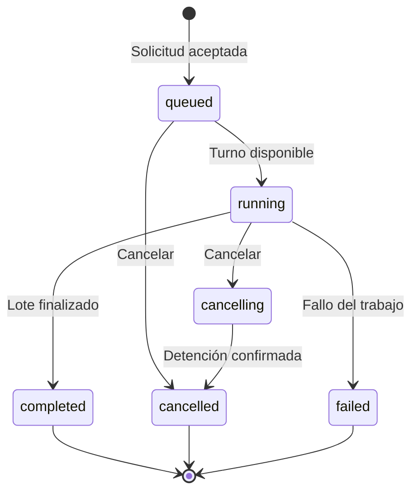

# SDD — Interfaz Liquid Glass de IntVal

**Especificación de la interfaz completa, sus interacciones y su integración con la aplicación. El HTML adjunto forma parte de esta especificación.**

| Campo                          | Valor                                                                                                                                                                       |
| ------------------------------ | --------------------------------------------------------------------------------------------------------------------------------------------------------------------------- |
| Versión                        | 1.4                                                                                                                                                                         |
| Fecha                          | 2026-11-15                                                                                                                                                                  |
| Encargo                        | Conservar la especificación completa y su HTML normativo; integrar UI-1–4 en el frontend real y conciliar resultados, configuración y Excel con Python                       |
| Anexo normativo                | [prototipo-intval-liquid-glass.html](../prototipo-intval-liquid-glass.html)                                                                                                 |
| Estado                         | UI-1–4 integrados y verificados localmente; UI-5 pendiente. Evidencia en TDD_UI1.md–TDD_UI4.md; navegador y capturas nuevos pendientes |
| Base de producto inspeccionada | `f04b8b8`, cierre F10, más los archivos locales del prototipo                                                                                                               |
| Relación con otras SDD         | Revisa la presentación e interacción de [SDD_WEB.md](SDD_WEB.md); mantiene sus contratos financieros, API y condiciones operativas salvo cambios expresos de este documento |
| Autorización de esta entrega   | El usuario solicitó los incrementos UI-1, UI-2, UI-3 y UI-4. No autoriza desplegar ni hacer commit/push                                                         |

## Índice

1. [Cómo usar esta especificación](#1-cómo-usar-esta-especificación)
2. [Objetivo de uso y alcance](#2-objetivo-de-uso-y-alcance)
3. [Mapa de pantallas y navegación](#3-mapa-de-pantallas-y-navegación)
4. [Selección para catálogos grandes](#4-selección-para-catálogos-grandes)
5. [Análisis, trabajos y continuidad](#5-análisis-trabajos-y-continuidad)
6. [Resultados y ordenación](#6-resultados-y-ordenación)
7. [Detalle de empresa y gráficas](#7-detalle-de-empresa-y-gráficas)
8. [Ajustes de valoración](#8-ajustes-de-valoración)
9. [Historial y Cómo se calcula](#9-historial-y-cómo-se-calcula)
10. [Sistema visual y apariencia elegible](#10-sistema-visual-y-apariencia-elegible)
11. [Modales, foco y comportamiento adaptable](#11-modales-foco-y-comportamiento-adaptable)
12. [Exportación y trazabilidad](#12-exportación-y-trazabilidad)
13. [Datos, persistencia y errores](#13-datos-persistencia-y-errores)
14. [Integración con la aplicación existente](#14-integración-con-la-aplicación-existente)
15. [Rendimiento y compatibilidad](#15-rendimiento-y-compatibilidad)
16. [Pruebas, trazabilidad y cierre](#16-pruebas-trazabilidad-y-cierre)
17. [Anexo normativo y mantenimiento](#17-anexo-normativo-y-mantenimiento)

## 1. Cómo usar esta especificación

Leer este documento junto con su [anexo HTML](../prototipo-intval-liquid-glass.html). El documento define los requisitos, los estados y las comprobaciones; el anexo proporciona la composición visual completa, los valores CSS, el texto de referencia y una demostración interactiva de los recorridos.

La especificación abarca el analizador completo: navegación, catálogo, selección, trabajos, resultados, detalle, gráficas, ajustes, historial, explicación del cálculo, exportación, apariencia, persistencia, errores, comportamiento adaptable y rendimiento. No se limita a copiar colores o a añadir una pantalla de presentación.

### 1.1 Precedencia y cambios de alcance

1. Las decisiones explícitas de esta SDD prevalecen sobre las propuestas anteriores de presentación e interacción de SDD_WEB.md, especialmente sus secciones 5–8.
2. El anexo es la referencia visual y de interacción para los aspectos que no necesitan repetirse literalmente en el documento. Los cambios finales enumerados aquí prevalecen sobre bocetos o capturas anteriores.
3. [methodology.md](methodology.md), los contratos versionados y el motor Python siguen siendo la autoridad sobre cálculo, unidades, aplicabilidad y trazabilidad. El prototipo no los redefine.
4. Las diferencias de integración de la sección 14 son explícitas: los temporizadores, datos precalculados o limitaciones de la demostración no se trasladan como mecanismos del producto conectado.
5. El registro F6–F10 acredita el software de aquellas entregas. No acredita que este rediseño ya esté integrado o comprobado visualmente en navegador.

### 1.2 Decisiones finales que sustituyen las anteriores

| Tema                  | Decisión vigente                                                                                                      |
| --------------------- | --------------------------------------------------------------------------------------------------------------------- |
| Entrada               | Abrir directamente el analizador. Sin landing ni pantalla introductoria como paso previo                              |
| Estructura            | Navegación lateral y contenido a la derecha en escritorio; cabecera superior adaptable en pantallas estrechas         |
| Presentación          | Liquid Glass con superficies de lectura estables, tipografía legible y una jerarquía centrada en la tarea             |
| Color                 | El usuario puede escoger una paleta o un color personalizado. Es una función del producto y se conserva entre visitas |
| Modo                  | Claro/oscuro independiente del color; seguir el sistema por defecto y permitir cambiarlo                              |
| Selección inicial     | Ninguna empresa seleccionada en una visita nueva; restaurar una selección guardada válida                             |
| Muchos registros      | Listas y resultados paginados, búsqueda global y selección entre páginas; una sola lista de empresas                  |
| Resultados            | Tabla de cuatro columnas; ordenar desde sus encabezados. Se retiran los filtros numéricos de Precio y Diferencia      |
| Contenido visible     | Métodos, Supuestos, los nueve ajustes y los apartados de Cómo se calcula se muestran sin desplegables                 |
| Modales               | Cerrar con su control, Escape o clic fuera. El clic dentro y los arrastres entre interior/exterior no deben cerrarlos |
| Complejidad operativa | Colas, recuperación y sincronización siguen siendo automáticas; el usuario no configura procesos, reintentos o cachés |

## 2. Objetivo de uso y alcance

La persona busca empresas, elige las que quiere analizar y obtiene una estimación de valor por acción frente a su precio. Puede consultar de dónde sale el resultado, revisar sus datos y descargar el análisis completo.

La interfaz debe permitir realizar esa tarea sin aprender primero el vocabulario interno de la aplicación. La precisión financiera se conserva mediante rótulos, unidades y contexto en el lugar donde hacen falta; no mediante párrafos repetidos en cada fila.

Se mantienen el motor, los cuatro métodos, los históricos, la cancelación, el historial local, la recuperación de trabajos y el Excel. Esta revisión no añade cuentas, compraventa, carteras, un proveedor nuevo, cálculos financieros en JavaScript ni una base de datos remota.

La arquitectura de destino sigue siendo Astro/React/TypeScript y FastAPI con el paquete Python existente. El HTML sirve como especificación ejecutable; no obliga a sustituir la arquitectura por un archivo monolítico ni a instalar una biblioteca para imitar cada efecto.

## 3. Mapa de pantallas y navegación

| Vista                 | Identificador del anexo | Entrada del anexo                                 | Contenido y acciones                                                                      |
| --------------------- | ----------------------- | ------------------------------------------------- | ----------------------------------------------------------------------------------------- |
| Elegir empresas       | `screen-selection`      | `#analizar` o archivo sin fragmento               | Buscar, filtrar mercado, alternar Catálogo/Seleccionadas, seleccionar, limpiar y analizar |
| Resultados            | `screen-analysis`       | `#resultados`                                     | Estado del trabajo, búsqueda, tabla, paginación, Editar selección y Excel                 |
| Historial             | `screen-history`        | `#historial`                                      | Análisis anteriores, estado, fecha y reapertura                                           |
| Detalle de empresa    | `screen-detail`         | `#empresa/{ticker}`                               | Modal con cuatro pestañas, comparación, métodos, supuestos y Excel del lote               |
| Cómo se calcula       | `screen-method`         | `#metodologia`                                    | Explicación dedicada y visible; regreso al analizador                                     |
| Ajustes de valoración | `settings-dialog`       | Control de ajustes en la cabecera                 | Nueve campos agrupados, restablecer, guardar y cerrar                                     |
| Apariencia            | `palette-controls`      | Disponible junto al contenido y dentro de modales | Botón Oscuro y selector Paleta                                                            |

**UI-NAV-01.** La marca IntVal y Analizar llevan a la selección sin limpiar el trabajo existente. El enlace Resultados se habilita cuando hay un análisis disponible. Historial permanece accesible.

**UI-NAV-02.** Usar Atrás/Adelante del navegador no debe perder la selección ni iniciar un análisis. Un fragmento desconocido vuelve al analizador; un símbolo desconocido o mal codificado no rompe la aplicación.

**UI-NAV-03.** Abrir el detalle conserva resultados, orden, búsqueda, página y posición de desplazamiento. Cerrarlo devuelve el foco al enlace de la empresa y recupera la posición de la comparación.

**UI-NAV-04.** En un cambio de pantalla se enfoca el título de la nueva vista. El enlace Saltar al contenido permite omitir la navegación.

**UI-NAV-05.** El indicador de origen siempre corresponde a los datos: Datos ficticios para la demo, sin aparentar cotizaciones actuales. Consultar Cómo se calcula es opcional y no reinicia la sesión.

Los fragmentos describen el anexo. En el producto se conserva la compatibilidad con `/app/`, sus parámetros de fuente y `/metodologia/`. La entrada pública de la revisión debe llevar a la herramienta. Las redirecciones se implementan sin eliminar de golpe enlaces publicados. Las fuentes habilitadas y el origen por defecto proceden de la API; esta revisión no añade una pantalla obligatoria para elegirlos.

## 4. Selección para catálogos grandes

### 4.1 Disposición y búsqueda

La vista empieza con Elige las empresas y una superficie que contiene buscador, mercado, vistas, acciones y lista. No añadir una lista paralela que vuelva a enumerar toda la selección debajo del catálogo.

**UI-SEL-01.** Buscar por nombre o símbolo. La búsqueda ignora mayúsculas y diacríticos y se aplica al conjunto de la vista, antes de paginar. El anexo precalcula los textos normalizados y usa un índice por símbolo.

**UI-SEL-02.** El selector de mercado ofrece Todos los mercados, USA y México y permanece junto al buscador. Cambiarlo no elimina empresas seleccionadas de otro mercado.

**UI-SEL-03.** Catálogo y Seleccionadas son dos vistas de una misma lista. Cada una conserva su búsqueda, mercado y página durante la sesión. La vista Seleccionadas muestra únicamente los símbolos elegidos y permite retirarlos desde su propia fila.

**UI-SEL-04.** Cada fila muestra nombre y, en una segunda línea, símbolo y moneda. El área de la fila etiqueta su checkbox; seleccionar no exige acertar a un control diminuto. El estado no se comunica únicamente mediante color.

**UI-SEL-05.** En una visita nueva la selección está vacía y no hay resultados inventados. Si hay estado guardado válido, recuperar sus símbolos, incluida una selección vacía intencional. Descartar símbolos desconocidos y duplicados.

### 4.2 Acciones y alcance de la selección

La barra de acciones queda sobre la lista y disponible al desplazarse: Seleccionar página, conteo global, acción global cuando aplica, Limpiar y Analizar.

| Acción                         | Regla                                                                                                                                      |
| ------------------------------ | ------------------------------------------------------------------------------------------------------------------------------------------ |
| Seleccionar página             | Selecciona/desmarca sólo las filas visibles. El checkbox tiene estado intermedio cuando sólo algunas están elegidas                        |
| Seleccionar N empresas         | Aparece cuando se ha seleccionado la página y existen más coincidencias sin seleccionar. N es el total de coincidencias de la vista, no 25 |
| Limpiar                        | Vacía la selección completa, no sólo la página o el mercado visible. Conserva análisis anteriores                                          |
| Desmarcar una fila             | Retira únicamente esa empresa y conserva el foco en la fila o en la siguiente disponible                                                   |
| Retirar la última seleccionada | Regresa al catálogo y a su buscador, sin dejar una vista sin salida                                                                        |
| Enter en búsqueda              | Añade una coincidencia única; no inicia el análisis. Con varias coincidencias se sigue eligiendo en la lista                               |
| Analizar                       | Crea el análisis de la selección actual. Si cambió respecto al lote consultado, el anexo muestra Analizar de nuevo                         |

**UI-SEL-06.** Buscar, cambiar mercado o página no modifica el conjunto seleccionado. El conteo es global y no se repite como varios mensajes equivalentes.

**UI-SEL-07.** Analizar una selección vacía muestra un error junto a la lista, conserva la pantalla y permite corregirlo. No se sustituye por un fallo genérico del servicio.

**UI-SEL-08.** Catálogo y resultados montan como máximo 25 registros de datos por página. Primera, Anterior, Siguiente y Última se deshabilitan en sus límites y muestran el rango global. Ocultar la paginación cuando no es necesaria. Al reducir coincidencias se ajusta la página a una válida.

**UI-SEL-09.** La demostración de escala usa 1,203 empresas sintéticas. Esto acredita selección y ordenación del conjunto y un DOM acotado; no acredita que el servidor pueda analizar 1,203 empresas simultáneamente.

**UI-SEL-10.** En producción se respeta `meta.limits.max_tickers` —650 en la configuración inspeccionada—. Si una selección lo supera, se informa del límite y se conserva la selección para corregirla. No truncar el lote silenciosamente ni exigir que el usuario configure el servidor. Aumentar capacidad requiere una entrega operativa comprobada.

## 5. Análisis, trabajos y continuidad

### 5.1 Separación de estados

| Estado                                            | Pertenece a                         | Qué puede modificarlo                                         |
| ------------------------------------------------- | ----------------------------------- | ------------------------------------------------------------- |
| Selección y ajustes actuales                      | Borrador para el siguiente análisis | Usuario                                                       |
| Símbolos, configuración y resultados del análisis | Snapshot del trabajo consultado     | Creación/progreso real del trabajo; queda estable al terminar |
| Búsqueda, orden y página                          | Vista local de ese resultado        | Usuario; no recalcula ni cambia el Excel                      |
| Paleta y modo                                     | Preferencia de apariencia           | Usuario/sistema, sin efecto financiero                        |

El ciclo del trabajo conectado conserva los estados de la API:



Un error de una empresa se conserva en su resultado y no implica por sí mismo que todo el trabajo pase a `failed`.

**UI-JOB-01.** Abrir la herramienta, seleccionar o editar ajustes no consulta el proveedor financiero ni inicia trabajos. Sí se pueden obtener metadatos y catálogo de la API.

**UI-JOB-02.** Analizar muestra inmediatamente que la solicitud se recibió, progresa según las empresas realmente procesadas y permite navegar mientras continúa. Se presentan los resultados parciales disponibles.

**UI-JOB-03.** La cola y el inicio del siguiente trabajo son automáticos. Estados funcionales: en espera, en curso, cancelando, completado, cancelado y fallo recuperable/final según la API. La persona no configura trabajadores, polling, cachés o reintentos.

**UI-JOB-04.** Evitar solicitudes duplicadas por repetición del botón. El anexo reconoce un trabajo activo para la misma lista de símbolos; en producción la identidad también considera fuente y configuración, como exige el contrato existente.

**UI-JOB-05.** Cancelar conserva lo ya procesado. La interfaz no confunde cancelación con finalización correcta ni descarta resultados obtenidos. Una respuesta tardía de un trabajo anterior no sustituye la vista actual.

**UI-JOB-06.** Editar empresas mantiene disponible el análisis anterior. Volver a Resultados muestra ese snapshot hasta que se ejecute otro. Un lote nuevo restablece búsqueda, orden y página para no ocultar sus empresas con el contexto del lote anterior.

**UI-JOB-07.** Recargar intenta recuperar el trabajo vigente de forma automática. En producción se consulta su referencia al servidor; si caducó o se perdió tras un reinicio, se conserva el borrador y se explica cómo repetirlo. No prometer recuperación indefinida ni persistencia remota.

### 5.2 Lo que simula el anexo

El HTML usa datos integrados y trabajos locales. Muestra un trabajo activo y hasta dos en espera; conserva hasta seis entradas recientes. Los pasos de 160/240 ms son temporizadores de demostración, no tiempos de servicio ni progreso estimado de Yahoo. La recuperación local reanuda esa simulación.

En el producto se reutilizan el gestor y transporte existentes. Sus límites, caducidad, capacidad y errores proceden de `/api/v1/meta` y de las respuestas del servicio. No copiar los temporizadores, los identificadores `preview-*` o los seis registros locales como límites del backend.

## 6. Resultados y ordenación

### 6.1 Composición

Cabecera: Resultados, conteo del lote o de coincidencias, Editar selección y Excel. Debajo, un buscador. A continuación, una sola tabla comparativa.

| Columna        | Contenido                                                            | Alineación en escritorio            |
| -------------- | -------------------------------------------------------------------- | ----------------------------------- |
| Empresa        | Nombre; símbolo y moneda en segunda línea. El nombre abre el detalle | Izquierda; ancho de referencia 37 % |
| Precio         | Precio por acción en la moneda de la empresa                         | Centro; 21 %                        |
| Valor estimado | Estimación central o Sin estimación                                  | Centro; 21 %                        |
| Diferencia     | Diferencia porcentual con signo o —                                  | Centro; 21 %                        |

**UI-RES-01.** Encabezados y cifras comparten el mismo eje. Las tres columnas numéricas tienen anchos iguales; los iconos de ordenación no desplazan el centro del texto. No reintroducir las desalineaciones de capturas anteriores.

**UI-RES-02.** La cabecera se mantiene visible en la región de desplazamiento. En anchuras insuficientes la tabla permite desplazamiento horizontal y conserva la identificación de empresa. No reducir el texto para forzar todas las columnas dentro del viewport.

**UI-RES-03.** Cada encabezado ordenable contiene un botón nativo. Orden inicial: Diferencia descendente. Al activar una columna nueva, empezar ascendente; al repetir, alternar. Las ausencias quedan al final en ambos sentidos. Comparar valores numéricos originales y nombres con comparación textual adecuada, no cadenas monetarias ya formateadas.

**UI-RES-04.** Buscar y ordenar se aplica al lote completo disponible antes de seleccionar la página de 25 registros. No ordenar únicamente las filas visibles. La búsqueda devuelve la primera página de coincidencias.

**UI-RES-05.** Conservar el foco del encabezado al ordenar y reutilizar las filas presentes cuando es posible. Sólo la columna activa lleva `aria-sort`. El estado de ordenación se comunica sin anunciar todas las filas como una actualización completa.

**UI-RES-06.** No hay filtros de Precio >/< o Diferencia >/<, panel Filtrar, selectores adicionales de mercado/disponibilidad ni chips que repitan esas condiciones. La búsqueda y la ordenación desde los encabezados son las interacciones vigentes.

**UI-RES-07.** No duplicar Precio, Estimado, Diferencia o Ver análisis dentro de cada fila como si fueran tarjetas. No añadir una explicación repetida del contenido del Excel bajo la tabla.

### 6.2 Formato y significado

- Formato de números `es-MX`, dos decimales para precios, estimaciones y porcentajes visibles; conservar precisión original para cálculos, orden y exportación.
- Importes en moneda de cotización de cada empresa. No sumar ni presentar USD y MXN como importes directamente equivalentes.
- La estimación central es la mediana de los métodos válidos recibidos del motor. Los métodos excluidos no se sustituyen por cero.
- Diferencia = estimación/precio − 1 cuando existe una referencia válida. El JSON usa ratio; la interfaz presenta porcentaje. `0.161879…` se muestra como `+16.19 %`.
- Diferencia positiva/negativa usa signo y un color semántico. Una ausencia muestra Sin estimación y —; no se representa como 0.00.
- La diferencia no es rentabilidad prevista ni recomendación de compra. La explicación corresponde a Cómo se calcula y al contexto del detalle, sin repetirse en todas las filas.

El estado por empresa —OK, datos incompletos, revisar o error— sigue disponible en el detalle y la exportación. No ocultar una empresa del lote por carecer de valoración.

## 7. Detalle de empresa y gráficas

El detalle abre sobre la comparación y ocupa una superficie de lectura propia. Su cabecera contiene regreso/cierre, empresa, símbolo y Excel. No se duplican controles de regreso equivalentes.

### 7.1 Pestañas

| Pestaña          | Contenido                                                                                                  |
| ---------------- | ---------------------------------------------------------------------------------------------------------- |
| Resumen          | Una comparación de Precio y Estimado unidos por la diferencia; tabla de cuatro Métodos; Supuestos visibles |
| Precio histórico | Serie temporal del precio con fecha, moneda y tipo de precio recibido                                      |
| Finanzas         | Evolución de ingresos, FCL, EBIT, EBITDA y utilidad neta; unidades explícitas                              |
| Márgenes         | FCL, NOPAT, EBITDA y utilidad neta respecto a ingresos, expresados como porcentaje                         |

**UI-DET-01.** En Resumen, precio y estimación aparecen una sola vez en la comparación principal. No añadir tarjetas y una segunda gráfica que repitan las mismas dos cifras.

**UI-DET-02.** Métodos y Supuestos son secciones visibles con encabezados, no `details/summary`. Los cuatro métodos son Flujo de caja libre, NOPAT, EBITDA ajustado y Utilidad neta. La tabla conserva valor por acción y moneda; una barra es una ayuda visual secundaria, no el único dato.

**UI-DET-03.** Supuestos muestra fuente y versión del conjunto, fecha de referencia, moneda, horizonte, descuentos usados, objetivo de analistas cuando exista y estado de suficiencia de datos. En la versión conectada esos valores pertenecen al snapshot, no a los ajustes que se están editando.

**UI-DET-04.** Las pestañas tienen selección y foco coherentes; flechas izquierda/derecha, Home y End permiten recorrerlas. Al volver a abrir una empresa el anexo empieza en Resumen.

**UI-DET-05.** La lectura de históricos es diferida y localizada. Si faltan precios o estados financieros, esa pestaña muestra su ausencia sin romper Resumen ni el resto del lote. Conservar el reintento del transporte real cuando sea aplicable.

**UI-DET-06.** En las tres vistas históricas, Datos permite consultar la tabla de la gráfica. Esa divulgación sí se conserva; no afecta a la regla de mostrar Métodos, Supuestos y Cómo se calcula de forma permanente.

**UI-DET-07.** Los ejes, leyendas, series, separadores y puntos adaptan contraste en oscuro. Cada serie conserva su identidad semántica al cambiar la paleta; la serie de precio puede usar el acento elegido. La apariencia no cambia datos ni la pestaña activa y no obliga a reconstruir la gráfica.

**UI-DET-08.** El anexo dibuja SVG adaptables. El producto puede reutilizar Recharts o SVG nativo según los componentes existentes y el presupuesto de carga. Debe preservar las mismas preguntas, unidades, datos, colores semánticos y alternativas tabulares.

## 8. Ajustes de valoración

Los nueve campos se presentan siempre, agrupados en Tasas de descuento, Crecimiento y márgenes, y Valores al final de la proyección. Se abre desde el control de ajustes de la cabecera.

| Campo visible                 | Clave                             | Inicial visible | Intervalo visible | Paso | Valor de transporte |
| ----------------------------- | --------------------------------- | --------------- | ----------------- | ---- | ------------------- |
| Tasa de descuento (%)         | `tasa_descuento`                  | 10              | 5–20              | 0.5  | Valor / 100         |
| Descuento de empresa (%)      | `tasa_descuento_empresa`          | 10              | 5–20              | 0.5  | Valor / 100         |
| Factor de margen (%)          | `factor_margen_conservador`       | 80              | 40–100            | 0.5  | Valor / 100         |
| Crecimiento inicial (% CAGR)  | `factor_crecimiento_inicial`      | 25              | 10–100            | 0.5  | Valor / 100         |
| Crecimiento final (% inicial) | `factor_crecimiento_final`        | 50              | 10–100            | 0.5  | Valor / 100         |
| Múltiplo FCL                  | `multiplo_terminal_fcl`           | 12              | 4–30              | 1    | Valor               |
| Múltiplo NOPAT                | `multiplo_terminal_ebit`          | 12              | 4–30              | 1    | Valor               |
| Múltiplo EBITDA               | `multiplo_terminal_ebitda`        | 12              | 4–30              | 1    | Valor               |
| Múltiplo utilidad neta        | `multiplo_terminal_utilidad_neta` | 15              | 4–30              | 1    | Valor               |

**Diferencia explícita del anexo:** el HTML permite 4 % en descuento de empresa; el producto conectado usa 5–20 %, conforme al contrato Python/API vigente. No se amplía el dominio financiero desde esta revisión visual. Los factores de crecimiento y el múltiplo de utilidad usan los intervalos de esta tabla; la API conserva sus rangos anteriores más amplios.

**UI-CFG-01.** Usar etiquetas visibles, ayudas breves asociadas, campos numéricos requeridos y validación de rango/paso. Un error conserva lo introducido y lleva al campo correspondiente. La validación del servidor sigue siendo obligatoria.

**UI-CFG-02.** Guardar aplica al borrador para el siguiente análisis y marca los ajustes como Modificados cuando difieren de los iniciales. No cambia resultados ni Excel de un trabajo ya creado.

**UI-CFG-03.** Cerrar, Escape o clic fuera descarta el borrador no guardado. Restablecer carga los iniciales dentro del borrador; sólo Guardar confirma. El caso especial del botón Restablecer del HTML se registra como diferencia de integración en 14.2.

**UI-CFG-04.** Las cifras iniciales son un punto de partida, no una calibración óptima para toda empresa. Horizonte de referencia: diez años. Los demás parámetros del dominio se conservan desde el contrato vigente, sin exponer infraestructura como opciones del usuario.

El HTML guarda ajustes de vista previa, pero sus cifras son precalculadas y los trabajos usan la configuración inicial; lo comunica al analizar con ajustes distintos. El producto conectado debe enviar la configuración guardada y mostrar el resultado realmente calculado por Python.

## 9. Historial y Cómo se calcula

### 9.1 Historial

**UI-HIS-01.** Análisis anteriores muestra por entrada: cantidad de empresas, sus nombres/símbolos, estado y fecha/hora. Una entrada abre su snapshot y recupera sus empresas elegidas. No ejecuta un trabajo nuevo.

**UI-HIS-02.** Sin entradas se muestra un estado vacío con acceso a Crear un análisis. El anexo conserva las seis entradas recientes; el producto mantiene referencias locales dentro de los límites de retención existentes.

**UI-HIS-03.** Historial local significa referencias de este navegador. No se presenta como una cuenta, historial entre dispositivos o almacenamiento permanente. La caducidad de un trabajo se resuelve como se indica en UI-JOB-07.

### 9.2 Página dedicada de explicación

**UI-MET-01.** Cómo se calcula muestra directamente, sin flechas desplegables, los cinco apartados del anexo:

1. Qué representa la estimación central.
2. Qué puedes ajustar.
3. Cómo interpretar la diferencia con el precio.
4. Monedas y empresas sin datos suficientes.
5. De dónde sale el ejemplo.

**UI-MET-02.** Conservar título, introducción, subtítulos, párrafos separados, columna de lectura acotada y enlaces para volver al analizador. No convertir la explicación en una pared de texto ni ocultarla para reducir su longitud aparente.

**UI-MET-03.** El vínculo Cómo se calcula del pie tiene superficie opaca, texto y borde legibles ligados al tema. Su contraste no depende de la onda decorativa que pase por detrás.

El documento técnico [methodology.md](methodology.md) conserva el detalle completo de fórmulas. La página de la aplicación resume su significado con fidelidad; no cambia la metodología por una decisión visual.

## 10. Sistema visual y apariencia elegible

### 10.1 Composición y escala

| Elemento               | Referencia del anexo                                                               | Requisito                                                                                  |
| ---------------------- | ---------------------------------------------------------------------------------- | ------------------------------------------------------------------------------------------ |
| Navegación escritorio  | Lateral fija, 238 px; 216 px en el ajuste intermedio                               | Mantener la separación lateral/contenido y la ruta activa                                  |
| Tipografía de interfaz | Source Sans 3, 400/500/600/700; fallback del sistema                               | Cuerpo y controles desde 1 rem; con base de 16 px, no usar microtexto para meter más datos |
| Cifras                 | IBM Plex Mono o fallback monoespaciado                                             | Números comparables, precisión y alineación consistentes                                   |
| Explicación            | Cuerpo 1.125 rem, interlineado 1.65; párrafos hasta 65 ch y panel hasta 74 ch      | Lectura cómoda y jerarquía visible                                                         |
| Controles              | Alturas habituales 44–52 px; foco visible                                          | Áreas utilizables con teclado y puntero                                                    |
| Paneles                | Superficies claras/oscuras estables, bordes suaves y radios de referencia 24–30 px | Separar contenido y escena sin perder contraste                                            |
| Tabla                  | Tres columnas numéricas simétricas, 25 filas por página                            | Priorizar comparación frente a tarjetas repetitivas                                        |
| Iconos                 | SVG de trazo con color heredado; decoración oculta semánticamente                  | No sustituir rótulos necesarios por símbolos ambiguos                                      |

Los valores CSS completos, espaciados, radios, sombras y posiciones están en el anexo. No sustituir la composición por componentes genéricos con su estilo predeterminado. Se permite adaptar el código al sistema de componentes existente, conservando el resultado visual y las interacciones.

### 10.2 Paletas y color personalizado

**UI-COL-01.** El selector Paleta forma parte permanente del producto. Cambiar color no requiere entrar a los ajustes financieros ni aceptar un cambio de análisis.

| Identificador | Nombre        | Color semilla                                |
| ------------- | ------------- | -------------------------------------------- |
| `ocean`       | Océano        | `#0878d4`                                    |
| `forest`      | Bosque        | `#138565`                                    |
| `lavender`    | Lavanda       | `#8056d9`                                    |
| `amber`       | Ámbar         | `#c06d1a`                                    |
| `rose`        | Rosa          | `#c34d7b`                                    |
| `graphite`    | Grafito       | `#536171`                                    |
| `custom`      | Personalizada | Color hexadecimal RGB elegido por el usuario |

**UI-COL-02.** Mostrar las opciones con muestra, nombre y marca de selección. La personalización usa un control de color nativo. La selección cambia inmediatamente la escena, superficies vinculadas, acentos y controles; se guarda al confirmar el color.

**UI-COL-03.** Guardar paleta en `intval-liquid-glass-palette-v1`: `{ "id": "forest" }` o `{ "id": "custom", "color": "#8254d8" }`. Un valor desconocido, mal formado o un fallo de almacenamiento vuelve a una opción válida sin bloquear la app.

**UI-COL-04.** La semilla no se aplica sin corrección a cualquier texto. El anexo deriva tintes, fondos, bordes y acentos y ajusta su contraste: el acento para botones con texto blanco busca 5.4:1, el extremo superior 4.8:1 y el texto de acento claro 9:1 respecto a blanco. El criterio de aceptación es el contraste final sobre la superficie real, no sólo cumplir esos objetivos intermedios.

**UI-COL-05.** No cambiar el significado de verde/rojo financieros con la semilla. Conservar la identidad de las series financieras. La elección estética nunca modifica importes, selección, configuración, trabajo activo o exportación.

**UI-COL-06.** El panel de Paleta se cierra con clic fuera o Escape. Al cerrarlo con teclado se recupera el foco. El control permanece utilizable dentro del modal activo y vuelve al documento cuando se cierra.

### 10.3 Modo claro/oscuro

**UI-MOD-01.** Botón Oscuro junto a Paleta, con estado presionado explícito. Permite alternar sin cambiar la paleta. Conservar el acento escogido en ambos modos.

**UI-MOD-02.** Sin preferencia guardada se sigue el sistema. Para alternar, tomar el modo realmente mostrado y elegir su opuesto. Si el destino coincide con el sistema, borrar la preferencia y volver a seguirlo; si difiere, guardar literalmente `light` o `dark`. No borrar después una elección explícita sólo porque el sistema cambie hasta coincidir con ella.

**UI-MOD-03.** Persistencia independiente en `intval-liquid-glass-scheme-v1`. Restaurar una preferencia válida antes del CSS mediante un script mínimo. Declarar `meta[name=color-scheme]` y mantener la propiedad CSS del documento coherente con ella, incluyendo controles y scrollbars nativos.

**UI-MOD-04.** Escuchar cambios del sistema y de la preferencia en otras pestañas. Sin acceso al almacenamiento el cambio sigue funcionando durante la visita. Sin JavaScript el CSS conserva la adaptación al sistema.

**UI-MOD-05.** Tematizar todo el contenido: escena SVG, navegación, controles, búsqueda, selección, tabla, modales, métodos, supuestos, página explicativa, avisos, paleta, ejes, leyendas y series. No usar un filtro de inversión global ni mantener paneles blancos dentro del modo oscuro.

**UI-MOD-06.** Usar tokens semánticos para texto, texto secundario, superficie, panel, borde, acento, estado y series. El anexo emplea `light-dark()` con alternativas CSS para navegadores sin soporte y colores del sistema en colores forzados. Cambiar de modo conserva el SVG abierto, la pestaña y el snapshot.

### 10.4 Material Liquid Glass y coste

**UI-GLS-01.** El fondo es una escena SVG estática de ondas, no un vídeo ni una animación continua. El vidrio usa transparencia, borde, reflejo y desenfoque donde aportan separación. Las superficies con texto mantienen contraste estable.

**UI-GLS-02.** La refracción es una mejora opcional limitada a la navegación. El anexo genera un mapa de desplazamiento en un Canvas fuera del DOM, de hasta 320 × 320 píxeles, con centro neutro y desplazamiento en los bordes. Se calcula al quedar libre el hilo o cambiar la geometría, con cancelación y espera de 100 ms; no hay bucle por frame.

**UI-GLS-03.** No depender de refracción para leer o navegar. Sólo se activa con soporte comprobado de filtros, navegador compatible y Canvas disponible. Firefox/Safari conservan el vidrio CSS sin esa mejora; si Canvas falla, la herramienta sigue funcionando.

**UI-GLS-04.** Respetar transparencia reducida, mayor contraste, colores forzados y movimiento reducido. En esos modos se elimina o simplifica el efecto. Las transiciones de interacción son breves —160 ms en el anexo— y no son necesarias para completar tareas.

## 11. Modales, foco y comportamiento adaptable

**UI-DLG-01.** Detalle y Ajustes usan un diálogo modal real, con nombre y foco inicial. No permitir interacción accidental con la comparación que queda debajo.

**UI-DLG-02.** Cerrar mediante control, Escape o un gesto que empieza y termina fuera de sus límites. `closedby="any"` es la referencia; sin soporte, usar un fallback que respete el evento cancelable antes de cerrar.

**UI-DLG-03.** Un clic en contenido o padding, o un arrastre desde dentro hacia fuera o al revés, no cierra el diálogo. No guardar ajustes como efecto secundario del cierre.

**UI-DLG-04.** Los controles de Apariencia pertenecen a la capa del modal activo mientras está abierto. No deben quedar detrás del backdrop ni cerrar el modal por considerarse un clic externo.

| Anchura/contexto                             | Adaptación del anexo                                                                         |
| -------------------------------------------- | -------------------------------------------------------------------------------------------- |
| Más de 1,000 px                              | Barra lateral de referencia 238 px; contenido a la derecha                                   |
| Hasta 1,000 px                               | Barra lateral de 216 px y ajustes de margen                                                  |
| Hasta 800 px                                 | Cabecera superior, navegación que se redistribuye y contenido sin margen lateral             |
| Hasta 800 px, detalle                        | Diálogo cercano al tamaño del viewport, con desplazamiento propio                            |
| Hasta 560 px                                 | Apariencia puede distribuirse en filas; se reserva espacio para no tapar contenido ni avisos |
| Hasta 520 px                                 | Ajustes de escala/composición de cabecera y detalle; no reducir el cuerpo a microtexto       |
| Contenedor de catálogo menor de 45/30 rem    | Redistribuir buscador, mercado y vistas sin afectar la selección                             |
| Contenedor de tabla menor de 600 px          | Mantener un ancho útil de identificación y permitir desplazamiento de tabla                  |
| Contenedor de comparación menor de 26/30 rem | Redistribuir comparación y ayudas sin superposición                                          |

**UI-ADP-01.** Verificar 320, 375, 768, 1,024 y 1,440 px y texto al 200 %. Ningún control esencial queda recortado o debajo de Apariencia. El desplazamiento horizontal pertenece a tablas, no a todo el documento.

**UI-ADP-02.** Preservar foco visible, etiquetas y nombres, validación asociada, jerarquía de títulos, estructura de tabla y regiones desplazables por teclado. La tabla no se convierte en un grid interactivo de cientos de tabulaciones.

**UI-ADP-03.** Contraste mínimo: texto normal 4.5:1; texto grande y elementos gráficos relevantes 3:1. Comprobar modo, paleta, selección, foco, hover y colores personalizados claros y oscuros. Los elementos con color esencial, como la muestra de una paleta, tienen un tratamiento específico en colores forzados.

## 12. Exportación y trazabilidad

**UI-XLS-01.** Excel está disponible al completar un análisis, desde Resultados y Detalle. Ambas acciones exportan el lote completo del mismo snapshot, no sólo la página, la búsqueda o la empresa abierta.

**UI-XLS-02.** Mientras se exporta, las acciones correspondientes indican ocupación e impiden duplicados. Un fallo conserva todos los resultados y permite volver a intentarlo.

**UI-XLS-03.** Datos, supuestos, origen, fecha, metodología y empresas corresponden al mismo trabajo. Los ajustes posteriores y la apariencia no alteran el documento de un análisis anterior.

### 12.1 Libro de la demostración adjunta

| Hoja del HTML | Contenido                                                                  |
| ------------- | -------------------------------------------------------------------------- |
| Resumen       | Empresa, símbolo, mercado, moneda, precio, estimación, diferencia y estado |
| Modelos       | Cuatro métodos, valor por acción, diferencia, inclusión y exclusión        |
| Supuestos     | Horizonte, configuración del snapshot, origen y referencia                 |
| Financieros   | Año, moneda, unidad, ingresos, FCL, EBIT, EBITDA y utilidad neta           |
| Precios       | Fecha, moneda, valor y tipo de precio                                      |
| Margenes      | Año y cuatro ratios de margen                                              |
| Trazabilidad  | Fuente, referencia, metodología, fecha del trabajo y campos de auditoría   |

El HTML carga SheetJS 0.20.3 desde su CDN oficial sólo al pulsar Excel; comparte la carga en curso y permite reintentar tras fallo o timeout de 15 s. El archivo se denomina `IntVal_ejemplo_2025-01-03.xlsx`. No se usa ese nombre para datos de mercado reales.

### 12.2 Decisión para el producto conectado

Se conserva el exportador Python y su endpoint de descarga, con las hojas vigentes **Resumen, USA, MX, Detalle, Supuestos, Universo y Fuentes**. La estructura distinta del anexo documenta su demostración, no autoriza una migración silenciosa del contrato de exportación.

La paridad exige mantener la información y trazabilidad del exportador real, reabrir su XLSX en pruebas y comprobar que filtro, orden, detalle y apariencia no reduzcan su alcance. No añadir SheetJS al frontend conectado ni recalcular allí el libro. Cualquier cambio futuro de nombres o de contenido contractual se versiona y prueba por separado.

## 13. Datos, persistencia y errores

### 13.1 Línea base financiera del anexo

| Empresa                | Símbolo         | Moneda | Precio | Estimación central sin redondear | Diferencia visible | Estado            |
| ---------------------- | --------------- | ------ | ------ | -------------------------------- | ------------------ | ----------------- |
| Industrial Aurora      | DEMO-USA        | USD    | 100    | 116.1879930510067                | +16.19 %           | OK                |
| Manufacturas Horizonte | DEMO-MX.MX      | MXN    | 200    | 209.138387491812                 | +4.57 %            | OK                |
| Datos insuficientes    | DEMO-INCOMPLETA | USD    | 80     | null                             | —                  | DATOS INCOMPLETOS |

Conjunto `demo-1.0`, referencia `2025-01-03`, esquema HTTP `1.0`, metodología `proxies-1.0` y contrato financiero `2.0`. Son empresas ficticias. La demo no toma precios actuales ni consulta Yahoo.

El JSON completo está integrado en el anexo: incluye métodos, históricos, auditoría, metadatos y un snapshot de ejemplo de la API. Sus identificadores y timestamps capturados son datos de referencia, no trabajos activos del despliegue actual. La huella del objeto financiero serializado se conserva en las pruebas para detectar modificaciones involuntarias.

### 13.2 Persistencia

| Clave del anexo                  | Contenido                                                                | Separación requerida                        |
| -------------------------------- | ------------------------------------------------------------------------ | ------------------------------------------- |
| `intval-liquid-glass-preview-v1` | Inicialización, selección, ajustes, trabajos locales y referencia actual | Exclusiva de la demostración                |
| `intval-liquid-glass-palette-v1` | Paleta y color personalizado                                             | Independiente del análisis y de los ajustes |
| `intval-liquid-glass-scheme-v1`  | `light`, `dark` o ausencia para sistema                                  | Independiente de paleta y análisis          |

En producción se mantienen referencias de sesión propias del transporte. No migrar los trabajos simulados como si fueran IDs reales ni borrar sesiones ajenas. Versionar y validar el almacenamiento; un fallo de lectura/escritura no impide usar la herramienta durante la visita. No guardar secretos, objetos de proveedor, configuración de despliegue o datos de otra sesión.

En UI-2, la selección de producción se guarda en `sessionStorage` bajo `intval.selection.v1:{api}:{source}:{dataset}` con versión 1, símbolos y entrada adicional. El sufijo `:views` guarda Catálogo/Seleccionadas y sus contextos independientes. Estas claves no sustituyen `intval.analysis.v1:{api}` ni los snapshots o referencias de transporte; no importan trabajos de la demostración HTML. La selección se valida contra el catálogo vigente, conserva un vacío explícito y tolera almacenamiento corrupto o bloqueado.

UI-3 añade `intval.configuration.v1:{api}` y `intval.history.v1:{api}`, ambas en `sessionStorage` con versión 1. La primera conserva únicamente los nueve ajustes confirmados. La segunda conserva IDs reales, fuente/dataset, fecha, estado/revisión, cantidad, hasta tres nombres/símbolos y solicitud aceptada; no guarda filas financieras ni históricos. Se acota por `meta.limits.max_retained`, valida el contenido y tolera almacenamiento bloqueado. Las demás referencias siguen perteneciendo al transporte.

### 13.3 Estados y errores que deben quedar cubiertos

| Situación                                               | Respuesta requerida                                                                        |
| ------------------------------------------------------- | ------------------------------------------------------------------------------------------ |
| Catálogo cargando o servicio sin preparar               | Shell utilizable y estado real, sin filas ficticias para aparentar resultados              |
| Selección vacía                                         | Error localizado con posibilidad de elegir                                                 |
| Sin coincidencias                                       | Estado vacío dentro de la lista/tabla y búsqueda editable                                  |
| Trabajo en espera/en curso                              | Estado, progreso real y cancelación cuando proceda                                         |
| Trabajo cancelado                                       | Identificación de cancelación y resultados ya procesados                                   |
| Empresa incompleta, revisar o error                     | Conservar fila/datos disponibles y diagnóstico del snapshot                                |
| Histórico vacío o fallido                               | Ausencia/error de esa vista, manteniendo la comparación                                    |
| Exportación fallida                                     | Aviso y reintento, conservando el lote                                                     |
| Red desconectada o respuesta tardía                     | Conservar lo disponible y la identidad del trabajo; recuperación automática del transporte |
| Capacidad o cola ocupada                                | Mensaje de tarea y conservación del borrador; no pedir parámetros de infraestructura       |
| Trabajo caducado o perdido                              | Explicar la pérdida de la referencia y permitir analizar de nuevo                          |
| Preferencia corrupta, almacenamiento o Canvas bloqueado | Valores de apariencia válidos y funcionamiento básico conservado                           |

Los avisos transitorios del anexo usan una región de estado y unos 4.2 s de permanencia. En el producto los errores que requieren una acción no dependen exclusivamente de un toast que desaparece.

## 14. Integración con la aplicación existente

### 14.1 Contratos que se reutilizan

| Necesidad                       | Recurso existente                                          |
| ------------------------------- | ---------------------------------------------------------- |
| Disponibilidad y preparación    | `/healthz`, `/readyz`                                      |
| Configuración, origen y límites | `GET /api/v1/meta`                                         |
| Catálogo por fuente/mercado     | `GET /api/v1/catalog`                                      |
| Crear trabajo                   | `POST /api/v1/analyses`                                    |
| Estado                          | `GET /api/v1/analyses/{id}`                                |
| Resultados incrementales        | `GET /api/v1/analyses/{id}/results`, con `after` y `limit` |
| Cancelar                        | `POST /api/v1/analyses/{id}/cancel`                        |
| Precios                         | `GET /api/v1/analyses/{id}/companies/{ticker}/prices`      |
| Financieros y márgenes          | `GET /api/v1/analyses/{id}/companies/{ticker}/financials`  |
| Exportación                     | `GET /api/v1/analyses/{id}/export.xlsx`                    |

Se reutilizan validación de DTO, recuperación, polling, deduplicación, cancelación y manejo de respuestas tardías de `frontend/src/features/analysis/transport.ts` y del estado existente. Cambiar la presentación no autoriza suprimir esas capacidades.

Los resultados del API actual llegan por cursor, sin búsqueda/ordenación global remota. Para esta revisión se acumulan las páginas de resúmenes del snapshot en la caché existente y se aplica búsqueda/orden global antes de paginar visualmente. No descargar los históricos de todas las empresas para construir la tabla. Si el volumen futuro exige paginación remota ordenada, esa extensión tendrá contrato y pruebas propios; no se presentará una ordenación local de una sola página como global.

### 14.2 Diferencias y correcciones al pasar de demostración a producto

| ID     | Observado en el anexo o producto                                                           | Requisito de integración                                                                                                                                                                   |
| ------ | ------------------------------------------------------------------------------------------ | ------------------------------------------------------------------------------------------------------------------------------------------------------------------------------------------ |
| GAP-01 | El anexo tiene datos precalculados y temporizadores                                        | Conectar al motor/API real; no fingir progreso ni recalcular en JS                                                                                                                         |
| GAP-02 | Ajustes de vista previa guardables, pero snapshot precalculado con iniciales               | Enviar configuración real y presentar sus resultados y supuestos efectivos                                                                                                                 |
| GAP-03 | Restablecer en el HTML muta el objeto de ajustes antes de Guardar                          | Usar borrador transaccional; cerrar sin guardar no altera ajustes confirmados, tampoco después de Restablecer                                                                              |
| GAP-04 | El catálogo actual de API sólo devuelve símbolo y mercado; el anexo conoce nombre y moneda | Extender metadatos de forma compatible cuando estén disponibles. Usar símbolo como identidad si falta nombre; no inventar nombre/moneda ni hacer una consulta financiera por fila al abrir |
| GAP-05 | API limitada a 650 símbolos/lote; pruebas de UI con 1,203                                  | Mantener DOM y búsqueda escalables, aplicar límites de servicio e identificar por separado pruebas de capacidad del servidor                                                               |
| GAP-06 | Libro de siete hojas del HTML distinto del contrato Python                                 | Aplicar la decisión explícita de 12.2 y verificar el Excel real                                                                                                                            |
| GAP-07 | Referencias locales de demo y acceso directo a empresa crean un snapshot de ejemplo        | En producción exigir pertenencia al trabajo disponible; no fabricar un análisis completado ni reutilizar un ID capturado                                                                   |
| GAP-08 | Rutas por fragmento y entrada actual Astro con landing                                     | Adaptar las rutas preservando enlaces existentes; entrada final directa al analizador                                                                                                      |
| GAP-09 | Estilos calculados y pruebas DOM disponibles, sin revisión del render actual               | Revisar navegador, capturas, tamaño de texto y coste real antes de declarar cerrada la migración visual                                                                                    |

**Resolución local tras UI-4 (2026-11-15):**

| Diferencia | Estado y evidencia |
| --- | --- |
| GAP-01 | UI-3 conserva trabajos reales; UI-4 consume respuestas ASGI y XLSX recién generados por Python, sin fórmulas ni temporizadores de valoración en JS |
| GAP-02 | Nueve ajustes confirmados conciliados con POST, configuración efectiva, resultados recalculados y Supuestos; el análisis anterior se conserva |
| GAP-03 | Resuelto en UI-3: Restablecer sólo modifica el borrador del modal hasta Guardar |
| GAP-04 | Resuelto en UI-2: identidad opcional y compatible; no se fabrican nombres/monedas ni se consulta al proveedor al abrir catálogo |
| GAP-05 | Resuelto en UI-2: 1,203 registros acreditan UI, no capacidad de análisis; se conserva el límite API por lote |
| GAP-06 | Resuelto con las siete hojas Python; se cotejan las 24 columnas de resumen y las 73 de auditoría, particiones, Supuestos, Universo y Fuentes |
| GAP-07 | Pertenencia, recuperación y errores de ID conservados; histórico exige fuente, símbolo, dataset y moneda del snapshot; no se rellena una fecha ausente con metadatos actuales |
| GAP-08 | Entrada directa y enlaces compatibles de UI-1; navegación e historial conectados de UI-3 |
| GAP-09 | Pendiente de UI-5: render real, capturas y coste visual; las comprobaciones ASGI/JSDOM no lo sustituyen |

La validación de respuestas usa los límites publicados por OpenAPI, separados de los límites editables del formulario. Un snapshot legítimo con crecimiento de 0 o múltiplo de utilidad de 35 se puede leer sin ofrecer esos valores como nuevas opciones de edición. Las nueve constantes efectivas de sólo lectura deben estar presentes; no se inventan al recuperar un trabajo. Detalle conserva la fecha del snapshot, con formato UTC estable y ausencia explícita.

El backend permanece agnóstico del alojamiento. Se conservan método financiero, proveedores, CLI y compatibilidad Streamlit hasta la entrega de migración correspondiente. Esta SDD no modifica `PORT`, número de procesos, retención o configuración del PaaS.

## 15. Rendimiento y compatibilidad

**UI-PERF-01.** El anexo completo ocupa 242,161 bytes y 40,338 bytes gzip con Node, por debajo de su presupuesto de 40 KiB gzip. Incluye los datos ficticios; no confundirlo con el presupuesto del bundle React ni con bytes descargados de las fuentes o del Excel diferido.

**UI-PERF-02.** La presentación inicial no depende de JavaScript de un CDN. La tipografía externa no bloquea la funcionalidad y tiene fallback. SheetJS sólo se carga al exportar la demo. El frontend conectado usa su exportador del servidor.

**UI-PERF-03.** Máximo 25 filas de datos por lista/tabla, índices por símbolo, búsqueda normalizada reutilizable, detalle e históricos bajo demanda. Sin crear una gráfica por empresa ni un Canvas por panel.

**UI-PERF-04.** Cambiar paleta o modo actualiza colores y estado de apariencia; no pide datos, recalcula finanzas, remonta el SVG activo ni genera mapas ópticos por frame.

**UI-PERF-05.** Conservar los presupuestos y medidores vigentes del frontend de producción de SDD_WEB.md, sección 15. Desde UI-1, `/` ejecuta el mismo analizador que `/app/` y comparte su presupuesto de 300 KiB gzip de JS; ya no usa el límite de 50 KiB de la antigua landing. Cómo se calcula mantiene 50 KiB de JS y todas las rutas mantienen 50 KiB de CSS. Las gráficas siguen fuera de la carga inicial. La nueva vista no carga una landing como prerrequisito. Objetivos del shell del analizador: LCP de 2.5 s, INP de 200 ms y CLS de 0.1 en un perfil móvil declarado. La duración de una consulta al proveedor se registra por separado. Una prueba de DOM no demuestra esos tiempos.

**UI-PERF-06.** Funciones modernas con detección y alternativa: `closedby`, invoker commands de ordenación, `moveBefore`, `focusgroup`, filtros de refracción y `light-dark()`. Conservar la funcionalidad en Chromium, Firefox y WebKit; no exigir una API experimental para completar un análisis.

**UI-PERF-07.** No añadir dependencias o efectos por su popularidad. Reutilizar las herramientas instaladas cuando conserven el resultado. La versión conectada compila sus dependencias; el CDN del anexo no se convierte automáticamente en una dependencia productiva nueva.

## 16. Pruebas, trazabilidad y cierre

### 16.1 Evidencia de la línea base adjunta

Comando desde `frontend/`:

```sh
node --test tests/prototipo.test.mjs tests/liquid-glass.test.mjs
```

Resultado local al redactar esta edición: **58 aprobadas, 0 fallos, 0 omitidas**. Los tests y el HTML forman parte del mismo conjunto documental de referencia:

- [Recorridos del prototipo](../frontend/tests/prototipo.test.mjs).
- [Liquid Glass, escala y apariencia](../frontend/tests/liquid-glass.test.mjs).
- [Investigación de UX/UI](UX_UI_RESEARCH.md), como antecedente y fuentes, no como prueba de satisfacción del usuario.
- [Decisiones técnicas de Liquid Glass](LIQUID_GLASS_RESEARCH.md).

La verificación cubre DOM, interacciones, persistencia, contraste calculado, límites de registros y peso comprimido. No certifica render actual, GPU, tiempos de campo, lectura de todos los datos por un usuario ni el Excel real de producción. Las capturas históricas de F7/F9/F10 corresponden a las interfaces de esas entregas.

### 16.2 Matriz de aceptación

| Caso   | Requisitos            | Comprobación de cierre                                                                                           |
| ------ | --------------------- | ---------------------------------------------------------------------------------------------------------------- |
| UI-T01 | NAV, SEL-05, JOB-01   | Visita nueva directa, sin selección ni análisis automático; origen correcto                                      |
| UI-T02 | SEL-01–04, SEL-06     | Buscar nombre/símbolo y mercado, cambiar vistas, conservar búsqueda y selección                                  |
| UI-T03 | SEL-05–10             | 1,203 empresas; 25 filas; página/global diferenciados; desmarcar y limpiar sin pérdida del análisis              |
| UI-T04 | JOB-01–06             | Crear, repetir botón, navegar, cola, progreso, cancelar y conservar resultados parciales con API real            |
| UI-T05 | JOB-07, HIS           | Recarga, historial, caducidad y respuesta tardía sin sustituir el trabajo vigente                                |
| UI-T06 | RES-01–07             | Cuatro encabezados y cifras alineados; orden global en ambos sentidos; búsqueda, ausencias y regreso del detalle |
| UI-T07 | DET-01–08             | Comparación sin duplicados; cuatro métodos, Supuestos y pestañas; históricos vacíos/fallidos localizados         |
| UI-T08 | CFG-01–04, GAP-02–03  | Nueve campos, límites, escala porcentual, borrador transaccional y recálculo Python efectivo                     |
| UI-T09 | MET-01–03             | Cinco apartados visibles; navegación sin perder sesión; vínculo legible en toda paleta                           |
| UI-T10 | COL-01–06             | Seis paletas y personalizado; persistencia válida/corrupta/bloqueada; independencia financiera                   |
| UI-T11 | MOD-01–06             | Sistema, override, restauración temprana, otra pestaña, cambio de sistema y almacenamiento bloqueado             |
| UI-T12 | COL, MOD, ADP-03      | Contraste de texto y series en ambos modos y colores extremos; estados de foco/selección                         |
| UI-T13 | DLG-01–04             | Cierre por botón/Escape/fuera; padding y arrastres; cancelación del cierre y foco recuperado                     |
| UI-T14 | XLS-01–03, GAP-06     | Reabrir XLSX real completo tras búsqueda, orden y detalle; fallo y reintento sin pérdida                         |
| UI-T15 | GLS-01–04, PERF-03–04 | Mapa acotado, sin bucle continuo; fallback sin Canvas; transparencia y movimiento reducidos                      |
| UI-T16 | ADP-01–03             | Navegador a cinco anchuras y texto al 200 %; teclado; scroll sólo en región; apariencia no tapa contenido        |
| UI-T17 | PERF-01–07            | Build, tamaños, carga diferida y mediciones reproducibles; matriz de tres motores                                |
| UI-T18 | GAP-01–09             | Paridad API/motor/contratos, sin datos inventados ni cambios de fuente/moneda ocultos                            |

### 16.3 Secuencia de implementación

El usuario autorizó sucesivamente UI-1, UI-2, UI-3 y UI-4 tras la redacción de la SDD. Avanzar por incrementos con TDD y sin rehacer F1–F10:

| Incremento | Entrega                                                                                | Criterio mínimo                                              |
| ---------- | -------------------------------------------------------------------------------------- | ------------------------------------------------------------ |
| UI-1       | Tokens, composición, paleta elegible y modo claro/oscuro dentro del frontend existente | UI-T01, UI-T09–12 y regresiones del transporte               |
| UI-2       | Catálogo único, selección entre páginas y comportamiento de escala                     | UI-T02–03; catálogo real y límites visibles correctos        |
| UI-3       | Resultados, detalle, ajustes e historial sobre estado/transporte existentes            | UI-T04–08, UI-T13 y recuperación sin regresiones             |
| UI-4       | Paridad de datos, exportación real y resolución de diferencias de integración          | UI-T14, UI-T18; configuración y Excel conciliados con Python |
| UI-5       | Revisión del conjunto en navegador, responsive, apariencia y rendimiento               | UI-T15–17; capturas identificadas por build, modo y viewport |

**Estado de UI-1 (2026-11-15):** integrado en el frontend real. Entrada directa `/` y `/app/`, sidebar/cabecera adaptable, tokens, seis paletas y color propio, modo de sistema/claro/oscuro, persistencia independiente y Cómo se calcula con cinco apartados visibles. Los 70 tests de componentes/estado y los 69 tests de shell/anexo pasan; estos últimos incluyen los 58 del prototipo. Build, tipos, lint, formato y presupuesto de assets pasan. Evidencia y límites en [TDD_UI1.md](TDD_UI1.md).

La revisión visual del diseño conectado queda en UI-5: los resultados DOM y de contraste calculado no acreditan render, reflow real, óptica ni tiempos de interacción. Se han adaptado los escenarios E2E sin ejecutarlos en esta sesión, que bloquea los navegadores/puertos. No se han aprobado referencias visuales nuevas. Esta limitación visual sigue vigente tras UI-3; las pantallas funcionales ya integradas se enumeran a continuación.

**Estado de UI-2 (2026-11-15):** integrado y verificado localmente. Un único catálogo con vistas Catálogo/Seleccionadas, filtros y página independientes, búsquedas normalizadas antes de paginar y hasta 25 filas montadas. Selección de página con estado parcial, selección global explícita de coincidencias, limpieza sin perder resultados y Enter que selecciona sin analizar. Se recuperan selección, vacío intencional y contexto de cada vista dentro de la sesión. Se mantiene el límite comunicado por la API, sin truncar ni enviar un lote excesivo. Evidencia en [TDD_UI2.md](TDD_UI2.md). La siguiente integración funcional, UI-3, se registra a continuación.

El catálogo HTTP admite `name` y `currency` opcionales. La demo los obtiene de su archivo de identidad local; el catálogo de mercado mantiene símbolo/mercado cuando no dispone de ellos. No se infieren monedas ni nombres, ni se consulta al proveedor financiero para rellenarlos. El esquema OpenAPI y los tipos TypeScript se regeneran juntos. Los metadatos de mercado que todavía no existen no se presentan como incorporados.

**Estado de UI-3 (2026-11-15):** integrado y verificado localmente. Resultados con cuatro columnas, orden y búsqueda globales antes de paginar a 25; detalle modal con cuatro pestañas, Métodos y Supuestos visibles; nueve ajustes transaccionales e historial de IDs reales. Navegar o editar la fuente del borrador no cancela el trabajo; la cancelación explícita antes de recibir su ID cancela la aceptación tardía. Los ajustes guardados se envían al siguiente POST, y resultados/Excel mantienen la configuración aceptada de su trabajo. Se conservan recuperación, cola, revisiones, cancelación y resultados parciales del transporte existente.

La suite tiene 92 pruebas frontend aprobadas y mantiene el umbral del 85 % en sus cuatro métricas de cobertura. Tipos, lint, formato, build, shell/anexo y assets pasan. Se ejecutaron dos regresiones Python dirigidas de configuración y Excel; no se repitió la suite Python completa de UI-2. Los E2E actualizados sólo se recopilaron, sin ejecución; foco nativo, cierres reales, alineación óptica, reflow y capturas corresponden a UI-5. Evidencia y diferencias en [TDD_UI3.md](TDD_UI3.md). La siguiente entrega es UI-4: conciliación completa de datos y exportación con Python.

**Estado de UI-4 (2026-11-15):** integrado y verificado localmente. Se separa validación del contrato recibido y validación del formulario; se corrige la procedencia de fecha, dataset y moneda del detalle. Un oráculo independiente de las fórmulas compara el snapshot API con el XLSX completo. Los componentes consumen intercambios reales generados por TestClient ASGI en cada ejecución y comprueban los nueve ajustes, búsqueda/orden, ambos controles Excel e historial sin otro POST. Pasan 476 pruebas Python y 120 frontend, más tipos, lint, formato, build, shell/anexo y presupuestos. No cambia el contrato HTTP ni el financiero, y no se modifica el exportador Python. Evidencia en [TDD_UI4.md](TDD_UI4.md).

UI-5 es la siguiente entrega: revisión del conjunto en navegador, apariencia, responsive y rendimiento. Los E2E se han actualizado y recopilado, sin ejecutarlos en esta sesión. No hay nuevas capturas ni referencias visuales aprobadas.

F11 continúa como entrega separada de distribución/arranque, después de resolver el alcance que realmente se solicite. La aprobación de esta SDD no autoriza publicar la web.

Para cerrar la integración: todos los requisitos aplicables comprobados, ninguna diferencia de 14.2 ocultada, suite de producto en verde y evidencia visual nueva del diseño conectado. Los fallos o límites pendientes se registran expresamente. No declarar completada la migración por existir este HTML o por pasar sus 58 pruebas.

## 17. Anexo normativo y mantenimiento

### Anexo A — HTML completo

**Archivo adjunto:** [prototipo-intval-liquid-glass.html](../prototipo-intval-liquid-glass.html).

Es el mismo archivo que se edita y prueba en la raíz del repositorio; no se mantiene una segunda copia con riesgo de divergencia. Debe incluirse en el mismo cambio/versionado que esta especificación. Puede abrirse directamente para explorar la demo; las fuentes y la primera descarga del Excel requieren conexión a sus CDN.

SHA-256 del archivo de referencia de esta versión:

```text
06694e7ba2628dbb0910243e72f80118f3caaa6c861e1ab505905fb16fafdb8f
```

El anexo conserva la definición literal de todos los tokens CSS, las seis paletas, colores de cada modo, tipografía, medidas, iconos SVG, contenido, datos, estructura, handlers y fallbacks. Esos detalles pertenecen a la referencia aunque aquí se hayan agrupado por comportamiento.

### Anexo B — Regla de cambios

Modificar el diseño requiere actualizar el HTML, los requisitos afectados y sus pruebas en una misma entrega; actualizar versión y huella del anexo cuando cambie el archivo. Una captura no sustituye la referencia interactiva ni una preferencia de biblioteca sustituye el resultado especificado.

Al retomar el trabajo: leer esta SDD, abrir el anexo, comprobar Git, revisar los tests y comparar el frontend real con la matriz. La siguiente acción autorizada depende del encargo vigente; no deducir una implementación o un despliegue de la mera existencia del plan.
