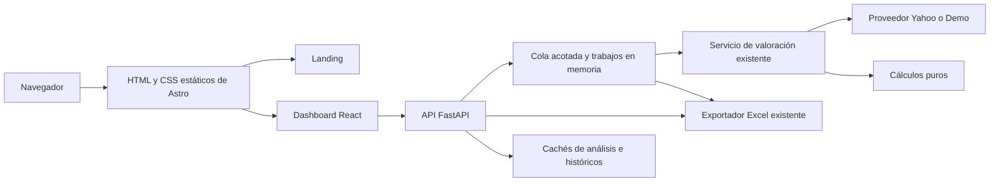
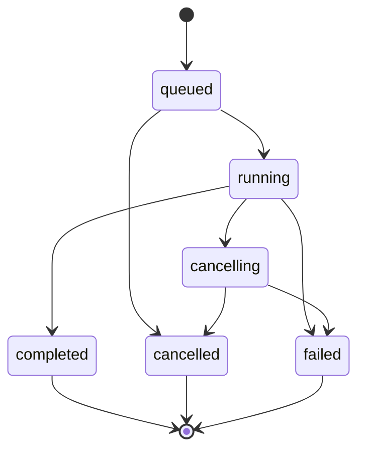
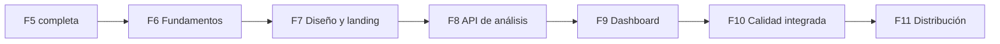

# SDD web — Landing y nueva interfaz de IntVal

**Extensión de la [SDD general](SDD.md) para diseñar y ejecutar la siguiente etapa del producto.**

| Campo | Valor |
| --- | --- |
| Versión de esta extensión | 1.6 |
| Fecha | 2026-11-13 |
| Línea base de software inspeccionada | `345aa0a` — F5: demo y documentación de portafolio |
| Estado de F1–F5 | Implementadas; evidencia en la SDD general y documentos TDD |
| Estado de F6–F11 | F6–F10 implementadas y verificadas localmente; F11 pendiente |
| Encargo de esta edición | Implementar sólo F10 con TDD; conservar el servicio Streamlit y no publicar |
| Stack de destino | Astro estático, React, TypeScript, Tailwind CSS, shadcn/ui, Recharts y FastAPI |
| Backend que se conserva | Paquete Python `valoracion`, proveedores, metodología y exportador |
| Idioma inicial | Español; identificadores técnicos de transporte en inglés |
| Método obligatorio | TDD en cada incremento de software |
| Licencia y titular | MIT; Copyright (c) 2026 adndvlp |
| Continuidad | Leer primero las secciones 1, 3, 14, 18 y 21 de este documento |

El estado actual no se deduce del diseño futuro. Un archivo, ruta o comando de los
apartados «propuestos» sólo existe cuando una fase lo crea y registra su evidencia.
Las cifras históricas de pruebas son las del cierre de F5: **345 pruebas y 98.59 %
de cobertura combinada de líneas y ramas**, con un warning conocido. F6 añade
el shell Astro/React y la API de lectura FastAPI: **394 pruebas Python, 12
unitarias frontend, dos del HTML compilado y cuatro de navegador** pasan
localmente. Evidencia y límites en [TDD_F6.md](TDD_F6.md) y 21.5. F7 añade la landing y metodología con ocho pruebas de navegador y capturas
revisadas; cierre en 21.6 y TDD_F7.md. F8 añade el transporte de análisis,
aislamiento de adquisiciones, cachés, históricos y Excel; evidencia en
[TDD_F8.md](TDD_F8.md). F9 integra el dashboard React con la API, doce pruebas de navegador y capturas revisadas; evidencia en [TDD_F9.md](TDD_F9.md) y continuidad en 21.8.

## Índice

1. [Encargo, acuerdos y alcance](#1-encargo-acuerdos-y-alcance)
2. [Línea base e invariantes](#2-línea-base-e-invariantes)
3. [Decisiones de arquitectura](#3-decisiones-de-arquitectura)
4. [Estructura de archivos de destino](#4-estructura-de-archivos-de-destino)
5. [Dirección visual y sistema de diseño](#5-dirección-visual-y-sistema-de-diseño)
6. [Landing y contenido](#6-landing-y-contenido)
7. [Dashboard y paridad funcional](#7-dashboard-y-paridad-funcional)
8. [Estado de la interfaz y accesibilidad](#8-estado-de-la-interfaz-y-accesibilidad)
9. [API, datos y contratos](#9-api-datos-y-contratos)
10. [Trabajos, concurrencia y cancelación](#10-trabajos-concurrencia-y-cancelación)
11. [Cachés, vigencia y exportación](#11-cachés-vigencia-y-exportación)
12. [Errores, límites y operación](#12-errores-límites-y-operación)
13. [Despliegue agnóstico](#13-despliegue-agnóstico)
14. [TDD y matriz de verificación](#14-tdd-y-matriz-de-verificación)
15. [Rendimiento, SEO y compatibilidad](#15-rendimiento-seo-y-compatibilidad)
16. [CI y dependencias reproducibles](#16-ci-y-dependencias-reproducibles)
17. [Migración, compatibilidad y reversión](#17-migración-compatibilidad-y-reversión)
18. [Fases F6–F11](#18-fases-f6f11)
19. [Trazabilidad de requisitos](#19-trazabilidad-de-requisitos)
20. [Riesgos y decisiones revisables](#20-riesgos-y-decisiones-revisables)
21. [Continuidad en otro chat](#21-continuidad-en-otro-chat)
22. [Fuentes y mantenimiento](#22-fuentes-y-mantenimiento)

## 1. Encargo, acuerdos y alcance

### 1.1 Problema que se quiere resolver

IntVal ya analiza empresas de USA y México, presenta cuatro proxies y produce
Excel trazable. Su interfaz actual de Streamlit tiene una presentación genérica
y no existe una landing de producto independiente que explique su utilidad y
permita entrar a una demostración desde el navegador.

El usuario pide una landing atractiva y una mejora sustancial de la experiencia
de la aplicación. El objetivo es que el proyecto pueda presentarse como un
producto coherente: una entrada pública cuidada y una herramienta de análisis
legible, útil en móvil y con controles de calidad verificables.

### 1.2 Decisiones expresadas en la conversación

| Tema | Decisión |
| --- | --- |
| Presentación | Crear una landing y rediseñar la interfaz de la app |
| Sitio estático | Usar Astro como base de la landing; Next.js dejó de ser la propuesta elegida |
| Interactividad | React para el dashboard, integrado en el mismo proyecto Astro |
| Lógica financiera | Conservar el motor Python; exponerlo mediante FastAPI |
| Estilos y componentes | TypeScript, Tailwind CSS y shadcn/ui personalizado |
| Gráficas | Recharts para las vistas del dashboard |
| Alojamiento | Agnóstico del proveedor; preferencia por PaaS y coste gratuito cuando sea viable |
| Ingeniería | TDD obligatorio; mantener metodología y trazabilidad |
| Especificación | Detallar el alcance completo para poder seguir en un chat sin historial |

El usuario autorizó redactar esta SDD. La implementación de cada fase se inicia
con el encargo correspondiente; terminar la redacción no activa automáticamente
todas las fases ni autoriza un despliegue.

### 1.3 Decisiones de diseño propuestas

Son decisiones concretas para hacer implementable el encargo: rutas, DTO de la
API, límites iniciales, memoria de trabajos, tokens visuales, orden de fases y
presupuestos de rendimiento. Se pueden ajustar con evidencia durante la
implementación, documentando el cambio y su efecto. No hace falta volver a pedir
permiso para opciones rutinarias ya dentro del alcance.

La dirección visual es una propuesta inicial revisable sobre una pantalla real.
No constituye una aprobación anticipada de todos los detalles gráficos.

### 1.4 Incluido

- Landing pública, contenido, navegación, identidad visual y enlaces de entrada.
- Dashboard React con paridad de los flujos actuales, presentación propia y
  adaptación a pantallas pequeñas.
- API para catálogo, análisis, progreso, históricos y descarga del Excel.
- Estados de carga, resultados parciales, fallos, cancelación y expiración.
- Separación de datos de demo/mercado y preservación de supuestos del resultado.
- Pruebas del motor, transporte, componentes, navegador, accesibilidad y regresión.
- Build estático reproducible, empaquetado y arranque genérico en PaaS.
- Documentación, capturas reales actualizadas y retirada gradual de la interfaz
  anterior cuando se demuestre la paridad.

### 1.5 Fuera del alcance

No se añaden cuentas, pagos, carteras personales, órdenes de compraventa,
suscripciones, newsletter, base de datos, Redis ni persistencia de análisis entre
reinicios. Tampoco se añaden nuevos modelos económicos, backtesting de precisión,
noticias, cotizaciones en tiempo real, un proveedor de datos de pago o una nueva
composición del catálogo.

El rediseño no autoriza afirmar rentabilidad, asesoría personalizada, precisión
predictiva ni respaldo de las empresas que pudieran aparecer en Mercado.
La publicación de una URL y los cambios de una cuenta de alojamiento se ejecutan
cuando se soliciten; preparar artefactos revisables sí pertenece a estas fases.

## 2. Línea base e invariantes

### 2.1 Lo que existe

| Elemento | Estado en `345aa0a` |
| --- | --- |
| Entrada web | `app.py`, Streamlit |
| Motor | `valoracion/calculos.py`, sin I/O |
| Orquestación | `valoracion/servicio.py`, proveedor inyectable |
| Configuración | `Configuracion`, dataclass con validación compartida |
| Proveedores | Yahoo y demo local |
| Exportación | Excel con Resumen, USA, MX, Detalle, Supuestos, Universo y Fuentes |
| CLI | `motor_valoracion.py`, fachada y entrada compatibles |
| Datos de mercado | Catálogo local: 500 símbolos USA y 104 MX |
| Demo | `demo-1.0`, referencia fija 2025-01-03, tres empresas ficticias |
| Metodología | `proxies-1.0` |
| Contrato tabular | `2.0`; 24 campos principales y 73 de detalle |
| Dependencias | Python 3.12 y resoluciones pip-tools |
| Calidad | pytest/AppTest/coverage/Ruff; CI de Python |
| Arranque | `iniciar_servicio.sh`, Streamlit en el `PORT` del entorno |
| Frontend JavaScript / API | No existen todavía |
| Evidencia visual | Capturas reales de la UI Streamlit, identificadas como demo |

Se verificó por API el CI del commit F5 `345aa0a`:
[Tests, run 43370891010](https://github.com/adndvlp/IntVal/actions/runs/43370891010),
con SHA `345aa0ada7fd7e80f0d36ca417a6df978d255c18` y resultado
completed/success. Acredita esa línea base; no una futura implementación F6–F11
ni un despliegue. No convertir un resultado local en un run remoto supuesto.

### 2.2 Invariantes de la migración

**WEB-INV-01.** Las expresiones financieras, selección de períodos, FX,
aplicabilidad y fallbacks del motor se conservan. Cambiar una fórmula exige una
tarea metodológica explícita, versionada y con esperados independientes.

**WEB-INV-02.** Se conservan contrato tabular 2.0, claves heredadas, orden de
columnas y siete hojas Excel. El JSON HTTP tiene una versión propia: no sustituye
ni renumera la metodología o el contrato financiero.

**WEB-INV-03.** La demo usa los datos de producto versionados y el mismo servicio.
Ningún código de producto importa fixtures ni resultados precalculados de tests.

**WEB-INV-04.** Un dato ausente sigue siendo ausente. No se sustituye por cero,
cadena vacía financiera o un punto artificial en una gráfica.

**WEB-INV-05.** El análisis y su Excel utilizan los supuestos aceptados al iniciar
ese análisis. Cambiar el formulario no altera retroactivamente los resultados.

**WEB-INV-06.** El precio y la moneda se identifican explícitamente. No se suman
importes de USD/MXN sin conversión; las agregaciones de upside son porcentuales.

**WEB-INV-07.** Cambiar fuente invalida el resultado visible anterior. Una respuesta
tardía no puede reintroducir resultados de la fuente descartada.

**WEB-INV-08.** No se realiza una consulta de mercado al abrir la landing, leer
metadatos/catálogo o visitar inicialmente Mercado sin pulsar Analizar.

**WEB-INV-09.** Los ejemplos Decimal, snapshots históricos y catálogo siguen
siendo referencias independientes; no se regeneran para ocultar diferencias.

**WEB-INV-10.** El alojamiento no aparece como dependencia funcional, manifiesto
obligatorio, SDK o URL fija de un proveedor.

### 2.3 Referencias numéricas que deben seguir conciliando

| Caso y configuración | Esperado |
| --- | --- |
| Caso simplificado independiente de F3 | Proxies 52, 44, 44, 48; mediana 46 USD |
| DEMO-USA, configuración inicial web | Precio 100 USD; mediana 116.1879930510067 USD |
| DEMO-MX.MX, configuración inicial web | Precio 200 MXN; mediana aproximadamente 209.138387491812 MXN |
| DEMO-INCOMPLETA | Precio 80 USD; ningún proxy ni mediana disponibles |
| Versiones de los tres casos | Demo `demo-1.0`, metodología `proxies-1.0`, contrato `2.0` |

La configuración inicial web replica la UI de F5: tasa de accionista 0.10,
tasa de empresa 0.10, margen conservador 0.80, factores 0.25/0.50 y múltiplos
12/12/12/15. El ejemplo de referencia está en
[examples/demo](../examples/demo/README.md); el caso de tasa cero es distinto.

## 3. Decisiones de arquitectura

### 3.1 Vista de conjunto



El flujo funcional es navegador → API → servicio → proveedor/cálculo. El
frontend no llama directamente a Yahoo, no contiene las fórmulas de valoración
y no construye el Excel financiero en JavaScript.

### 3.2 Frontend estático con interactividad

Astro genera HTML/CSS/JS en build mediante `output: "static"`. La landing tiene
contenido completo en su HTML inicial. El dashboard es una raíz React de la ruta
`/app/`, con hidratación explícita; no se divide su estado principal entre
muchas islas independientes.

Astro admite componentes React y directivas de hidratación; la elección exacta
entre `client:load` y `client:only="react"` se prueba con el componente raíz.
Preferencia: prerenderizar un shell determinista e hidratar con `client:load`;
si una dependencia exige APIs del navegador, aislarla o justificar
`client:only` con un fallback útil.
[Componentes de framework en Astro](https://docs.astro.build/en/guides/framework-components/).

No se necesita un servidor Node para atender peticiones en producción.
Node/npm pertenecen al build y a las herramientas. Los datos de mercado y el
estado de trabajos pertenecen al proceso Python.

### 3.3 Stack y responsabilidades

| Capa | Elección | Responsabilidad |
| --- | --- | --- |
| Páginas | Astro | Landing, layouts, rutas estáticas y metadatos |
| Interfaz interactiva | React + TypeScript estricto | Formulario, resultados, filtros, detalle y estados |
| Estilos | Tailwind CSS y CSS propio con tokens | Identidad visual, adaptación y microinteracciones |
| Componentes | shadcn/ui personalizado | Primitivas accesibles complejas; no copiar una plantilla completa |
| Gráficas | Recharts | Barras y series sobre datos entregados por Python |
| Tabla | TanStack Table | Orden, selección de columnas y paginación controlada |
| Peticiones | Fetch + TanStack Query | Polling, cancelación de fetch y caché de transporte |
| Estado local | Reducer/estado de React | Borrador del formulario, filtros y empresa seleccionada |
| API | FastAPI + Pydantic + Uvicorn | Contrato HTTP, validación, serialización y ciclo de vida |
| Trabajo financiero | Paquete `valoracion` | Adquisición, normalización y cálculo existentes |
| Pruebas | pytest, Vitest, Testing Library, Playwright y axe | Regresiones por capa y flujo real |
| Formato/lint | Ruff en Python; ESLint y Prettier en frontend | Reglas reproducibles y explícitas |

TanStack Query no reemplaza la caché financiera del servidor. La clave de consulta
debe incluir todas las variables que cambian el dato, conforme a su
[documentación](https://tanstack.com/query/latest/docs/framework/react/guides/query-keys).

Mantener un solo sustrato de primitivas para shadcn/ui, inicialmente Radix.
No mezclar Base UI, React Aria y Radix para resolver el mismo componente.
Preferir HTML nativo cuando ya resuelve el control y su accesibilidad.

### 3.4 API nueva, dominio existente

La capa `valoracion/web` adapta el dominio al transporte. Llama a:

- `analizar_empresa(ticker, config, mercado, proveedor=...)`.
- `obtener_precio_historico(ticker, periodo, proveedor=...)`.
- `obtener_historicos_financieros(ticker, config, proveedor=...)`.
- `escribir_excel(principales, detalles, destino, config)`.

No importa `app.py` para aprovechar sus cachés ni captura datos de widgets.
El motor no recibe objetos Request, DTO de FastAPI, señales React ni dependencias
de Starlette.

### 3.5 Un proceso inicial y memoria efímera

La primera versión tiene una instancia y un worker Uvicorn. En ella viven una
cola acotada, el registro de trabajos y las cachés. Las consultas bloqueantes
de Yahoo se ejecutan fuera del event loop.

La necesidad de progreso en lotes de cientos de símbolos motiva el protocolo de
trabajos descrito en las secciones 9–10. No se presupone un Redis o una base de
datos. Reiniciar pierde trabajos; esto se comunica y se prueba.

Escalar a varias réplicas/varios workers exige almacenamiento/cola compartidos
y es una ampliación posterior. No habilitarlo mientras el estado viva en memoria.

## 4. Estructura de archivos de destino

**Propuesta**, para crear por fases. No mover el paquete Python a una nueva raíz.

```text
frontend/
├── package.json
├── package-lock.json
├── .node-version
├── astro.config.mjs
├── tsconfig.json
├── eslint.config.mjs
├── .prettierrc.json
├── vitest.config.ts
├── playwright.config.ts
├── public/
│   ├── favicon.svg
│   ├── images/
│   └── fonts/                  # Archivos y licencias si se usan fuentes externas
├── src/
│   ├── pages/
│   │   ├── index.astro
│   │   ├── app/index.astro
│   │   ├── metodologia.astro
│   │   └── 404.astro
│   ├── layouts/SiteLayout.astro
│   ├── components/landing/
│   ├── components/ui/
│   ├── features/analysis/
│   ├── features/catalog/
│   ├── features/company/
│   ├── lib/api/
│   ├── lib/format/
│   ├── lib/generated/          # Tipos del OpenAPI, sin editar manualmente
│   └── styles/
│       ├── tokens.css
│       └── global.css
└── tests/
    ├── unit/
    ├── components/
    ├── e2e/
    └── visual/                # Baselines intencionales, no reportes efímeros
valoracion/web/
├── __init__.py
├── aplicacion.py              # create_app y lifespan
├── rutas.py
├── esquemas.py                # Modelos HTTP
├── adaptadores.py             # Dominio ↔ DTO; sin fórmulas financieras nuevas
├── trabajos.py                # Cola, estados, cancelación y retención
├── cache.py
└── ajustes.py                 # Configuración operativa, separada de Configuracion
contracts/openapi.v1.json      # Exportado de la API implementada
tests/api/
docs/SDD_WEB.md
Dockerfile                    # Build Node; runtime Python y estáticos
.dockerignore
```

Los nombres se pueden ajustar sin cambiar estas responsabilidades. F6 crea sólo
los archivos necesarios para sus entregables; la tabla no obliga a crear módulos
vacíos ni rutas falsas para anticipar fases.

Los documentos TDD de F6–F11 se crean cuando ocurra cada implementación, no con
resultados inventados durante la especificación.

## 5. Dirección visual y sistema de diseño

### 5.1 Concepto inicial

**Una mesa de análisis financiera con presentación editorial.** La landing
explica una idea clara y muestra un resultado propio. El dashboard prioriza
comparar cifras y comprender sus límites.

Propuesta inicial: fondo marfil, superficies claras, tinta verde oscuro, un
acento esmeralda y colores de series estables. Tipografía con personalidad,
cifras tabulares y contraste marcado entre titulares y datos. La composición
combina espacios amplios en la landing con una densidad mayor en el dashboard.

La dirección se valida con vistas reales a 390 px y 1440 px. No se declara
«diseño aprobado» por haber instalado Tailwind o pegado componentes.

### 5.2 Tokens iniciales propuestos

| Token | Valor inicial o regla |
| --- | --- |
| Fondo | `#F6F5F1` |
| Superficie | `#FFFFFF` |
| Texto principal | `#142824` |
| Texto secundario | `#4B635C` |
| Acción principal | `#086A4D`, con contraste comprobado para su texto |
| Positivo | Verde, acompañado de signo/texto |
| Negativo | Rosa oscuro, acompañado de signo/texto |
| Advertencia | Ámbar oscuro con fondo claro; verificar contraste |
| Tipografía | Una familia variable local; candidata Manrope, sujeta a licencia y prueba visual |
| Cifras | `font-variant-numeric: tabular-nums` |
| Espaciado | Escala de 4 px; unidades rem en CSS |
| Ancho de contenido | Aproximadamente 1200–1280 px en landing; dashboard puede crecer |
| Radios | 10–16 px en superficies; controles de menor radio |
| Sombras | Discretas, con bordes visibles; no depender de sombras para separar todo |
| Movimiento | 120–220 ms para interacciones breves; estado estático con movimiento reducido |

Los colores son una propuesta, no una certificación de contraste. F7 mide las
combinaciones reales y ajusta valores antes de aceptar el sistema.

### 5.3 Componentes compartidos

Definir tokens y variantes para enlaces, botones, inputs, selectores, chips,
tabs, alertas, skeletons, tarjetas de métricas, tablas, tooltips, acordeones y
drawer de controles en móvil. Cada componente debe cubrir normal, hover,
foco, activo, deshabilitado, error y carga cuando corresponda.

Las superficies de la landing y de la app comparten identidad, pero no tienen
por qué usar las mismas dimensiones o densidad. Los valores financieros no se
truncan de forma que cambie su interpretación; nombres largos pueden truncarse
si existe acceso al texto completo por teclado y puntero.

### 5.4 Reglas para un resultado propio

- Hero con composición y visualización propias del proyecto; evitar una colección
  de tarjetas intercambiables con cualquier SaaS.
- Mostrar precio frente a proxies con cifras sintéticas identificadas, utilizando
  los resultados versionados o una visualización derivada y conciliada.
- Iconos coherentes y pocos; logo/monograma SVG propio si se crea.
- Evitar fotos de bolsa, testimonios, métricas de usuarios o cotizaciones animadas
  que impliquen actividad real inexistente.
- Movimiento al servicio de orientación y feedback; el contenido inicial debe
  ser legible sin animación ni JavaScript.
- Modo claro como entrega inicial completa. El modo oscuro no bloquea la fase
  y no se anuncia como función hasta tener sus contrastes y gráficos revisados.

### 5.5 Modern Web Guidance

La referencia facilitada está en
`temp/modern-web-guidance/skills/modern-web-guidance/SKILL.md`. Es una referencia
de trabajo local no versionada; no debe ser una dependencia del build o runtime.
Si no está disponible en otro chat, usar las fuentes oficiales de la sección 22
y las reglas explícitas de esta SDD. No copiar todo `temp/` al repositorio.

En la implementación consultar las guías pertinentes antes de escribir HTML,
CSS o JS del patrón: responsive design, accesibilidad, motion, tablas, formularios,
colores y rendimiento. Seguir el flujo search/retrieve de la skill cuando esté
disponible; documentar qué reglas se aplicaron. No instalar herramientas o
polifills sólo para satisfacer una lista genérica.

Criterios incorporados al diseño: componentes adaptables a su contenedor,
tipografía escalable con límites en rem, espacio reservado para imágenes,
contenido visible al reducir movimiento y tablas con relaciones de encabezados
conservadas. No adoptar una API nueva sin comprobar su soporte y fallback.

## 6. Landing y contenido

### 6.1 Rutas públicas

| Ruta | Contenido |
| --- | --- |
| `/` | Landing |
| `/app/` | Shell y aplicación React |
| `/app/?fuente=demo` | Entrada directa a demo |
| `/app/?fuente=market` | Mercado, preparado para seleccionar y analizar |
| `/metodologia/` | Explicación pública de proxies, supuestos y límites |
| `/404.html` | Página de error estática útil |

Los valores de query son identificadores técnicos; los controles visibles dicen
«Demostración» y «Mercado». Una query desconocida se ignora con el valor por
defecto; nunca activa una consulta de mercado implícita.

### 6.2 Orden de contenido de la landing

| Bloque | Contenido y propósito |
| --- | --- |
| Cabecera | IntVal, enlaces a cómo funciona/metodología/GitHub y CTA a la demo |
| Hero | Propuesta breve, explicación, CTA principal y visual propia de comparación |
| Demostración visible | Ejemplo sintético que hace entendible el producto antes de entrar |
| Cómo funciona | Elegir empresas → revisar supuestos → comparar y exportar |
| Capacidades | Cuatro proxies, USA/MX, procedencia y Excel; descripciones concretas |
| Metodología | Qué significa un proxy, por qué hay mediana y límites de interpretación |
| Evidencia técnica | Repositorio, metodología versionada y calidad con evidencia enlazada |
| CTA final | «Explorar la demo» y alternativa «Analizar empresas» |
| Pie | GitHub real, MIT, autoría y carácter educativo |

Borrador de mensaje principal: **«Pon el precio de una acción en perspectiva.»**
Texto de apoyo: comparar empresas de USA y México con cuatro aproximaciones
de valoración y revisar los supuestos detrás de cada cifra. La redacción puede
ajustarse conservando estos significados.

La landing no convierte «upside» en rentabilidad prometida ni llama «valor justo
demostrado» a una mediana heurística. El botón principal abre el producto; no
requiere registro ni un formulario comercial.

### 6.3 Demostración dentro de la landing

La visual de hero usa DEMO-USA o DEMO-MX.MX, con etiqueta visible «Datos
sintéticos · referencia 2025-01-03». Sus números salen de los artefactos de
`examples/demo` o de un derivado pequeño generado por un comando reproducible.

No ejecutar el motor ni consultar Yahoo durante el build de Astro. No duplicar
en TypeScript las fórmulas para alimentar el hero. Un cambio de dataset exige
actualizar el derivado, su prueba de conciliación y la referencia visible.

Puede resolverse con SVG/HTML accesible y CSS; no cargar Recharts ni todo el
dashboard para una figura estática del hero. Si se añade interacción, cargar
sólo esa isla y preservar una alternativa textual.

### 6.4 Contenido y procedencia

Los enlaces apuntan a `adndvlp/IntVal` y documentación real. Las cifras de
pruebas/cobertura deben llevar fecha o apuntar al registro, para no parecer un
contador actualizado en tiempo real.

La página de metodología resume el documento vigente y enlaza al detalle. No
publicar una copia divergente de fórmulas: las expresiones se concilian con la
misma referencia y se revisan cuando cambia la metodología.

### 6.5 Criterios de aceptación de la landing

- LND-01: HTML inicial contiene título, mensaje, capacidades, límites y CTA.
- LND-02: se puede leer y navegar sin JavaScript; menú y enlaces esenciales útiles.
- LND-03: demo visible identifica su procedencia y concilia sus números.
- LND-04: todos los CTA y enlaces funcionan; no hay botones decorativos sin acción.
- LND-05: no aparecen texto de relleno, identidades inventadas o métricas sin fuente.
- LND-06: sin desbordamiento global a 320/390/768/1440 px ni contenido inaccesible
  por zoom, teclado o movimiento reducido.
- LND-07: identidad visual coherente con el dashboard y revisión visual real.

## 7. Dashboard y paridad funcional

### 7.1 Composición propuesta

En escritorio: cabecera compacta, panel de análisis a la izquierda y área
principal con resumen, tabla y detalle. Los supuestos secundarios se agrupan
en un acordeón. El resultado y su procedencia tienen más peso visual que los
controles secundarios.

En móvil: los resultados ocupan el ancho disponible y el panel de análisis se
abre desde un botón con nombre claro. Mantener el origen de datos visible aunque
se cierre ese panel. La tabla tiene un área de scroll propia y columnas esenciales
legibles; la página completa no adquiere scroll horizontal.

### 7.2 Matriz de paridad

| ID | Comportamiento actual que se conserva | Presentación de destino |
| --- | --- | --- |
| APP-01 | Mercado / Demostración | Selector explícito con fuente siempre visible |
| APP-02 | USA / MX / Todos | Control de mercado y búsqueda del catálogo |
| APP-03 | Selección múltiple y todo el mercado | Buscador, chips y cantidad seleccionada |
| APP-04 | Tickers extra normalizados y sin duplicados | Entrada separada; inhabilitada en demo |
| APP-05 | Tasas y supuestos editables | Controles numéricos accesibles con unidades |
| APP-06 | Analizar lote | Acción primaria, progreso y resultados por empresa |
| APP-07 | Lote mixto o enteramente fallido | Conteos por estado; conservar filas/diagnósticos |
| APP-08 | Filtrar mercado y estado | Filtros compactos y vacíos explícitos |
| APP-09 | Filtro upside con ausencias conservadas | Incluir registros sin upside en su grupo visible |
| APP-10 | Tabla ordenada por upside descendente | Orden consistente; ausentes al final |
| APP-11 | Cuatro KPI sobre el conjunto filtrado | Mostradas, upside mediano, >15 %, OK |
| APP-12 | Empresa de detalle y cuatro gráficas | Selector, métricas, paneles y diagnósticos |
| APP-13 | Cambiar controles sin reanalizar | Aviso de cambios pendientes; resultado intacto |
| APP-14 | Excel de todo el análisis | Descarga independiente de filtros visibles |
| APP-15 | Limpiar resultados | Vista inicial; sin análisis automático posterior |
| APP-16 | Entrar a demo carga sus casos una vez | Activación inicial idempotente |
| APP-17 | Históricos vacíos/fallidos localizados | Aviso en el panel afectado; resumen permanece |
| APP-18 | Errores de Excel localizados | Resultado conservado y descarga reintentable |

La cancelación, expiración y recuperación de peticiones son comportamientos
nuevos del transporte HTTP; se detallan aparte y no cambian los estados
financieros de las filas.

### 7.3 Formulario y configuración

| Campo de Configuracion | Control visible inicial | Intervalo / paso | Valor inicial |
| --- | --- | --- | --- |
| `tasa_descuento` | Tasa de descuento accionista (%) | 5–20 / 0.5 | 10 |
| `tasa_descuento_empresa` | Tasa de descuento empresa (%) | 5–20 / 0.5 | 10 |
| `factor_margen_conservador` | Factor conservador de margen (%) | 40–100 / 5 | 80 |
| `factor_crecimiento_inicial` | Crecimiento 1–5 como % del CAGR | 0–100 / 5 | 25 |
| `factor_crecimiento_final` | Crecimiento 6–10 como % del inicial | 0–100 / 5 | 50 |
| `multiplo_terminal_fcl` | Múltiplo terminal FCL | 4–30 / 0.5 | 12 |
| `multiplo_terminal_ebit` | Múltiplo terminal NOPAT | 4–30 / 0.5 | 12 |
| `multiplo_terminal_ebitda` | Múltiplo terminal EBITDA ajustado | 4–30 / 0.5 | 12 |
| `multiplo_terminal_utilidad_neta` | Múltiplo terminal utilidad neta | 4–35 / 0.5 | 15 |

Los porcentajes viajan como razones: 10 % → 0.10. Los límites son los de la UI
actual; no reemplazan la validación del dominio. Las tasas y múltiplos se
explican como supuestos manuales; no se presenta la tasa de empresa como WACC
estimado automáticamente.

La proyección de diez años y demás valores de Configuracion se conservan como
defaults de servidor. La pausa entre consultas es operativa: 0.15 s en Mercado,
cero en demo; no se envía como control financiero editable por el navegador.
La configuración completa utilizada se devuelve y se exporta.

### 7.4 Resumen y tabla

Usar «Mediana de proxies», «Proxy NOPAT», «Proxy EBITDA ajustado» y demás
etiquetas de presentación actuales. Las claves heredadas de Python se conservan
internamente; no tienen que ser encabezados visibles.

Columnas principales iniciales: ticker/empresa, mercado, moneda, precio,
mediana, upside, cantidad de proxies y estado. Un control permite consultar los
cuatro proxies y objetivo de analistas sin obligar a un ancho ilegible.
Todas las columnas financieras del resumen deben poder consultarse.

El KPI «Upside mediano» se calcula sobre ratios finitos del conjunto filtrado.
Si no hay datos válidos se muestra «—». «Con upside >15 %» es una cuenta de
resultados de la heurística, no una lista de recomendaciones.

Un conjunto filtrado vacío conserva el análisis y su Excel. Un resultado ERROR
sigue mostrando ticker, estado y mensaje seguro, con sus ausencias.

### 7.5 Detalle y gráficas

| Panel | Datos y reglas |
| --- | --- |
| Métricas | Precio, mediana, objetivo ficticio/real según fuente, estado y moneda |
| Comparación | Precio frente a los cuatro proxies, mediana y objetivo disponible |
| Precio histórico | Períodos 1y/2y/5y/10y, fechas ordenadas y fuente explícita |
| Históricos financieros | Ingresos, FCL, EBIT, EBITDA y utilidad neta; millones de la moneda |
| Márgenes | FCL, NOPAT, EBITDA bruto y neto; ratios convertidos una sola vez a % |
| Supuestos y diagnóstico | Configuración del resultado, períodos, fuentes, FX, inclusiones y exclusiones |

Usar colores de series estables entre empresas y vistas. Mostrar moneda en eje,
métrica y tooltip. Datos ausentes producen huecos/ausencia de serie, no ceros.

Los resultados de valoración proceden del snapshot del análisis. Los históricos
pueden adquirirse después: exponer su procedencia y vigencia por separado,
sin fingir una captura atómica de todas las fuentes.

Si el filtro deja fuera a la empresa de detalle, mantener la selección si
pertenece al análisis completo e indicar el contexto. Un lote nuevo selecciona
una empresa de su propio conjunto; no mantiene un ticker inexistente.

## 8. Estado de la interfaz y accesibilidad

### 8.1 Estado del navegador

Separar:

- Borrador: fuente, mercado, símbolos y supuestos del formulario.
- Resultado aceptado: identificador del análisis, fuente y configuración inmutables.
- Presentación: filtros, orden, columnas y ticker del detalle.
- Transporte: creación, polling, carga de resultados/históricos y descarga.
- Generación de vista: contador/token local para descartar respuestas antiguas.

El estado financiero no se deriva otra vez de los sliders actuales. Un cambio de
supuesto muestra «Hay cambios sin aplicar» y mantiene resultado/descarga previos
hasta completar un análisis nuevo.

### 8.2 Reglas de navegación y concurrencia

- Visitar Mercado no analiza automáticamente.
- Activar demo crea su análisis una sola vez por activación, también bajo
  remontajes de desarrollo de React. Usar un identificador de solicitud estable.
- Limpiar invalida las peticiones visibles, detiene polling y solicita cancelación
  del trabajo activo de esa vista. Conserva fuente y deja de autocargar demo.
- Cambiar fuente limpia resultado/detalle y genera claves nuevas. La cancelación
  del trabajo anterior es cooperativa; ignorar su respuesta aunque llegue tarde.
- Reanalizar conserva un resultado previo rotulado como anterior mientras llega
  el nuevo, siempre que la fuente sea la misma. No mezclar filas de ambos lotes.
- Abrir otra pestaña no comparte estado mutable de formulario o selección.
- Recargar puede recuperar el identificador desde sessionStorage mientras exista
  en servidor. Si se perdió o expiró, explicar y permitir reanalizar.
- No guardar resultados financieros completos en localStorage como una persistencia
  implícita. No poner resultados ni identificadores de trabajo en enlaces públicos.

Precedencia inicial de fuente: query válida → preferencia de la pestaña →
default publicado por metadatos de la API. `VALORACION_DEMO=1` sigue siendo
una variable de runtime del producto; el frontend estático no depende de leer
variables Python durante el build.

### 8.3 Estados visibles mínimos

Inicial, conectando al servicio, en cola, analizando, cancelando, terminado,
terminado con observaciones, fallo general, expirado, filtro vacío, histórico
vacío/fallido y descarga fallida.

Mostrar conteos verificables «X de Y empresas procesadas». No inventar un porcentaje
de progreso interno de Yahoo ni un tiempo exacto restante. Los mensajes hablan de
acciones del usuario; no muestran UUID, trazas Python o códigos HTTP como texto
principal.

### 8.4 Accesibilidad y teclado

Objetivo de diseño: criterios pertinentes de **WCAG 2.2 AA**, comprobados
automática y manualmente; no se declara una certificación.
[Norma W3C](https://www.w3.org/TR/WCAG22/).

- Landmarks y jerarquía de encabezados; un h1 por página y enlace para saltar al
  contenido. Idioma es y títulos específicos.
- Nombre visible/asociado en controles; ayudas y errores vinculados al campo.
  El color y el placeholder no sustituyen la etiqueta.
- Tabulación coherente, foco visible y retorno de foco al cerrar overlays.
  Enter/Espacio/Esc y flechas donde el patrón lo requiere.
- Contraste mínimo aplicable: 4.5:1 en texto normal, 3:1 en texto grande y controles
  relevantes. No transmitir estado sólo por color.
- Objetivos táctiles al menos conformes a 24 × 24 CSS px o sus excepciones;
  preferir 44 × 44 en acciones frecuentes de móvil.
- Zoom 200 %, reflow a 320 CSS px y respeto de la escala de texto.
- Tablas semánticas con caption, th y scope. El contenedor de scroll puede recibir
  foco y tiene nombre accesible; el contexto del ticker se conserva al desplazar.
- Gráficas acompañadas de valores/resumen accesibles. Tooltips de ratón no son
  la única forma de leer una cifra.
- Progreso mediante progress/rol adecuado; anuncios agrupados y moderados.
  No anunciar cada cambio de precio o cada render.
- Dialog nativo cuando resuelva el patrón; si se usa una primitiva de shadcn,
  comprobar su gestión real de foco/teclado y no duplicar trampas de foco.
- Reducir movimiento espacial sin dejar contenido oculto. No aplicar una regla
  global de duración 0.01 ms ni depender de animationend para completar acciones.

## 9. API, datos y contratos

### 9.1 Convenciones

Base: `/api/v1`. JSON UTF-8, identificadores técnicos en snake_case y mensajes
de usuario en español. La API tiene `schema_version: "1.0"`; la metodología
continúa en proxies-1.0 y el contrato financiero en 2.0.

Excepción deliberada a los nombres en inglés: configuration conserva las nueve
claves de Configuracion en español para un mapeo explícito con el dominio.
No mezclar alias adicionales de esos campos en la misma versión de API.

Fechas de negocio: `YYYY-MM-DD`. Instantes: ISO 8601 UTC con zona. Números
monetarios sin formato de pantalla; porcentajes como ratios. Ausencias: null.
La serialización convierte escalares NumPy/pandas y rechaza NaN/Infinity
recursivamente. No resolver estos valores convirtiendo todo a string.

DTO con campos explícitos y validación estricta, incluidos números finitos,
booleanos que no se aceptan como números y rechazo de campos desconocidos en
peticiones. Los DTO no contienen DataFrames, objetos yfinance o paths del sistema.

### 9.2 Operaciones

| Método y ruta | Entrada | Respuesta / efecto |
| --- | --- | --- |
| GET `/healthz` | Ninguna | Liveness sin consultas externas |
| GET `/readyz` | Ninguna | Preparación del runtime y build disponible; sin consultar Yahoo |
| GET `/api/v1/meta` | Ninguna | Versiones, defaults, capacidades y límites de la instancia |
| GET `/api/v1/catalog` | source=demo/market, market=USA/MX/all | Catálogo local de la fuente, procedencia y referencia |
| POST `/api/v1/analyses` | Fuente, tickers, supuestos, client_request_id | 202 y referencia del trabajo; validación antes de encolar |
| GET `/api/v1/analyses/{id}` | ID | Estado, progreso, conteos, configuración y links |
| GET `/api/v1/analyses/{id}/results` | after y limit | Filas procesadas desde un cursor estable |
| POST `/api/v1/analyses/{id}/cancel` | ID | Solicitud de cancelación idempotente |
| GET `/api/v1/analyses/{id}/companies/{ticker}/prices` | period=1y/2y/5y/10y | Serie de precios y procedencia |
| GET `/api/v1/analyses/{id}/companies/{ticker}/financials` | ID/ticker | Estados y márgenes para las gráficas |
| GET `/api/v1/analyses/{id}/export.xlsx` | ID de lote completado | Excel del snapshot íntegro del lote |

Las rutas de salud están fuera del prefijo de API. Los ejemplos con llaves
describen parámetros, no URLs literales a crear en archivos.

El catálogo no valida símbolos contactando Yahoo. En Mercado conserva el orden
del JSON y acepta tickers extra válidos; en demo sólo acepta sus tres símbolos.
Los históricos sólo se solicitan para una empresa perteneciente a ese análisis.

### 9.3 Metadatos y catálogo

Metadatos mínimos: versiones API/metodología/contrato, demo y referencia,
default_source, configuración financiera inicial, límites operativos publicados
al cliente y capacidades implementadas.

El campo capabilities evita anunciar análisis/exportación antes de que una fase
los implemente. F6 puede publicar health/meta/catalog sin exponer rutas de análisis
que respondan con datos simulados como si estuvieran completas.

Catálogo: `source`, `dataset_version` cuando corresponda, `reference_date`,
`market`, `total` y elementos con ticker/mercado. El catálogo actual no tiene
nombre fiable para todas las empresas: no inventarlo antes de analizar.
El frontend puede filtrar localmente sus 604 símbolos.

### 9.4 Solicitud de análisis

Ejemplo válido de contrato propuesto; no implica que la ruta ya exista:

```json
{
  "client_request_id": "00000000-0000-4000-8000-000000000001",
  "source": "demo",
  "tickers": ["DEMO-USA", "DEMO-MX.MX", "DEMO-INCOMPLETA"],
  "configuration": {
    "tasa_descuento": 0.1,
    "tasa_descuento_empresa": 0.1,
    "factor_margen_conservador": 0.8,
    "factor_crecimiento_inicial": 0.25,
    "factor_crecimiento_final": 0.5,
    "multiplo_terminal_fcl": 12,
    "multiplo_terminal_ebit": 12,
    "multiplo_terminal_ebitda": 12,
    "multiplo_terminal_utilidad_neta": 15
  }
}
```

Reglas:

1. Normalizar espacios/mayúsculas, quitar duplicados conservando orden y exigir
   al menos un ticker antes de tocar proveedor/cola.
2. Validar longitud y caracteres admitidos por símbolos Yahoo de acciones; admitir
   puntos y guiones usados por el catálogo. No aceptar URLs, separadores de rutas
   o texto arbitrario como símbolo. Caracterizar el catálogo completo antes de
   fijar una expresión regular.
3. En demo rechazar cualquier símbolo ajeno al dataset. No recurrir a Mercado.
4. El navegador envía sólo los nueve campos editables; los omitidos toman defaults
   de la web, no defaults implícitos divergentes del modelo antiguo.
5. Completar Configuracion con diez años, cinco históricos y demás defaults
   vigentes; establecer pausa de servidor según fuente.
6. Validar intervalos de 7.3 y las reglas de Configuracion. Los pasos del control
   son ayudas de interacción; no usar aritmética de floats frágil para validarlos.
7. Retornar la configuración completa aceptada. Nunca confiar en un precio,
   deuda, FX o resultado enviado por el navegador.
8. La solicitud y sus tickers/configuración quedan congelados al aceptarse.
   Cambios posteriores de formulario exigen otro análisis.

### 9.5 Idempotencia de creación

client_request_id es un UUID generado por la vista antes del envío. Se conserva
al reintentar la misma creación. El servidor asocia ID de solicitud a payload
normalizado durante la retención del trabajo:

- Mismo ID y mismo payload: devolver el trabajo existente; no ejecutar dos lotes.
- Mismo ID y payload diferente: 409 con conflicto identificable.
- Otro ID: nueva operación, aunque pueda reutilizar entradas de caché financiera.

La deduplicación no es una autorización ni un sistema de cuentas. No se publica
un listado global de trabajos; sus IDs son aleatorios de alta entropía.

### 9.6 Snapshot y resultado de empresa

El registro del trabajo conserva configuración completa, fuente, tickers
normalizados, versiones, tiempos y resultados de dominio copiados. La API no
usa el contenido del estado de React para reconstruir una descarga.

DTO de empresa:

| Campo | Significado |
| --- | --- |
| ticker, market, company_name, currency | Identidad y moneda |
| market_price | Precio por acción o null |
| proxies | Cuatro entradas de ID estable: fcl, nopat, ebitda_adjusted, net_income |
| median | Valor por acción, upside, cantidad e IDs incluidos |
| analyst_target | Valor, upside, estadístico, cobertura, fechas y horizonte disponibles |
| status | OK / DATOS INCOMPLETOS / REVISAR / ERROR, sin inventar un estado financiero nuevo |
| notes | Texto de diagnóstico del dominio |
| traceability | Fuente, fechas, períodos y evidencia relevante, sin paths privados |
| audit_fields | Campos de detalle 2.0 con clave, etiqueta y valor JSON seguro |

Cada proxy contiene value_per_share, upside, included y motivo de exclusión
cuando exista. Included no se infiere de value_per_share > 0 en JavaScript;
procede de la decisión del motor.

audit_fields permite revisar todos los 73 campos del detalle vigente. Los
adaptadores mantienen un mapeo explícito a las claves heredadas y sus etiquetas.
Los grupos tipados de traceability no autorizan descartar evidencia del detalle.

Ejemplo reducido de una fila completa; el esquema definitivo añade sus cuatro
proxies, objetivo y evidencia, sin mantener dos fórmulas:

```json
{
  "ticker": "DEMO-MX.MX",
  "market": "MX",
  "company_name": "Manufacturas Horizonte (demo)",
  "currency": "MXN",
  "market_price": 200,
  "median": {
    "value_per_share": 209.138387491812,
    "upside": 0.045691937459060084,
    "count": 4,
    "included_models": ["fcl", "nopat", "ebitda_adjusted", "net_income"]
  },
  "status": "OK",
  "notes": "Datos sintéticos de demostración demo-1.0; referencia 2025-01-03."
}
```

Es una proyección explicativa, no un payload completo ni un snapshot que deba
copiarse como implementación. La prueba completa usa el proveedor demo y el
servicio reales; las pruebas de mapeo tienen valores esperados independientes.

### 9.7 Resultados incrementales y paginación

La consulta de estado es pequeña: ID, state, total, processed, current_ticker,
conteos por estado financiero, configuración/versiones, revision y timestamps.
No devuelve todo el detalle de cientos de empresas cada segundo.

results acepta after (offset inicial 0) y limit (1–100, default 100).
Devuelve items, next_cursor, processed, total y done. Las filas son append-only,
en el orden de tickers aceptados; no se reordenan al aumentar el conjunto.
La tabla aplica su orden de presentación después.

Al aumentar processed, el cliente obtiene sólo las filas nuevas. Al terminar,
drena todas las páginas antes de considerar completo el conjunto local. Los KPI
sobre filas parciales se identifican como parciales. La revisión monotónica
permite descartar estados antiguos sin perder resultados.

### 9.8 Históricos

Precios: filas con date/value; price_kind diferencia cierre ajustado de Mercado
de precio sintético. Incluir source, reference_date cuando aplique y procedencia
de la consulta. Se ordenan fechas y no se inventan observaciones anteriores al
archivo disponible.

Financieros: años, ingresos, FCL, EBIT, EBITDA y utilidad neta con unit=millions
y moneda explícita; el servicio ya convierte a millones. Márgenes con unit=ratio.
El frontend no vuelve a dividir por un millón ni multiplica porcentajes dos veces.

Respuesta vacía válida: 200, availability=empty e items vacío, con mensaje.
Un fallo del proveedor es un error del recurso, no una serie de ceros ni un fallo
del resumen completo. Los datos históricos no modifican el snapshot del análisis.

### 9.9 Errores de transporte

Formato uniforme propuesto:

```json
{
  "error": {
    "code": "INVALID_CONFIGURATION",
    "message": "Revisa los supuestos indicados.",
    "fields": [
      {
        "field": "configuration.tasa_descuento",
        "message": "La tasa debe estar entre 0.05 y 0.20."
      }
    ],
    "retryable": false
  }
}
```

| HTTP | Códigos / uso |
| --- | --- |
| 400 | Query malformada o combinación de parámetros no admitida |
| 404 | Trabajo desconocido, reinicio o empresa que no pertenece al lote |
| 409 | Conflicto de idempotencia o exportación aún no disponible |
| 410 | Trabajo expirado que aún tiene una marca de expiración en memoria |
| 413 | Cuerpo superior al límite admitido |
| 422 | Fuente, tickers o configuración no válidos |
| 429 | Cola/capacidad de admisión agotada; Retry-After |
| 502 | Fallo de un recurso de proveedor solicitado fuera del cálculo por fila |
| 503 | Runtime no preparado o carril del proveedor temporalmente ocupado |
| 500 | Error inesperado con mensaje seguro y correlación sólo en logs técnicos |

Un ERROR financiero por ticker no hace fallar el HTTP de creación ni elimina
otras filas. No devolver str(exc) de forma indiscriminada: puede contener rutas,
URLs internas o respuestas del proveedor.

La protección se aplica también a notes, audit_fields y los registros destinados
al Excel. Ante una excepción inesperada, el worker crea el registro financiero
de error con un mensaje seguro; los detalles técnicos quedan en logs. No basta
limpiar el mensaje superior si el mismo texto privado se filtra en otro campo.

### 9.10 Contrato fuente y tipos

Los modelos Pydantic y rutas implementadas generan OpenAPI. Versionar su export
en contracts/openapi.v1.json y generar los tipos TypeScript desde ella.
CI comprueba drift, determinismo y ausencia de cambios manuales en tipos generados.

F6 fija ejemplos de contrato independientes y los primeros DTO/endpoints.
F8 completa operaciones de análisis/históricos/exportación y actualiza la
exportación. No escribir a mano un OpenAPI que anuncie endpoints todavía falsos.
Las fixtures esperadas no se generan desde el código que están validando.

## 10. Trabajos, concurrencia y cancelación

### 10.1 Estados de ejecución



Estos estados son operativos y no sustituyen OK/REVISAR/DATOS INCOMPLETOS/ERROR
de cada empresa.

completed significa que se procesaron todos los símbolos, aunque todos hayan
producido ERROR. El frontend comunica «con observaciones» según los conteos,
no sólo porque state sea completed.

failed representa un fallo de infraestructura/orquestación del trabajo.
Conservar filas ya calculadas y diagnóstico seguro; no fabricar filas exitosas
para los símbolos restantes.

### 10.2 Worker y ciclo de vida

Usar un gestor de trabajos iniciado/cerrado con el lifespan de FastAPI.
Su cola y registro tienen límites explícitos. No crear un hilo sin límite
por petición ni usar el event loop para llamadas bloqueantes de yfinance.

El worker inicial procesa un ticker cada vez. La exclusión mutua protege estado,
cursores y cancelación; devolver copias para que el serializador no observe
mutaciones concurrentes. La pausa operativa ocurre fuera del event loop.

Usar un reloj monotónico para TTL/plazos y un reloj UTC para fechas de respuesta.
Inyectar ambos en pruebas; un cambio de zona horaria o ajuste del reloj de pared
no puede prolongar o expirar arbitrariamente un trabajo.

Una petición a health/meta/status debe responder mientras otro ticker está
bloqueado en un proveedor de prueba. Los tests usan barriers/eventos y un reloj
inyectable, no sleeps largos para esperar una condición.

Al apagar: detener admisión, señalar cancelación, cerrar recursos propios y
respetar señales del runtime. No prometer durabilidad del trabajo ni recuperación
automática después de que el proceso se pierda.

### 10.3 Cancelación cooperativa

- queued: cancelar sin comenzar consultas.
- running: pasar a cancelling; finalizar la empresa en curso, registrar su
  resultado y pasar a cancelled antes de iniciar otra.
- completed/cancelled/failed: repetir cancel devuelve el estado terminal, sin
  modificar resultados o crear otro trabajo.
- Carrera entre fin y cancel: prevalece el estado terminal confirmado bajo lock.

Cancelar el fetch o dejar de hacer polling no detiene un hilo del servidor.
La UI dice «Cancelando; terminando la consulta actual» cuando corresponde.
Ningún control promete detener instantáneamente una petición externa.

### 10.4 Timeouts y límites de ejecución

Definir timeouts finitos de I/O allí donde el adaptador/proveedor los permita
y verificar su comportamiento real en F8. Un timeout de espera del cliente
no se presenta como cancelación de una operación bloqueante.

Propuesta de plazo global: 1800 s desde inicio, comprobado entre tickers.
Si se supera, failed con filas parciales y causa operativa clara. Es un plazo
cooperativo, no una garantía de interrupción de un I/O ya iniciado.

F8 debe registrar límites efectivos de las llamadas de yfinance usadas por
info/estados/history/FX y cómo se recupera un worker degradado. Si la biblioteca
no permite un timeout fiable en alguna ruta, documentar esa limitación y
resolver el aislamiento antes de declarar la fase preparada para operar.
No dar por solucionado un cuelgue sólo por devolver un 504 temprano.

### 10.5 Polling y reconexión

Estado cada 1 s inicialmente; hasta 5 s con backoff en fallos transitorios.
Detener al estado terminal, limpiar, cambiar fuente o abandonar la vista.
No repetir POST automáticamente con un client_request_id nuevo.

Históricos y estado: hasta dos reintentos acotados en errores retryable, con
señal AbortController. No reintentar validaciones 4xx; respetar Retry-After.
Una reconexión recupera la misma referencia o explica que el análisis ya no está
disponible. No iniciar un lote nuevo silenciosamente.

La pestaña oculta reduce/pausa polling de presentación; el trabajo puede seguir.
Volver a la pestaña revalida estado, no fuerza nuevas consultas financieras.

## 11. Cachés, vigencia y exportación

### 11.1 Caché financiera del backend

| Recurso | Clave mínima | TTL inicial propuesto |
| --- | --- | --- |
| Análisis por empresa | fuente, versión de datos, metodología, ticker y configuración financiera completa | 3600 s |
| Precio histórico | fuente, versión de datos, ticker y período | 1800 s |
| Históricos financieros | fuente, versión de datos, ticker y parámetros que afecten la transformación | 3600 s |
| Error transitorio de histórico | Recurso y fuente | Como máximo 30 s, o sin caché |
| Trabajos terminales | ID | 3600 s desde terminación |

Las claves no omiten moneda/mercado cuando sean parte explícita del contrato.
No cachear indefinidamente un fallo como si fuera un dato definitivo.
Los ERROR por excepciones de cálculo/adquisición no se almacenan como éxitos;
REVISAR o DATOS INCOMPLETOS son resultados de dominio, con su procedencia.

Conservar computed_at, fetched_at cuando exista y expires_at del dato original.
Un cache hit no cambia la fecha de una cotización ni la «refresca» en la UI.

### 11.2 FX y ámbito del proveedor

La API crea un proveedor de la fuente por trabajo, con caché FX propia durante
ese lote. El adaptador ya admite aislamiento de cachés. Esto impide que una
conversión fallida se arrastre sin límite entre trabajos independientes de la API.

Los resultados de análisis reutilizados por caché conservan el FX y sus fechas.
La API no reetiqueta FX antiguo como actual. Este cambio de ámbito es operativo,
debe tener regresión específica y no modifica la lógica económica de selección
de conversión. La fachada/CLI conservan su compatibilidad declarada.

### 11.3 Caché del navegador

Claves de consulta incluyen origen de API, source, dataset_version, analysis_id
y ticker/período cuando corresponda. Desactivar revalidaciones que disparen nuevos
análisis por foco de ventana; el único creador es el flujo explícito/idempotente
del usuario o la activación de demo.

Los resultados del análisis no cambian por revalidar un histórico. No utilizar
el borrador actual como parte de una petición histórica de un resultado anterior.

### 11.4 Retención y pérdida

Expiración de trabajos terminales después de una hora; recolección periódica y
perezosa al acceder. La retención puede terminar antes por presión de memoria:
retirar terminales más antiguos y devolver ANALYSIS_EXPIRED mientras exista
su marca acotada. Nunca desalojar un trabajo activo sin una transición explícita.

Tras reinicio puede devolverse 404 porque ya no hay memoria del ID. El cliente
trata 404/410 como «Análisis no disponible; puedes volver a ejecutarlo».
No mostrar una garantía de «siempre guardado» ni recuperación entre dispositivos.

### 11.5 Excel

Descargar únicamente un trabajo completed, con todas sus filas procesadas,
incluidos errores. Mantener las siete hojas y los campos actuales. Los filtros,
orden y columnas ocultas de la UI no afectan la descarga completa.

El servidor llama al exportador con sus registros/configuración almacenados.
No recibe filas financieras arbitrarias del navegador. Temporal por descarga,
nombre genérico seguro, MIME de XLSX y limpieza incluso si falla la transmisión.
Una descarga no recalcula el análisis ni exige llamar a Yahoo.

queued/running/cancelling: 409 EXPORT_NOT_READY. cancelled/failed: conservar
consulta de filas parciales pero indicar que la exportación de un lote incompleto
no está disponible en la primera versión. Un lote completed con todas las filas
ERROR sí conserva su descarga, como exige la regresión de F1.

Demo mantiene el nombre demo_valoraciones_USA_MX.xlsx y fuente sintética en
Detalle/Notas. Los valores numéricos y ausencias se reabren y concilian en tests;
no comparar los bytes completos del ZIP ni sólo la existencia del archivo.

## 12. Errores, límites y operación

### 12.1 Límites iniciales propuestos

Son defaults de ingeniería pendientes de medir en F8/F10, no capacidad certificada
de un plan gratuito. Se publican en meta para que el cliente comunique los límites
reales de la instancia.

| Límite | Propuesta inicial |
| --- | --- |
| Tickers por análisis | 650, para admitir catálogo completo actual de 604 y extras |
| Tamaño máximo de JSON de creación | 64 KiB |
| Trabajos en cola | 2, además del trabajo activo |
| Ejecución financiera | Un worker serial por instancia |
| Trabajos terminales retenidos | Hasta 16, también sujetos al presupuesto de memoria |
| Presupuesto de datos gestionados por jobs/cachés | 64 MiB iniciales, estimación explícita y medición |
| Longitud de símbolo | Hasta 32 caracteres, revisado contra el catálogo |
| Paginación de resultados | Hasta 100 filas por respuesta |
| Retención terminal | Una hora |
| Plazo cooperativo de un lote | 30 minutos, sin contar tiempo en cola |

El presupuesto de datos gestionados no es una promesa de RSS total: Python,
pandas, dependencias, copias y librerías nativas tienen coste adicional.
F10 registra el pico real y ajusta límites con evidencia.

La capacidad llena produce 429/Retry-After antes de aceptar más trabajo.
El frontend no presenta «Seleccionar todo» como incompatible con la API: sus 604
símbolos deben caber. Si cambia el catálogo, revisar el límite y las pruebas.

### 12.2 Históricos mientras hay análisis activo

No iniciar adquisiciones Yahoo paralelas ilimitadas desde los cuatro paneles.
Reutilizar caché y coordinar un carril de adquisición acotado. Si no hay capacidad
para un histórico sin caché, devolver 503 retryable con Retry-After y mantener
los resultados existentes. La demo local no debe quedar bloqueada innecesariamente
por la espera de red de un histórico.

Esta política se prueba sin consultar mercado y se explica con mensajes útiles.
No introducir colas silenciosas infinitas o reintentos ilimitados en React.

### 12.3 Seguridad de la superficie nueva

Validar antes de acceder al proveedor; limitar cuerpos, listas y admisión.
No aceptar archivos, URLs de descarga o paths del cliente para analizar.
Renderizar texto de terceros como texto, sin insertar HTML sin sanitización.

No publicar rutas personales, stack traces, variables de entorno o respuestas
crudas del proveedor. No incluir secretos en variables PUBLIC_ de Astro.
Usar same-origin en la modalidad recomendada; CORS sólo con allowlist explícita
si se separa el frontend. No abrir orígenes con credenciales por defecto.

Los IDs de análisis no constituyen cuentas de usuario ni una promesa de privacidad
personal. No hay datos de carteras o información privada en el alcance. Añadir
datos privados exigiría diseñar acceso/autorización antes de incorporarlos.

### 12.4 Logs y salud

Registrar estado/transiciones/duración/conteos y códigos seguros con correlación
técnica; no volcar cada payload o la lista completa de símbolos por defecto.
No añadir un proveedor de analytics/tracking como requisito del producto.

healthz acredita proceso vivo. readyz comprueba inicialización, archivos de demo,
disponibilidad del gestor y estáticos preparados en el modo de distribución.
Ninguno consulta Yahoo: su disponibilidad no puede impedir que funcione la demo.

Separar error financiero por empresa, fallo de adquisición histórica, pérdida de
trabajo y error de infraestructura. La API y UI deben permitir identificar cada
categoría sin convertir todo en «no hay datos».

## 13. Despliegue agnóstico

### 13.1 Modalidad de referencia: un servicio

Un build multietapa instala versiones fijadas de Node/npm, compila frontend/dist
y prepara el runtime Python. La imagen final contiene Python, dependencias de
ejecución, código/datos y los estáticos; no necesita servidor Node.

FastAPI sirve /api/v1 y salud; después monta los estáticos de Astro. Registrar
la API antes del montaje raíz para no responder HTML a errores de API.
Verificar rutas directas, trailing slash, 404 y MIME. No usar un fallback SPA
global que convierta cualquier ruta desconocida en un 200.
[Archivos estáticos con FastAPI](https://fastapi.tiangolo.com/tutorial/static-files/).

El servicio se aloja en cualquier PaaS compatible con esa imagen y HTTP. Mantener
PORT obligatorio y escucha 0.0.0.0. TLS/dominio/plan/autodespliegue son ajustes del
entorno, no dependencias del producto.

### 13.2 Arranque y transición

Durante F6–F10, iniciar_servicio.sh sigue siendo la entrada Streamlit existente.
La API tiene una entrada de desarrollo explícita. No cambiar el comando público
de producción antes de cumplir los criterios de migración.

En F11, iniciar_servicio.sh pasa a ejecutar Uvicorn con un worker mediante exec,
usando el PORT del entorno y sin instalar paquetes al iniciar. Documentar el
comando de rollback de la UI anterior mientras se conserve.

El health check de destino será /healthz o /readyz según el entorno. La ruta
anterior /_stcore/health sólo corresponde a Streamlit; actualizar documentación
y pruebas cuando cambie el arranque.

### 13.3 Variables previstas

| Variable | Momento | Uso |
| --- | --- | --- |
| PORT | Runtime | Puerto del servicio, obligatorio |
| VALORACION_DEMO | Runtime | 1 selecciona demo por defecto en meta |
| VALORACION_MARKET_ENABLED | Runtime | Permite deshabilitar Mercado; demo sigue disponible |
| VALORACION_MAX_TICKERS | Runtime | Límite publicado de símbolos |
| VALORACION_MAX_QUEUED_JOBS | Runtime | Admisión acotada |
| VALORACION_JOB_TTL_SECONDS | Runtime | Retención terminal |
| VALORACION_MAX_JOB_SECONDS | Runtime | Plazo cooperativo |
| VALORACION_DATA_BUDGET_MB | Runtime | Presupuesto gestionado de datos |
| VALORACION_CORS_ORIGINS | Runtime | Allowlist opcional para modalidad separada |
| PUBLIC_SITE_URL | Build | URL real para canonical/sitemap/OG; no inventar dominio |
| PUBLIC_API_BASE_URL | Build opcional | URL de API sólo si se separa; default relativo /api/v1 |

Los defaults financieros pertenecen a Configuracion y a la configuración inicial
web explícita, no a una colección de variables del proveedor. Configuración
operativa inválida impide el arranque con diagnóstico claro.

### 13.4 Modalidad separada opcional

Es posible servir frontend estático y API desde recursos distintos. No es un
requisito inicial ni obliga a contratar dos servicios. Necesita definir URL de
API, CORS y comprobar ambos recursos como una entrega.

No se requiere SSR de Astro, un adaptador de un proveedor o un servidor Node
permanente. Se pueden usar comandos equivalentes en vez de Docker si el entorno
prepara ambos builds y conserva el mismo contrato; el artefacto portable de
referencia sigue siendo la imagen multietapa.

### 13.5 Recursos y disponibilidad

Los trabajos y cachés son efímeros. Un reinicio o suspensión del servicio puede
interrumpirlos; la UI maneja ese caso. Los activos estáticos y dataset de demo
van incluidos en el build, sin depender de un filesystem persistente.

No afirmar que un plan sigue siendo gratuito o admite cierta RAM/tiempo sin
verificar las condiciones del proveedor al desplegar. No contratar un VPS ni
crear recursos remotos para implementar o verificar el repositorio.

## 14. TDD y matriz de verificación

### 14.1 Regla de implementación

En **cada fase**, antes de añadir o corregir comportamiento:

1. Escribir una prueba con un esperado independiente y un caso representativo.
2. Ejecutarla y observar un fallo debido a la capacidad ausente o defecto.
3. Implementar el cambio mínimo para pasar.
4. Refactorizar con la suite pertinente verde.
5. Registrar comandos, RED/GREEN, alcance y límites de la verificación.
6. Actualizar SDD, contratos y documentación afectados.

Preparar el runner y dependencias de pruebas permite ejecutar el ciclo; un fallo
de instalación o falta de disco no es el RED de una funcionalidad. No fabricar
fallos cuando una caracterización demuestra que el comportamiento ya es correcto.
No regenerar snapshots/esperados desde el propio motor para «arreglar» una prueba.

F10 consolida pruebas entre capas y auditorías: no es la primera fase en la que
se prueba la landing, API o dashboard. Cada entrega anterior cierra sus propios
casos y regresiones.

### 14.2 Herramientas y límites

| Capa | Herramienta | Comprobación |
| --- | --- | --- |
| Dominio y adaptadores Python | pytest/pytest-cov | Esperados, null, fuentes y compatibilidad |
| API | pytest + TestClient de FastAPI | HTTP real in-process, validación y lifespan |
| Trabajos/caché | pytest con reloj/eventos inyectados | Transiciones, races, expiración y capacidad |
| Helpers y estado React | Vitest | Formato, filtros, reducer y respuestas tardías |
| Componentes React | Testing Library + user-event | Interacción desde nombres/roles accesibles |
| Frontera HTTP de componentes | MSW o handler de fetch controlado | Errores y reintentos deterministas |
| Sitio compilado | Playwright | HTML estático, navegador y flujo real con demo |
| Accesibilidad | axe + Playwright y revisión visual | Incidencias automáticas, teclado, zoom, foco y contraste |
| Visual | Capturas Playwright | Diseño aceptado en un entorno de referencia |
| Exportación | openpyxl | Estructura, valores, fuentes y configuración reales |

TestClient no requiere levantar un puerto externo. La suite Python mantiene
la protección de sockets/DNS y proveedor Yahoo no preparado. El servidor para
Playwright se ejecuta por su runner aparte, con Mercado deshabilitado, archivos
reales de demo y sin mocks del cálculo.

Las pruebas de componentes pueden simular transporte para cubrir sus estados.
El E2E principal debe pasar por FastAPI → ProveedorDemo → servicio → cálculo →
Excel reales. No basta interceptar todas las respuestas y demostrar sólo un mock.

### 14.3 Matriz mínima

| ID | Caso y resultado que debe observarse | Fase inicial |
| --- | --- | --- |
| WEBT-01 | Build estático no contacta Yahoo ni ejecuta cálculos de mercado | F6 |
| WEBT-02 | health/meta/catalog no llaman al proveedor; meta refleja defaults | F6 |
| WEBT-03 | JSON convierte escalares y conserva null; rechaza NaN/Infinity | F6 |
| WEBT-04 | Configuración estricta: tipos, booleanos, límites y defaults web | F6 |
| WEBT-05 | Instalar desde lock, comprobar tipos y build sin editar salidas | F6 |
| WEBT-06 | Landing completa con JavaScript deshabilitado | F7 |
| WEBT-07 | CTA/navegación, título y referencia sintética visibles | F7 |
| WEBT-08 | Hero concilia las cifras del ejemplo versionado | F7 |
| WEBT-09 | 320/390/768/1440 px sin overflow global ni texto cortado | F7 |
| WEBT-10 | Menú y CTA operables con teclado y foco visible | F7 |
| WEBT-11 | Movimiento reducido mantiene todo el contenido visible | F7 |
| WEBT-12 | Demo de tres empresas concilia motor y DTO, incluida incompleta | F8 |
| WEBT-13 | Fuente inválida o ticker ajeno a demo falla sin acceder a Yahoo | F8 |
| WEBT-14 | Creación devuelve 202; progreso y resultados incrementales coherentes | F8 |
| WEBT-15 | client_request_id duplicado no ejecuta dos lotes; conflicto 409 | F8 |
| WEBT-16 | Un ticker fallido no elimina otros; lote de errores también termina | F8 |
| WEBT-17 | Cancelar queued/running, carrera con fin y repetición idempotente | F8 |
| WEBT-18 | Health/status responden con proveedor de prueba bloqueado | F8 |
| WEBT-19 | TTL, presión de memoria, cola llena y reinicio tienen error definido | F8 |
| WEBT-20 | Caché separa fuente/config/ticker/período/versiones y no muta fechas | F8 |
| WEBT-21 | FX aislado entre trabajos; caché de un lote comparte fecha original | F8 |
| WEBT-22 | Excel real, siete hojas, todos los registros y configuración congelada | F8 |
| WEBT-23 | Históricos vacíos/fallidos no alteran resultados del análisis | F8 |
| WEBT-24 | Abrir Mercado no analiza; demo se activa una sola vez | F9 |
| WEBT-25 | Selección vacía, normalización/extras y selección del catálogo completo | F9 |
| WEBT-26 | Cambiar supuestos no altera resultado/Excel hasta reanalizar | F9 |
| WEBT-27 | Cambiar fuente/limpiar ignora respuestas antiguas y detiene polling | F9 |
| WEBT-28 | Filtrar conserva ausencias; orden y KPI coinciden con reglas actuales | F9 |
| WEBT-29 | Filtro vacío mantiene análisis y descarga íntegra | F9 |
| WEBT-30 | Selección de detalle válida después de nuevo lote | F9 |
| WEBT-31 | Cuatro gráficas: unidades, fechas, null, moneda y colores estables | F9 |
| WEBT-32 | Error de descarga conserva filas y permite reintento | F9 |
| WEBT-33 | E2E landing → demo → filtros → detalle → XLSX real reabierto | F9 |
| WEBT-34 | Cargas parciales, desconexión, reconexión y expiración sin doble POST | F10 |
| WEBT-35 | Navegación por teclado, drawer y cierre con retorno de foco | F10 |
| WEBT-36 | Revisiones visuales desktop/móvil y zoom sin ocultar controles | F10 |
| WEBT-37 | Presupuestos de JS/assets, estabilidad visual y latencias de demo | F10 |
| WEBT-38 | Capacidad medida: 604 símbolos sintéticos, memoria y cola acotadas | F10 |
| WEBT-39 | Imagen final sirve /, /app/, /metodologia/, API y 404 correctos | F11 |
| WEBT-40 | PORT, señales, un worker, sin instalar al arrancar y salud correcta | F11 |
| WEBT-41 | CLI/fachada, metodología, columnas, catálogo y ejemplos conservados | Cada fase |
| WEBT-42 | Tipos generados/OpenAPI sin drift y sin secretos/rutas privadas | F6/F8–F11 |

Usar datos sintéticos para carga/capacidad. El caso de 604 símbolos puede utilizar
un proveedor de memoria que entregue observaciones independientes por símbolo;
no ampliar el catálogo de producto demo para sostener ese test.

### 14.4 Cobertura

Python mantiene medición de líneas y ramas, alcance de entradas y todo
valoracion, incluido valoracion/web, y mínimo 85 %. No excluir la nueva API para
conservar el porcentaje de F5. Las pruebas antiguas se mantienen mientras sus
entradas sigan soportadas.

Frontend: mínimo inicial 85 % de líneas/ramas/funciones/statements sobre lógica
TS/TSX propia: estado, cliente, adaptadores de presentación y componentes.
Excluir tipos generados, declaraciones y configuración de herramientas; documentar
cualquier otra exclusión. No excluir globalmente componentes/ui o features.

Las plantillas Astro y CSS se verifican mediante HTML compilado, comportamiento,
accesibilidad y revisión visual. El porcentaje TS no se anuncia como cobertura
total del sitio. Los casos críticos de 14.3 son obligatorios aunque se supere
el umbral.

### 14.5 Capturas y evidencia

Capturas de portafolio y baselines visuales son artefactos intencionales que
pueden versionarse. Reportes HTML, trazas, videos y diferencias temporales se
ignoran o conservan como artefactos de CI.

Generar baselines en un entorno fijo: navegador/OS/fuentes/viewport/reduced-motion
y datos de demo definidos. Revisar la imagen antes de aceptarla; actualizar
snapshots masivamente no constituye validación de un rediseño.
[Comparaciones visuales en Playwright](https://playwright.dev/docs/test-snapshots).

Las capturas de F5 acreditan Streamlit. No reutilizarlas como evidencia de React.
Actualizar docs/images con capturas reales del nuevo flujo, tamaño, dataset,
referencia y versión del código. Sin rutas privadas ni datos personales.

Si el entorno del agente impide abrir navegador/socket, completar primero
código y comprobaciones disponibles y dejar el comando concreto para ejecutarlo
en un entorno permitido. No declarar E2E, accesibilidad manual o revisión visual
aprobados sin evidencia; no sustituirlos por una imagen generada.

### 14.6 Registro por entrega

Crear docs/TDD_F6.md y equivalentes en la fase correspondiente con:

- Commit/estado de la línea base y alcance real.
- Requisitos/casos cubiertos y esperados independientes.
- Comando y fallo RED de comportamiento; implementación y GREEN.
- Refactorización y regresiones verificadas.
- Resultados de checks locales, CI remoto y navegador, por separado.
- Cambios de contrato/dependencias/estilo y cualquier desviación de esta SDD.
- Limitaciones y punto exacto de continuidad.

No se exige una prueba que repita cada regla CSS ni un conteo fijo de tests.
Sí se exige protección de interacciones, invariantes y fallos relevantes.

## 15. Rendimiento, SEO y compatibilidad

### 15.1 Presupuestos propuestos

Objetivos a comprobar en F7/F10 sobre build de producción, no cifras medidas
durante la redacción:

| Métrica | Objetivo inicial |
| --- | --- |
| JS inicial de landing | ≤50 KiB gzip; sin bundle del dashboard/Recharts |
| CSS inicial de landing | ≤50 KiB gzip |
| Imagen principal, si se usa | ≤200 KiB y dimensiones reservadas |
| Fuentes iniciales | Una familia variable/variantes necesarias, locales y con licencia |
| JS inicial de /app/ antes del análisis | ≤300 KiB gzip |
| Gráficas y paneles secundarios | Carga diferida cuando se necesitan |
| LCP de landing en laboratorio móvil definido | ≤2.5 s como objetivo |
| CLS en recorrido medido | ≤0.1 |
| Interacciones bajo control del frontend | Buscar INP ≤200 ms; no atribuirle latencia de Yahoo |
| Demo de tres casos en servidor caliente | Objetivo ≤3 s de cálculo/adaptación, excluyendo red del usuario |

LCP/INP/CLS son referencias de experiencia; los datos de campo y laboratorio se
interpretan por separado. No afirmar cumplimiento de campo sin usuarios y medición.
[Web Vitals](https://web.dev/articles/vitals).

Registrar hardware, build, caché fría/caliente, navegador, red y número de
ejecuciones. Si se necesita ajustar un presupuesto, justificar con medición y
efecto de UX; no aumentar el límite sólo para borrar una alerta.

### 15.2 Estrategia de carga

Landing de HTML primero; dimensiones/aspect-ratio reservadas, imágenes optimizadas,
carga diferida bajo el primer viewport y sin video pesado como requisito.

Dashboard: renderizar el shell antes de cargar catálogo/resultados. Paginar la
tabla, no montar 604 gráficos ni todos los detalles a la vez. Cargar histórico
sólo para la empresa/período activos y desacoplar su error.

No introducir un service worker o caché offline persistente en esta etapa.
«Demo sin Yahoo» significa datos financieros locales en el servidor; la primera
visita sigue necesitando descargar la web y contactar su API.

### 15.3 SEO y enlaces sociales

Landing/metodología: HTML semántico, title/description específicos, favicon,
OG con imagen real del producto o arte propio y rutas canónicas cuando exista
URL pública. Sitemap sólo con rutas públicas adecuadas; robots configurado al
conocer el entorno.

La ruta del dashboard se excluye de indexación inicial para evitar páginas
vacías de sesión o parámetros de demo. Esto no restringe su acceso público.
No declarar schema de precios en vivo ni reseñas/ratings inexistentes.

No inventar un dominio para satisfacer un build. En preview sin URL canónica
configurada, omitir canonical/sitemap externo o usar el modo de preview explícito.

### 15.4 Navegadores y progresión

Soporte inicial: versiones recientes de Chrome/Edge, Firefox y Safari, comprobadas
en Chromium/Firefox/WebKit; revisar Safari real para interacciones de móvil cuando
se disponga del dispositivo. WebKit de Playwright no equivale a certificar todos
los dispositivos Safari.

Preferir funciones Baseline Widely Available. Una mejora más reciente necesita
feature detection y fallback útil. No hacer depender navegación, lectura o
descarga de View Transitions, animaciones ligadas al scroll o APIs experimentales.

No son objetivos iniciales PWA instalable, funcionamiento sin red de extremo a
extremo o navegadores obsoletos. Cualquier ampliación debe declarar qué requiere
y qué coste añade.

## 16. CI y dependencias reproducibles

### 16.1 Pipeline desde F6

Mantener el job Python y añadir frontend en la primera fase, sin esperar a F11.
Propuesta de jobs:

| Job | Comprobaciones |
| --- | --- |
| Python | Entorno limpio, lock, pip check, Ruff, pytest con cobertura y API |
| Frontend | npm ci, lint, format check, astro check/TypeScript, Vitest y build |
| Contratos | Exportar OpenAPI de la API implementada, generar tipos y comprobar diff |
| Navegador | Build preparado, FastAPI local con demo, E2E y descarga real |
| Distribución | Desde F11, build de imagen y smoke de rutas/puerto/señales |

F6 ejecuta los checks de lo que ya existe. Navegador crece desde smoke/landing
hasta el flujo integrado de F9; no aprobar un job vacío como evidencia de paridad.

Sin credenciales de Yahoo, alojamiento o despliegue. Permisos de lectura y
acciones fijadas a revisión. No alterar protección de ramas ni desplegar como
efecto de ampliar el workflow.

### 16.2 Versiones y locks

- Conservar CPython 3.12 y las versiones financieras verificadas salvo necesidad
  demostrada y probada.
- En F6 resolver versiones estables compatibles de Astro, React, Tailwind,
  shadcn/primitivas, Recharts y herramientas. No fijar una versión inventada en
  esta SDD ni usar latest como contrato permanente.
- Elegir una versión LTS compatible de Node, registrar la versión exacta en
  frontend/.node-version, engines y CI/build. Fijar también npm.
- Versionar package-lock.json y usar npm ci; ninguna instalación en el arranque.
- Añadir entradas Python con pip-tools, resolver sus locks y comprobar conflictos
  con las dependencias actuales. No reemplazar locks por pip freeze global.
- Conservar licencias de componentes/fuentes copiados y revisar compatibilidad
  antes de incorporarlos. La licencia propia del repo sigue siendo MIT.

Comandos frontend previstos a crear en F6: npm run lint, format:check,
check, test:unit, build y test:e2e. Los scripts deben tener ese significado y
propagar fallos. Los comandos Python vigentes siguen en development.md.
No afirmar que estos scripts frontend ya se pueden ejecutar hoy.

### 16.3 Resultados y artefactos

Publicar JUnit/cobertura/reportes del runner como artefactos con retención
limitada. No incluir sus directorios de salida en el commit.

Versionar el contrato, tipos generados, baselines revisados y capturas de
documentación intencionales. Añadir reglas específicas para node_modules,
frontend/dist, .astro, coverage, test-results y playwright-report sin excluir
todos los PNG/JPEG ni ocultar las capturas del producto.

No sumar porcentajes de Python y TypeScript para anunciar una cobertura única.
Cada capa indica alcance, umbral y casos obligatorios.

## 17. Migración, compatibilidad y reversión

### 17.1 Secuencia segura

1. Conservar la app actual y demostrar la línea base.
2. Añadir fundamentos web/API sin cambiar el arranque público.
3. Construir landing y sistema visual sobre datos/versiones existentes.
4. Completar el transporte y el dashboard con pruebas de paridad.
5. Verificar el flujo completo, recursos, accesibilidad y capturas.
6. Cambiar la entrada por defecto sólo con los criterios de F11 cumplidos.

F6–F10 no eliminan AppTest, app.py ni las dependencias necesarias para la
interfaz actual. La CLI/fachada y los contratos financieros siguen disponibles.

### 17.2 Transición de Streamlit

F11 cambia el servicio por defecto a Astro estático + FastAPI. Conservar app.py
como entrada de compatibilidad temporal y sus tests en esta primera entrega
de migración; README debe identificar claramente cuál es la interfaz principal.

No borrar las pruebas antiguas para conseguir verde o reducir el denominador de
cobertura. Si posteriormente se retira Streamlit, documentar una decisión
explícita, pruebas equivalentes ya existentes, contratos que se dejan de soportar,
limpieza de dependencias y nuevo alcance de cobertura. Esa retirada posterior no
es un requisito oculto para cerrar la primera migración.

Se puede separar resolución core/API y legacy en F11 si se demuestra la
necesidad y se verifican ambos entornos. No hacer depender el runtime nuevo de
importar Streamlit o el módulo app para conseguir los cálculos.

### 17.3 Conciliación de paridad

Comparar sobre los mismos snapshots/configuración:

- Servicio directo, análisis de API y valores mostrados por la nueva UI.
- Estado de cada empresa, cuatro proxies, mediana, cantidad, diagnóstico y fuente.
- Histórico, fechas/unidades y tratamiento de null.
- Excel del nuevo flujo frente a los valores/estructura esperados del exportador.
- Precio/FX y fechas preservadas en cache hits y entre fuentes.
- Todos los casos históricos relevantes de F1/F3, sin sobreescribir sus fixtures.

No exigir equivalencia píxel a píxel con Streamlit. Sí exigir que los cambios
de interacción deliberados estén descritos y no cambien las cifras.

### 17.4 Reversión

Antes de cambiar el arranque, registrar commit/artefacto anterior, comando
de entrada Streamlit y variables necesarias. Revertir el artefacto/entrada no
requiere migrar una base de datos, porque no se añade persistencia.

Un rollback pierde trabajos en memoria. Comunicarlo con el mismo mecanismo de
análisis no disponible; no conservar un ID apuntando a un resultado de otra
fuente o versión como si siguiera vigente.

## 18. Fases F6–F11

F6–F10 están implementadas; F11 sigue pendiente. Continuar una por una;
cada fase incluye código, pruebas, documentación y evidencia propia.

### 18.1 F6 — Fundamentos web, contratos iniciales y CI

**Implementada y verificada localmente el 2026-11-13.** Evidencia RED/GREEN,
versiones, navegador y límites en [TDD_F6.md](TDD_F6.md). El CI remoto del nuevo
commit y su publicación todavía requieren una ejecución posterior.

**Objetivo:** permitir construir/probar el nuevo frontend y la nueva frontera HTTP
sin cambiar el producto en ejecución.

| ID | Requisito verificable |
| --- | --- |
| F6-R01 | Crear frontend Astro/React/TS estático con versiones/lock y un shell mínimo accesible |
| F6-R02 | Configurar lint, formato, tipos, Vitest/Testing Library y Playwright smoke |
| F6-R03 | Añadir create_app y health/meta/catalog, con modelos de configuración/transporte estrictos |
| F6-R04 | Añadir adaptadores JSON y pruebas de null/tipos/valores no finitos |
| F6-R05 | Exportar OpenAPI real inicial y tipos, sin anunciar operaciones ficticias |
| F6-R06 | Añadir CI de frontend y ampliar Python/API sin afectar la entrada Streamlit |
| F6-R07 | Documentar versiones, comandos, invariantes y evidencia TDD real |

Primeros RED: metadatos inexistentes/defaults erróneos, serialización no finita,
shell sin heading/navegación. Preparar el runner primero, no confundir una falta
de instalación con un fallo de producto.

No incluye todavía landing terminada, trabajos de análisis ni dashboard funcional.
La fase cierra cuando instalación limpia/build/checks y sus tests pasan, con la
app anterior preservada. Crear TDD_F6.md con el registro real.

### 18.2 F7 — Sistema visual y landing completa

**Implementada y cerrada con verificación local el 2026-11-13.** Ocho pruebas
de navegador y capturas reales revisadas. Ver [TDD_F7.md](TDD_F7.md).

**Objetivo:** materializar la identidad y una landing estática cuidada.

| ID | Requisito verificable |
| --- | --- |
| F7-R01 | Implementar tokens/componentes base con contraste y estados de interacción |
| F7-R02 | Construir todos los bloques de 6.2 y metodología pública coherente |
| F7-R03 | Visual hero con demo conciliada, sin consultas de mercado en build |
| F7-R04 | Navegación/CTA a rutas existentes y HTML útil sin JavaScript |
| F7-R05 | Adaptación móvil, teclado, foco y movimiento reducido |
| F7-R06 | Revisar capturas reales desktop/móvil y presupuesto de carga inicial |
| F7-R07 | Registrar RED/GREEN y decisiones visuales; no declarar terminado el dashboard |

Los CTA apuntan a la ruta del shell real, pero la publicación del conjunto no
se acepta hasta integrar el análisis de F9. Un estado temporal de desarrollo no
debe presentarse como demo funcional completa.

Cierre: criterios LND-01 a LND-07, pruebas de navegación y revisión visual real.
Las preferencias visuales se valoran sobre el resultado concreto; no se requiere
elegir colores por adelantado con una aprobación separada.

### 18.3 F8 — API de análisis, trabajos, cachés e históricos

**Implementada y verificada localmente el 2026-11-13.** Registro RED/GREEN,
procesos reales, contratos y límites en [TDD_F8.md](TDD_F8.md) y 21.7.

**Objetivo:** exponer el motor sin duplicar lógica y con un transporte operable.

| ID | Requisito verificable |
| --- | --- |
| F8-R01 | Crear análisis con validación/idempotencia, snapshot y fuente explícita |
| F8-R02 | Cola/worker acotados, progreso, resultados incrementales y cancelación |
| F8-R03 | Cachés aisladas, TTL, fechas y proveedor FX por trabajo |
| F8-R04 | Históricos vinculados al resultado y fallos localizados |
| F8-R05 | Descarga del Excel real desde el snapshot completo |
| F8-R06 | Errores/límites, expiración, reinicio y salud sin llamadas a Yahoo |
| F8-R07 | Resolver/documentar timeouts efectivos y recuperación de I/O bloqueado |
| F8-R08 | Conciliar demo/oráculos y mantener columnas/CLI/ejemplos |
| F8-R09 | Completar OpenAPI/tipos y evidencia TDD de contratos y races |

Primeros RED: resultado demo incorrecto/ausente, POST duplicado, pérdida de fuente,
estado bloqueado, cancelación que procesa otra empresa, descarga con supuestos
actuales del cliente en vez de los almacenados.

Cierre: WEBT-12 a WEBT-23 y casos de dominio/transporte aplicables; pruebas
deterministas, sin consulta real de mercado. Verificar que el event loop sigue
respondiendo con un proveedor bloqueado y que no se anuncian garantías falsas
de cancelación o timeout.

### 18.4 F9 — Dashboard e integración completa

**Implementada y verificada localmente el 2026-11-13.** Evidencia y límites en
[TDD_F9.md](TDD_F9.md) y 21.8.

**Objetivo:** sustituir la experiencia genérica por una herramienta coherente con
la landing, con paridad de análisis y exportación.

| ID | Requisito verificable |
| --- | --- |
| F9-R01 | Controles de fuente, catálogo, selección, extras y supuestos |
| F9-R02 | Modelo separado de borrador/resultado y aviso de cambios pendientes |
| F9-R03 | Progreso, carga incremental, cancelación y respuestas tardías controladas |
| F9-R04 | Tabla/KPI/filtros, null y conjunto vacío según paridad |
| F9-R05 | Detalle con cuatro gráficas y evidencia financiera accesible |
| F9-R06 | Descarga completa y fallos de históricos/Excel localizados |
| F9-R07 | UI adaptada y estados de fuente sintética visibles en todos los tamaños |
| F9-R08 | Flujo E2E real, contrato tipado y evidencia de paridad |

Primeros RED: cambiar fuente deja filas antiguas, cambiar tasa modifica la
descarga anterior, filtro excluye null, selección inválida tras lote nuevo,
porcentajes o unidades duplicados en gráficas.

Cierre: APP-01 a APP-18 y WEBT-24 a WEBT-33; demo real desde landing y XLSX
descargado/reabierto. No cerrar sólo porque las pantallas renderizan con JSON mock.

### 18.5 F10 — Calidad integrada y validación visual/operativa

**Implementada y verificada localmente.** Evidencia y mediciones en
[TDD_F10.md](TDD_F10.md); procedimiento en [QA_F10.md](QA_F10.md).

**Objetivo:** comprobar el producto completo y corregir defectos con TDD antes de
cambiar el servicio por defecto.

| ID | Requisito verificable |
| --- | --- |
| F10-R01 | Pruebas de carreras, desconexión, expiración y capacidad integrada |
| F10-R02 | Auditoría automática de accesibilidad y recorridos de teclado, zoom, foco y contraste |
| F10-R03 | Recorridos Chromium/Firefox/WebKit y revisión móvil |
| F10-R04 | Medición de bundles, estabilidad, demo y memoria con límites publicados |
| F10-R05 | Capturas finales reales y baselines revisados, sin artefactos temporales en Git |
| F10-R06 | Corregir hallazgos con regresión previa y actualizar documentación |

Si un comportamiento ya es correcto, registrar la verificación; no fabricar un
RED. Si el entorno no permite una comprobación necesaria, dejarla pendiente y
obtener evidencia en un entorno permitido antes de marcarla aceptada.

Cierre: WEBT-34 a WEBT-38, métricas con contexto y desviaciones justificadas.
No equivale a certificación financiera, legal o de disponibilidad del alojamiento.

### 18.6 F11 — Distribución, arranque y cierre de migración

**Objetivo:** dejar el nuevo producto listo para publicar de forma agnóstica.

| ID | Requisito verificable |
| --- | --- |
| F11-R01 | Build multietapa reproducible con estáticos y runtime Python |
| F11-R02 | Rutas/MIME/404/API/salud correctos en la imagen final |
| F11-R03 | Arranque genérico por PORT, un worker, señales y sin instalaciones al iniciar |
| F11-R04 | Cambiar entrada por defecto con compatibilidad/rollback documentados |
| F11-R05 | CI completo, locks, contratos y reportes con evidencias separadas |
| F11-R06 | README, arquitectura, desarrollo, SDD, capturas y limitaciones actuales |
| F11-R07 | Verificar CLI, motor, catálogo, contratos y ejemplos sin cambios involuntarios |

Primeros RED: API interceptada por fallback HTML, ruta /app/ falla al recargar,
arranque ignora PORT, instala paquetes o no propaga señales; todos se reproducen
antes de corregirlos.

Cierre de implementación: imagen y smoke reales en un entorno permitido,
paridad y comprobaciones obligatorias verdes. La URL pública se verifica al
desplegar por encargo; no se inventa ni se exige contratar un servicio para
marcar preparada la distribución.

### 18.7 Dependencias y estado



| Fase | Estado de esta edición | Evidencia de implementación |
| --- | --- | --- |
| F1–F5 | Completadas en la línea base | SDD general y registros existentes |
| F6 | Implementada; validación local completa | [TDD_F6.md](TDD_F6.md); CI remoto del nuevo commit pendiente |
| F7 | Implementada y verificada localmente | [TDD_F7.md](TDD_F7.md); capturas revisadas |
| F8 | Implementada y verificada localmente | TDD_F8.md; 458 pruebas Python, procesos reales y contratos sin drift |
| F9 | Implementada y verificada localmente | [TDD_F9.md](TDD_F9.md), demo/XLSX reales y capturas revisadas |
| F10 | Implementada y verificada localmente | [TDD_F10.md](TDD_F10.md); automatización, capacidad y referencias visuales verificadas |
| F11 | Especificada, pendiente | Ninguna todavía |

Que una fase tenga un plan detallado o un ejemplo JSON no significa que esté
implementada. No marcar casillas de ejecución hasta aportar evidencia.

## 19. Trazabilidad de requisitos

| Necesidad | Requisitos / secciones | Prueba o evidencia |
| --- | --- | --- |
| Landing atractiva y propia | 5–6, F7-R01/R02/R06 | Revisión visual, móvil y contraste |
| Landing estática | 3.2, LND-01/02, F6-R01 | HTML sin JS, build sin Yahoo |
| Interfaz con identidad común | 5, 7, F9-R01/R07 | Componentes compartidos y capturas |
| Conservar resultados | WEB-INV-01/02/09, F8-R08, F9-R08 | Oráculos, DTO y XLSX reabierto |
| TDD siempre | 14, cada fase | Registros RED/GREEN reales |
| Fuente y datos honestos | WEB-INV-03/07/08, APP-01/16 | Pruebas sin mercado y respuestas tardías |
| Configuración del análisis estable | WEB-INV-05, APP-13/14 | Cambiar borrador y conciliar descarga |
| Lotes sin congelar servidor | 9–10, F8-R02/R07 | Progreso, idempotencia y proveedor bloqueado |
| Caché sin contaminación | 11, F8-R03 | Claves, TTL, FX y timestamps |
| Móvil y accesibilidad | 8, 15, F10-R02/R03 | Teclado, foco, axe, contraste y viewports |
| Agnosticismo del alojamiento | WEB-INV-10, 13, F11 | Imagen, PORT, rutas y señales |
| Continuidad sin historial | 1–2, 18, 21 | Documentación y estados sin contradicciones |

### 19.1 Definición de terminado del conjunto

- Landing y dashboard integrados, navegables y revisados en móvil/escritorio.
- Demo funciona desde el CTA con motor/API/Excel reales y sin consultas de mercado.
- Paridad financiera y de errores demostrada con datos independientes.
- Interfaz conserva fuente/configuración, maneja races, expiración y fallos.
- Comandos, tipos, contratos, locks y CI son reales y coherentes.
- Artefacto de distribución sirve estáticos/API con el contrato agnóstico.
- Documentos y capturas corresponden al software final; MIT y atribución se mantienen.
- No hay pruebas obligatorias ocultas con skip ni métricas de calidad inventadas.
- La evidencia local, CI remoto y despliegue público se identifican por separado.

## 20. Riesgos y decisiones revisables

| Riesgo | Respuesta de diseño | Verificación |
| --- | --- | --- |
| Convertir el rediseño en cambio de modelo | Dominio intacto y DTO como adaptador | Oráculos/contrato financiero |
| Volver a una UI genérica | Dirección visual, tokens y revisión concreta | F7/F9/F10 |
| JS excesivo en landing | HTML primero; dashboard y gráficas fuera de su carga inicial | Bundle/HTML |
| Estado distribuido entre islas | Una raíz React para el dashboard | Reducer y flujo E2E |
| Lotes largos exceden petición HTTP | 202, trabajo efímero y polling | F8, cargas sintéticas |
| I/O bloqueante agota capacidad | Worker acotado, timeouts efectivos y salud separada | Test con proveedor bloqueado |
| Trabajos desaparecen al suspender PaaS | Estado explícito de pérdida y reanálisis | Reinicio/404/410 |
| Memoria sin límites | Retención/cola/presupuesto y medición real | Capacidad F10 |
| Fallos de FX persistentes | Ámbito por trabajo y fechas originales | Regresión de dos trabajos |
| Doble POST y carreras de fuente | Idempotencia y generación de vista | Retries y respuestas tardías |
| Caché presenta datos como actuales | Timestamp original y fuente visible | Cache hit |
| E2E valida sólo mocks | Flujo principal con demo/servicio/exportador reales | XLSX reabierto |
| Snapshot visual tapa defectos | Revisión antes de aceptar baselines | Capturas con entorno fijo |
| Mezclar salida estática con SSR | Astro estático y API Python separada | Build y runtime sin Node servidor |
| Herramientas de temp no existen después | Reglas trasladadas a la SDD y fuentes oficiales | Build sin temp |
| Versiones nuevas incompatibles | Resolución probada y locks desde F6 | Instalación limpia |
| UI anterior se borra antes de demostrar paridad | Compatibilidad temporal y rollback | F11 y regresiones |

Decisiones ajustables con evidencia: paleta, tipografía, composición, biblioteca
de primitivas compatible, tamaños de página, TTL y límites dentro del presupuesto
del entorno. Cambiarlas requiere revisar sus tests/documentación, no pedir una
aprobación abstracta antes de preparar un resultado revisable.

Decisiones que necesitan un nuevo encargo o contexto: nuevas fórmulas,
cambio de licencia/titular, cuentas/datos privados, servicios de pago, publicación
o recursos externos. Astro/React/FastAPI y TDD son la base acordada de este diseño;
no volver a proponer Next.js por defecto al retomar.

## 21. Continuidad en otro chat

### 21.1 Qué leer primero

1. Esta sección y 1–3 para alcance, línea base e invariantes.
2. Sección 18 para la fase que realmente se haya solicitado.
3. Secciones de diseño/contratos/pruebas afectadas por esa fase.
4. SDD general, methodology.md y registros TDD previos para la lógica existente.
5. Estado Git e instrucciones del repositorio antes de editar.

La línea base documental fue F5 en 345aa0a. F6 se implementa sobre 908084c:
existen `frontend/`, `valoracion/web/`, `contracts/openapi.v1.json` y `web.yml`.
La carpeta temp es una referencia del usuario, ajena al producto y a las
resoluciones; conservar sus archivos y no añadirla en bloque.

No instalar ni ejecutar fases sólo porque esta SDD ya las describa. Si el usuario
pide el siguiente punto después del cierre de F10, corresponde **F11**. Leer
primero 21.9; no rehacer F7–F10 ni solicitar de nuevo sus capturas o instalaciones.

### 21.2 Encargo histórico de F6 (ya implementado)

> Lee docs/SDD.md y docs/SDD_WEB.md, comprueba Git y las instrucciones del repo.
> Implementa únicamente F6 con TDD: fundamentos Astro estático/React/TypeScript,
> locks y herramientas; shell mínimo y primeros contratos; FastAPI con
> health/meta/catalog y serialización estricta; OpenAPI/tipos reales y CI desde
> el inicio. Conserva la entrada Streamlit, motor, CLI, catálogo, metodología,
> contrato financiero, demo y ejemplos. No implementes la landing completa,
> trabajos de análisis o dashboard de fases posteriores. Registra RED/GREEN y
> comprobaciones reales en TDD_F6.md y actualiza estado/continuidad. No publiques,
> despliegues ni hagas commit/push como efecto automático.

### 21.3 Cómo cerrar cualquier fase posterior

Antes de marcar una fase completa:

- Comprobar todos sus requisitos y casos de 14.3; ejecutar checks pertinentes.
- Conciliar invariantes del motor y la exportación cuando la fase los pueda afectar.
- Revisar UI real, accesibilidad y tamaño móvil si cambia presentación.
- Actualizar estado, archivos creados, contratos y evidencia sin borrar historia.
- Indicar qué permanece pendiente y cuál es la siguiente fase.
- No inventar resultados de herramientas, CI o despliegue que no se pudieron ejecutar.
- Continuar el trabajo autorizado sin volver a pedir decisiones ya resueltas.

### 21.4 Registro de la edición documental original (v1.0)

Esta edición especifica el trabajo futuro y actualiza enlaces/continuidad.
No introduce dependencias, endpoints, componentes, imágenes nuevas ni cambios de
cálculo. Se revisan coherencia, enlaces locales, ejemplos JSON, referencias de
requisitos y diff; no se presenta como una nueva ejecución de las 345 pruebas.

Las reglas anteriores de «no hay una F6 definida» de los cierres históricos de
F5 quedan sustituidas por esta extensión. La licencia MIT, titular adndvlp y
capturas históricas ya están resueltos; no volver a pedirlos.

Se verificó también el CI remoto de la línea base F5, como se registra en 2.1.
No se modificaron workflows o recursos externos al consultar su estado.

### 21.5 Registro de cierre local de F6

La continuidad vigente está en 21.8.

F6 está implementada con TDD. [TDD_F6.md](TDD_F6.md) documenta los ciclos,
incidencias y resultados: 394 pruebas Python con 97.90 % de cobertura combinada,
12 pruebas unitarias del cliente/componente, dos del HTML compilado y cuatro
de navegador real en 1280/390 px. OpenAPI y tipos TS se generan desde las tres
rutas reales; `capabilities` sólo contiene `catalog`. Los supuestos web aplican
los defaults de esta SDD sin cambiar el constructor de dominio heredado.

Node 26.13.1/npm 11.12.1, Astro 7.4.11/React 19.3.1, TS 5.9.3 y Tailwind 4.3.5
quedan fijados con sus herramientas y lock. Python incorpora FastAPI 0.162.5 y
Pydantic 2.14.3; HTTPX 0.28.1 permite pruebas HTTP. Las demás resoluciones
anteriores se conservan. Recharts/shadcn y componentes del dashboard se añadirán
cuando se usen. No hay todavía trabajos, cachés HTTP o exportación por API.

La revisión visual acredita únicamente el shell mínimo. El CI local no demuestra
un run remoto ni una URL publicada. El nuevo workflow instala entornos limpios
en Ubuntu, fija npm explícitamente, comprueba contratos y ejecuta navegador/API.
El usuario ejecutó el smoke local porque esta sesión no puede escuchar puertos.

`app.py`, `iniciar_servicio.sh`, motor, CLI, fórmulas, catálogo, datos demo,
ejemplos, snapshots y capturas F5 permanecen intactos. El arranque sigue siendo
Streamlit hasta F11. No repetir la instalación asistida de herramientas en /tmp:
los comandos de desarrollo reproducibles están en [development.md](development.md#8-fundamentos-web-f6).

> Lee la SDD general, esta extensión y TDD_F6.md; revisa Git e instrucciones.
> Implementa únicamente F7 con TDD: sistema visual, componentes base y landing
> completa de las secciones 5–6 y 18.2. Consulta Modern Web Guidance antes de UI,
> prueba navegación real, teclado, HTML sin JS, móvil y capturas. Conserva los
> contratos iniciales y el servicio Streamlit. No implementes análisis F8 ni
> dashboard F9 dentro de esta fase. Actualiza evidencia y continuidad; no hagas
> commit/push ni publiques como efecto automático.

### 21.6 Cierre local de F7 y siguiente fase

Registro histórico; la continuidad vigente está en 21.8.

F7 queda implementada y verificada localmente. La base de implementación fue
fd47e78; el cierre corrige y revisa el árbol sobre fb3951d. Existen landing,
metodología, 404, tokens/componentes compartidos, metadatos y capturas reales.
El ejemplo está conciliado con CSV/manifest mediante el derivado de demo.
La landing no hidrata React ni consulta el proveedor; los CTA abren el shell
real con la fuente en query y explican su estado de preparación.

Evidencia: 396 pruebas Python (97.90 %), 12 unitarias frontend, cinco HTML y
**ocho Playwright en 15.5 s** contra API real. Se verifican 320/390/768/1440 px,
texto al 200 %, movimiento reducido, ocho contrastes de texto de al menos
5.94:1, navegación sin JS y desplazamiento de la tabla por teclado. La revisión
visual aceptó escritorio, móvil, metodología, tabla ampliada e imagen social.

La primera ejecución detectó overflow; la revisión posterior detectó etiquetas
fragmentadas aunque los tests de ancho pasaban. Se corrigieron mínimos de grid,
footer y tabla, y se añadió una comprobación de FCL en una línea. La tabla
conserva sus cifras y admite scroll propio cuando el texto ampliado lo exige.
No se ocultó el overflow global para forzar el test a verde.

Detalles y límites en [TDD_F7.md](TDD_F7.md). Procedencia/dimensiones/hashes de
imágenes en [captura-landing.json](images/captura-landing.json). Los reportes y
capturas efímeras siguen ignorados; sólo las imágenes revisadas se versionan.
No se certifica WCAG completa, métricas de campo ni Safari/teléfono real.
CI remoto del nuevo commit y publicación siguen sin acreditarse.

Se mantienen motor, metodología proxies-1.0, contrato 2.0, datos, API inicial,
CLI y entrada Streamlit. No actualizar Node/npm por el aviso del instalador:
se conserva la resolución fijada. Para repetir imágenes, usar los comandos
versionados de development.md; el helper temporal no es dependencia.

> Para continuar: revisar Git, TDD_F7.md y las secciones 9–12, 14 y 18.3.
> Cuando se solicite el siguiente punto, implementar únicamente F8 con TDD:
> análisis, trabajos, idempotencia, límites, cancelación, cachés, históricos,
> Excel y contratos reales. Preservar el dominio y los oráculos; no adelantar
> dashboard F9 ni distribución F11. F7 ya está cerrada y no necesita repetirse.

### 21.7 Cierre local de F8 y siguiente fase

Registro histórico; la continuidad vigente está en 21.8.

F8 se implementa sobre 4dedb81. Hay once rutas reales, trabajos con idempotencia,
cola acotada y cancelación, resultados con cursor, DTO con 73 campos de auditoría,
cachés/TTL por fuente y recurso, históricos y Excel del snapshot aceptado.
OpenAPI y tipos TypeScript están regenerados. Los defaults y variables están
en [development.md, sección 10](development.md#10-api-de-análisis-f8).

La adquisición está aislada en procesos spawn propios; el watchdog termina al
hijo bloqueado y permite al worker tomar otro trabajo. Un proveedor por lote
mantiene FX propio. Cancelar termina la empresa actual; el deadline global es
cooperativo. No presentar el timeout de una petición HTTP como si detuviera I/O.
La documentación registra los timeouts inspeccionados de yfinance y las pruebas
de recuperación. Los terminales se confirman después de liberar el carril.

Regresiones verifican oráculos anteriores, demo real, tasas/valores del XLSX,
financieros ya convertidos a millones de moneda de cotización y años sin fechas
inventadas. No se cambian metodología, fórmulas, proveedores existentes, catálogo,
datos, snapshots, ejemplos, CLI, entrada Streamlit, estilos o capturas F7.
Resultados y ciclos concretos en [TDD_F8.md](TDD_F8.md).
Pasan 458 pruebas Python con 95.28 % de cobertura combinada, 14 unitarias
frontend y cinco de HTML compilado; lint, formato, tipos y build correctos.
La evidencia de navegador/capturas sigue siendo la del cierre de F7; no se
atribuye una nueva revisión visual a una fase que no cambió la presentación.

La memoria es efímera y requiere un proceso ASGI por instancia. GET /readyz
acredita el runtime; el build de distribución se verifica al integrarlo en F11.
El presupuesto publicado mide payload JSON administrado, no RSS. F10 conserva
la medición de carga/memoria y la revisión integrada. El CI remoto y una URL
publicada son comprobaciones separadas. No hubo commit/push ni publicación.

> Para continuar: revisar Git, TDD_F8.md y las secciones 7–9, 14 y 18.4.
> Cuando se solicite el siguiente punto, implementar únicamente F9 con TDD:
> dashboard React, borrador separado de snapshot, catálogo/supuestos, creación
> idempotente, polling/cancelación, tabla/KPI, detalle/gráficas, Excel y paridad
> APP-01 a APP-18. Consumir los contratos generados de F8 sin duplicar fórmulas.
> Consultar las guías web antes de UI y verificar navegador/teclado/móvil reales.
> Conservar Streamlit y el arranque hasta F11. No rehacer landing/API ni actualizar
> dependencias por avisos del instalador; añadir herramientas cuando se utilicen.

### 21.8 Cierre local de F9 y siguiente fase

Fecha: 2026-11-13. Base: `93a143a`. Se implementó sólo F9 con TDD. El dashboard
React de `/app/` consume los contratos de F8 y sustituye el shell de vista
previa. Landing y metodología enlazan al flujo real. El contrato financiero,
motor, API, datos/oráculos, CLI y entrada Streamlit se conservan.

La implementación está en `frontend/src/features/analysis/`: `model.ts` contiene
normalización, filtros, KPI y reducer; `transport.ts` valida DTO runtime y gestiona
errores/abort; `use-analysis.ts` orquesta recursos/trabajos; `AnalysisApp`,
`AnalysisForm`, `ResultsTable` y `CompanyDetail` componen la UI; `Charts.tsx`
carga Recharts de forma diferida. Estilos propios en `dashboard.css`; no se
introducen fórmulas financieras ni dependencias de UI sin utilizar.

El formulario permite catálogo USA/MX/Todos, búsqueda, selección de todo el
mercado aunque esté paginado, extras normalizados con `&` y nueve supuestos.
Demostración conserva su catálogo propio y referencia sintética visible. Mercado
no crea un trabajo al abrir; la demo se inicia una sola vez. El borrador nunca
modifica el snapshot aceptado ni el Excel hasta solicitar otro análisis.

UUID/payload se conservan al reintentar una creación. Las claves de Query incluyen
API/fuente/dataset/trabajo/empresa/período según el recurso; las generaciones y
revisiones descartan respuestas antiguas. Cambiar fuente o limpiar aborta lecturas
y cancela un trabajo conocido; si el POST llega tarde se cancela su ID. Se drenan
las páginas antes de declarar completos los resultados. Un lote nuevo de la
misma fuente conserva el anterior rotulado hasta recibir sus primeras filas.

`sessionStorage` guarda sólo fuente, supresión de auto-demo y referencia/solicitud
aceptada bajo `intval.analysis.v1:<baseUrl>`; no persiste filas o históricos.
Recuperar 404/410 explica la pérdida y exige volver a analizar explícitamente.
El bloqueo de almacenamiento no impide usar la pestaña actual.

Tabla paginada con todas las columnas financieras opcionales, filtros locales,
null al final, cuatro KPI del conjunto filtrado y detalle del snapshot completo.
Históricos se adquieren al abrir su panel y sus fallos/vacíos son locales;
estados y márgenes comparten recurso, con millones/FX ya aplicados por la API.
La descarga conserva todo el lote y los supuestos aceptados aunque los filtros
vacien la tabla. El Excel real se reabre y concilia, incluidas sus siete hojas.

El usuario ejecutó Chrome fuera del sandbox y compartió los doce recorridos
correctos. Se revisaron las capturas reales de escritorio, móvil y diálogo,
además de reflow a 320 px, ampliación al 200 %, teclado/Esc y axe en el estado
recorrido. Fuente/cifras/fecha sintética son visibles. Los PNG seleccionados
están en docs/images; reportes, trazas y XLSX temporales siguen ignorados.
Versiones, ciclos, resultados y límites en [TDD_F9.md](TDD_F9.md); comandos
permanentes en [development.md, sección 11](development.md#11-dashboard-react-f9).

**Siguiente fase: F10**, únicamente al solicitarla. Leer 14, 15 y 18.5 junto
con TDD_F9.md, estado Git y los reportes disponibles. No rehacer landing/API/
dashboard ni pedir de nuevo las instalaciones o capturas ya acreditadas.
Completar auditoría de accesibilidad/contraste, varios motores de navegador,
escenarios integrados de transporte y mediciones de bundles/estabilidad/demo/
memoria con contexto. No atribuir RSS al presupuesto de payload ni capacidad
PaaS a una medición local. Mantener TDD y registrar verificaciones ya correctas
sin RED artificial. F11 conserva la distribución agnóstica y el cambio de arranque.
No hubo commit/push, CI remoto de esta entrega ni publicación de URL.

### 21.9 Cierre local de F10 y continuidad hacia F11

Base 6c7ffbf; F10 está implementada y verificada localmente. Automatización,
mediciones y capturas revisadas están completas. No se cambian fórmulas, contratos/datos financieros,
proveedores, resoluciones, CLI, Streamlit o arranque; no adelantar F11.

Leer TDD_F10.md, QA_F10.md y los reportes seleccionados de docs/quality. Pasan
460 Python (95.28 % combinado), 65 unitarias frontend (todas las dimensiones
superiores al 85 %), seis HTML/contraste y dos del medidor de assets. La matriz
normal de Chromium/Firefox/WebKit en dos tamaños consigue 55 aprobadas y cinco
omisiones del perfil CDP duplicado. Las tres referencias visuales revisadas se
comparan con éxito en Darwin/Chromium; un caso de panel desktop no aplica.

Se corrigieron errores numéricos descritos, nombre del botón de ticker y
scroll por teclado de las tablas React/Astro en WebKit móvil. La landing añade
un módulo mínimo sin islas ni dependencia de JS para leer. La cobertura incluye
los helpers directos de src/lib. Firefox/macOS reproducía un cierre nativo al
leer ariaLabelledByElements en la app; los cuatro contenedores usan nombres
equivalentes con aria-label y constantes compartidas con sus títulos.
La suite final no usa legacy, reglas desactivadas ni preferencias especiales.
No repetir los diagnósticos anteriores ni atribuir todas las caídas a ENOSPC.

La campaña real usa 604 símbolos sintéticos, procesos spawn, cola/caché acotadas
y XLSX reabierto, sin Yahoo ni cambios del catálogo demo. Memoria JSON y RSS
son medidas diferentes y no acreditan capacidad de un PaaS. LCP/CLS se miden
sobre localhost con CPU 4×; el indicador de filtros no acredita INP de campo.
Cifras y contexto completos en TDD_F10.md.

**Ajuste de alcance solicitado por el usuario:** la revisión manual externa se
elimina como requisito de cierre y como pendiente de F10. Se conservan pruebas
automáticas de accesibilidad, teclado, zoom, foco y contraste y la revisión
visual realizada. No reintroducir ese requisito en otra conversación ni atribuir
una prueba manual no realizada. La evidencia no equivale a certificación WCAG.

Los comandos permanentes están en QA_F10.md. No repetir la matriz, las capturas
o la preparación de dependencias sin cambios o fallos que lo justifiquen.
CI remoto, dispositivo físico y publicación son evidencias distintas.

**Siguiente fase: F11**, únicamente cuando se solicite: distribución agnóstica,
arranque y cierre de migración de 18.6. Mantener TDD, el dominio financiero y los
contratos; no interpretar esta continuidad como permiso para desplegar.

## 22. Fuentes y mantenimiento

### 22.1 Evidencia del repositorio

- [SDD general e historial F1–F5](SDD.md).
- [Arquitectura actual](architecture.md).
- [Metodología y límites](methodology.md).
- [Desarrollo y despliegue actuales](development.md).
- [Registro TDD de F5](TDD_F5.md).
- [Demo versionada](../data/demo/README.md).
- [Ejemplo público reproducible](../examples/demo/README.md).
- [Ejemplo Decimal independiente](../examples/README.md).
- [Licencia](../LICENSE).

### 22.2 Fuentes técnicas primarias consultadas

| Tema | Fuente |
| --- | --- |
| Astro estático/configuración | [Configuration Reference](https://docs.astro.build/en/reference/configuration-reference/#output) |
| React en Astro/hidratación | [Framework components](https://docs.astro.build/en/guides/framework-components/) |
| Estilos/Tailwind | [Styles and CSS](https://docs.astro.build/en/guides/styling/) |
| Pruebas de Astro | [Testing](https://docs.astro.build/en/guides/testing/) |
| Personalización de componentes | [shadcn/ui](https://ui.shadcn.com/docs) |
| Recharts en shadcn | [Chart](https://ui.shadcn.com/docs/components/base/chart) |
| Claves de caché | [TanStack Query](https://tanstack.com/query/latest/docs/framework/react/guides/query-keys) |
| Ciclo de vida backend | [FastAPI lifespan](https://fastapi.tiangolo.com/advanced/events/) |
| Archivos estáticos | [FastAPI Static Files](https://fastapi.tiangolo.com/tutorial/static-files/) |
| Tests HTTP | [FastAPI Testing](https://fastapi.tiangolo.com/tutorial/testing/) |
| Regresión visual | [Playwright visual comparisons](https://playwright.dev/docs/test-snapshots) |
| Accesibilidad | [WCAG 2.2](https://www.w3.org/TR/WCAG22/) |
| Rendimiento | [Web Vitals](https://web.dev/articles/vitals) |
| Guía facilitada | [Modern Web Guidance](https://developer.chrome.com/docs/modern-web-guidance) |

Las fuentes documentan capacidades y prácticas, no demuestran que este proyecto
ya las implemente. Verificar versiones/soporte de navegador al ejecutar la fase.
No copiar una API experimental de una guía sin sus condiciones de fallback.

### 22.3 Mantenimiento

Esta extensión describe el destino; los documentos actuales describen el
software disponible. Actualizarlos por fase, indicando cuándo una decisión pasa
de propuesta a implementada y qué evidencia lo respalda.

Si cambia el contrato HTTP, revisar OpenAPI, tipos, cliente, ejemplos y E2E.
Si cambia la metodología, se necesita su cambio versionado y oráculos financieros.
Si cambia una cifra del hero, revisar dataset/derivado y procedencia.
Si cambian los activos/identidad, revisar móvil, contraste, carga y capturas.

Al terminar F11, registrar el punto de continuidad real, mantener explícitas las
verificaciones externas pendientes y conservar la historia F1–F5 como evidencia
de la evolución del proyecto.
