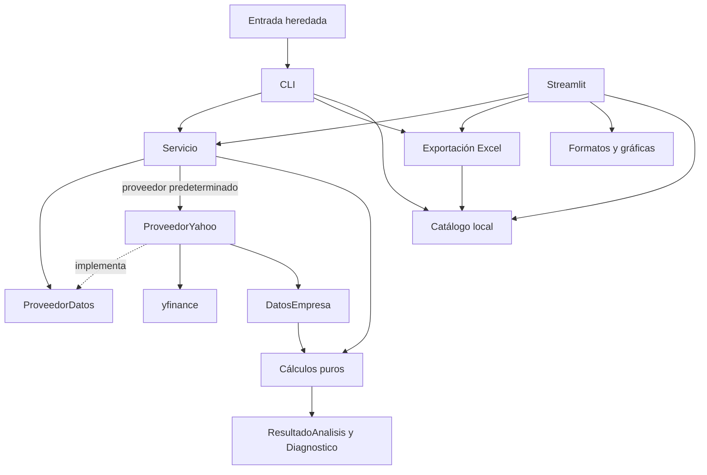

# Arquitectura — F2

## Decisión ADR-001: separar adquisición, cálculo, orquestación y presentación

Fecha: 2026-11-12. Estado: implementada y verificada localmente.
Línea base de la migración: commit `b9852e6`, con F1 completa.

Este documento conserva la decisión y evidencia del cierre de F2. F3 añadió
políticas y trazabilidad sobre esta estructura, detalladas en la
[metodología](methodology.md) y el [registro TDD](TDD_F3.md). Las afirmaciones de
equivalencia total y 19/45 columnas de las secciones históricas describen F2;
el contrato vigente es 2.0, con prefijos heredados y 24/73 campos.

El motor anterior concentraba catálogo, consultas de Yahoo, cálculos, Excel y CLI
en unas 1,900 líneas. Streamlit también descargaba y transformaba estados para
gráficos. F2 introduce un paquete en la raíz para separar esas responsabilidades,
conservar las entradas existentes y permitir probar el motor con un proveedor
que ya entregue datos de dominio.

Esta decisión reorganiza el software. Las fórmulas, los fallbacks económicos,
los símbolos del catálogo y las columnas de los resultados se mantienen. La
revisión de metodología corresponde a F3.

## Estructura

```text
app.py                         # Streamlit: controles, sesión, cachés y vistas
motor_valoracion.py             # Fachada de compatibilidad y entrada CLI
valoracion/
├── __init__.py
├── configuracion.py            # Supuestos y validación compartida
├── modelos.py                  # Snapshots, diagnósticos y contratos tabulares
├── universo.py                 # Carga y validación del catálogo local
├── normalizacion.py            # Números, etiquetas, fechas y alineación
├── calculos.py                 # Valoración y preparación de históricos sin I/O
├── servicio.py                 # Orquesta proveedor y cálculo
├── cli.py                      # Parser, selección y ejecución por terminal
├── proveedores/
│   ├── __init__.py
│   ├── base.py                 # Protocolo ProveedorDatos
│   └── yahoo.py                # Único módulo que importa yfinance
├── exportacion/
│   ├── __init__.py
│   └── excel.py                # Libro Excel a partir de resultados
└── presentacion/
    ├── __init__.py
    ├── formatos.py
    └── graficas.py
data/
└── universo.json
```

El paquete usa la estructura plana prevista en la SDD. No exige instalar el
proyecto como paquete editable, crear un backend HTTP o incorporar dependencias
nuevas. La fachada quedó en 24 líneas y la UI en 446 al cerrar esta fase.

## Dependencias



El servicio recibe un proveedor explícito o resuelve `PROVEEDOR_YAHOO` de forma
diferida. Cuando se inyecta otro proveedor, no se utiliza la implementación de
Yahoo para adquirir sus datos. Ningún módulo del paquete importa la fachada
`motor_valoracion`; las dependencias apuntan desde las entradas hacia el paquete.

Se verificaron 16 módulos y 23 dependencias internas mediante análisis de imports,
incluidos los imports diferidos: no se encontraron ciclos.

## Responsabilidades y límites

| Módulo | Hace | Límite |
| --- | --- | --- |
| `configuracion` | Define y valida supuestos | No adquiere datos ni presenta resultados |
| `modelos` | Define datos y resultados compartidos | No contiene objetos de yfinance |
| `normalizacion` | Limpia números, etiquetas y series | Sin consultas ni archivos de producto |
| `calculos` | Métricas, proyecciones, valoración e históricos | Sin Streamlit, yfinance, openpyxl ni I/O |
| `proveedores.yahoo` | Adapta información, estados, precios y FX | No calcula el valor intrínseco ni construye vistas |
| `servicio` | Conecta adquisición y cálculo | No administra widgets ni genera Excel |
| `universo` | Lee y valida JSON local | No actualiza componentes desde Internet |
| `exportacion.excel` | Escribe las siete hojas existentes | No consulta un proveedor de mercado |
| `presentacion` | Formatea y grafica resultados disponibles | No decide supuestos ni adquiere datos |
| `cli` | Interpreta argumentos y ejecuta un lote | Comparte el servicio con la UI |
| `app` | Controles, sesión, filtros, cachés y descarga | Usa el servicio para análisis e históricos |

Los cálculos conservan las expresiones de F1. Su extracción fue mecánica; ocho
escenarios completos de F1 y los oráculos numéricos independientes protegen el
resultado. La preparación de históricos financieros también es una operación
pura sobre un snapshot, separada de las consultas para obtenerlo.

## Contratos del proveedor y del dominio

`ProveedorDatos` es un `Protocol` de la biblioteca estándar con tres operaciones:

```python
def obtener_empresa(self, ticker: str) -> DatosEmpresa: ...
def obtener_precio_historico(self, ticker: str, periodo: str) -> pd.DataFrame: ...
def obtener_estados_historicos(self, ticker: str) -> DatosEmpresa: ...
```

`DatosEmpresa` contiene ticker, información, precio, objetivo de analistas,
acciones, estados, monedas, FX y diagnósticos. Los estados conservan el formato
tabular contable que normalizan las funciones del dominio. No se entrega un
`yf.Ticker` al cálculo ni a la UI.

`Diagnostico` conserva mensaje y ámbito. `ResultadoAnalisis` asocia los registros
principal/detalle con su configuración y sus diagnósticos. `como_registros()`
devuelve copias para mantener la API de diccionarios de F1.

Las dataclasses son `frozen`; sus atributos no se reasignan. Eso no convierte un
DataFrame o diccionario interno en una colección inmutable: los constructores
copian las entradas y cada resultado posee sus datos. También se copian los
registros entregados mediante `como_registros()` y los precios que devuelve el
servicio.

El adaptador convierte estados `None` en DataFrames vacíos, igual que admitía el
motor heredado. Las excepciones por estado mantienen el aislamiento previo. No
se convierten otros payloads malformados en resultados válidos para ocultarlos.

Las funciones públicas principales son:

```python
analizar_empresa(ticker, config, mercado=None, *, proveedor=None)
analizar_ticker(ticker, config, mercado=None, *, proveedor=None)
obtener_precio_historico(ticker, periodo, *, proveedor=None)
obtener_historicos_financieros(ticker, config, *, proveedor=None)
```

La primera devuelve `ResultadoAnalisis`; la segunda conserva el par de
diccionarios. El proveedor sintético de
`tests/integration/test_servicio_inyectado.py` muestra cómo implementar las tres
operaciones y verificar el servicio sin simular funciones de cálculo.

## Yahoo y cachés

Sólo `valoracion/proveedores/yahoo.py` importa yfinance. El mismo adaptador sirve
para análisis, precio histórico y estados históricos; la UI no contiene otra
implementación del acceso a Yahoo.

`ProveedorYahoo` permite inyectar `ticker_factory`. Sus consultas FX también usan
esa factory. Las instancias creadas sin un caché explícito tienen un caché propio;
dos proveedores de prueba pueden usar tipos de cambio distintos sin mezclarlos.

El proveedor predeterminado comparte `CACHE_FX`, reexportado por la fachada para
conservar el comportamiento anterior. Se mantiene la ausencia de TTL propio y
el almacenamiento de conversiones fallidas como `None`. No se ha cambiado esa
política durante F2.

Las cachés de Streamlit permanecen en `app.py`, con sus TTL de F1 y claves basadas
en ticker, período y configuración. El servicio y el cálculo no importan
Streamlit ni administran estado de sesión.

## Catálogo local

`data/universo.json` contiene una versión de esquema, mercados y símbolos,
fuentes, descripción, fecha del snapshot extraído y fecha de verificación de
fuentes. Esta última es `null`: extraer las listas del código no equivale a volver
a comprobar sus referencias ni la composición actual de un índice.

La carga valida versión, fechas, mercados, identidad de símbolos, duplicados y
estructura de las fuentes. Conserva los símbolos y su orden. Resuelve la ruta
respecto a `__file__`, de modo que funciona al ejecutar la CLI desde otra carpeta.
La importación de `universo` lee el archivo local, sin consultas externas.

`CatalogoEmpresas` utiliza tuplas y fuentes de sólo lectura. Las listas heredadas
se derivan de ese snapshot para conservar sus valores públicos. La prueba de
equivalencia verifica 500 símbolos USA, 104 MX y las fuentes con el SHA-256 del
contenido ordenado de F1:

```text
0eccd1e38ec685a8b9eb2667366c8d45cbeb87e21c15cfdcbfba7641e94cf21b
```

## Compatibilidad y pruebas migradas

Se mantienen:

```bash
streamlit run app.py
python motor_valoracion.py --help
python motor_valoracion.py --ticker AAPL --output valoraciones_empresas.xlsx
```

El último comando consulta mercado y no forma parte de la suite offline. La
entrada heredada reexporta las operaciones públicas; no duplica su implementación.
Se conservan las 19 columnas principales, las 45 de detalle, las siete hojas de
Excel y los argumentos de la CLI.

Las pruebas de F1 conservan sus funciones y esperados. Los imports y parches se
migraron al módulo propietario: Yahoo en `proveedores.yahoo`, CLI en `cli`,
exportación en `exportacion.excel` y servicio en `servicio`. Los imports internos
incidentales del antiguo monolito, como `motor.yf`, no constituyen una API de
inyección. Para código nuevo se usa `proveedor=` o `ticker_factory=`.

La cobertura incluye `app`, `motor_valoracion` y **todo `valoracion`**, en pytest y
en `.coveragerc`. No se excluyó el código movido para conservar artificialmente
un porcentaje alto. El workflow sigue ejecutando el mismo comando canónico.

## Verificación y pendientes

| Requisito SDD | Evidencia ejecutable |
| --- | --- |
| F2-R01: cálculo sin I/O | `tests/unit/test_arquitectura.py`; oráculos existentes y cálculo fuera de pytest |
| F2-R02: adquisición compartida | `tests/integration/test_servicio_inyectado.py` y `tests/ui/test_proveedor_inyectado.py` |
| F2-R03: contratos compartidos | Pruebas de copias de snapshots/resultados y equivalencia de columnas en el servicio |
| F2-R04: entradas separadas | Suite de CLI/UI de F1 y comprobación de imports |
| F2-R05: Excel sin adquisición | `tests/integration/test_excel.py` y comprobación de imports del exportador |
| F2-R06: catálogo local validado | `tests/unit/test_universo.py` y hash de `test_compatibilidad_f1.py` |
| F2-R07: entradas compatibles | `tests/integration/test_entrada_heredada.py`, fachada y suite de CLI/UI |
| F2-R08: resultados equivalentes | Ocho snapshots de `resultados_f1.json` y oráculos numéricos de F1 |

- `python -m pytest`: **270 passed**, cero skips y xfails; cobertura total con
  ramas **98.49 %**, en 32.30 s.
- `python -m pip check`: sin requisitos rotos.
- Se comprobó la entrada heredada con `--help` desde otro directorio.
- Se ejecutó un cálculo puro fuera de pytest, sin fixtures ni parches de proveedor.
- Se conservaron los ocho snapshots completos del motor de F1 y sus notas.
- El registro RED/GREEN y los comandos están en [TDD de F2](TDD_F2.md).
- No se ejecutó CI remoto ni una instalación limpia en Linux en esta sesión.
- F3, F4 y F5 siguen pendientes. No se incorporó un backend, bloqueo de todas
  las dependencias, demo de producto ni cambios de metodología.

## Extensión de F3

- `metodologia.py` contiene versiones, clasificación y validación de FX, sin I/O.
- `TrazabilidadDatos` captura procedencia y fechas disponibles desde el adaptador;
  `ResultadoAnalisis.trazabilidad` asocia esa evidencia con cada proxy.
- El cálculo conserva la separación de proveedor/servicio/entradas. Comparte la
  selección de observaciones de margen para calcular y describir períodos.
- `presentacion/etiquetas.py` traduce claves heredadas a etiquetas de proxy en
  Streamlit y Excel. Las fórmulas no dependen de esa capa de presentación.
- El caché de FX conserva adquisición/cierre originales; descargar el análisis
  otra vez no cambia la fecha de una cotización FX reutilizada.
- La API tabular agrega versiones y trazabilidad. La migración económica de los
  ocho snapshots se declara en las pruebas; el JSON original sigue intacto.
- El ejemplo de `examples/` ejecuta cálculo/exportación sin proveedor, con un
  oráculo Decimal independiente y datos CSV ficticios.

F4 y F5 permanecen pendientes; el cierre vigente se registra en la sección 21.8
[de la SDD](SDD.md).

## Entorno y arranque agnóstico en F4

La separación de producto de F2/F3 permanece. F4 centraliza herramientas en
`pyproject.toml` y resuelve dependencias desde `.in` con pip-tools. El producto se
ejecuta como servicio web Python/Streamlit sobre Linux; el entorno del Mac sirve
para desarrollar y verificar. El alojamiento es una decisión externa al código.

`iniciar_servicio.sh` utiliza el Python preparado y `PORT`, escucha en `0.0.0.0`
y conserva el proceso con `exec`. La preparación usa `requirements.txt`; el
arranque no instala paquetes. No se exige un manifiesto, SDK o recurso de un
proveedor. CI se limita a Ubuntu y comprueba el repositorio sin publicarlo.

Ruff normalizó formato/imports; el análisis AST confirmó que no cambiaron
expresiones de producto salvo una lambda local convertida en función equivalente.
La excepción F401 de la fachada protege sus reexportaciones. Metodología,
contrato, catálogo y snapshots conservan sus valores. La cobertura usa TOML con
el mismo alcance y umbral.

La [guía de despliegue y desarrollo](development.md) documenta el contrato genérico.
[TDD de F4](TDD_F4.md) registra instalación limpia y límites. La continuidad está
en 21.10 de la SDD; F5 y la validación de una URL publicada siguen pendientes.
